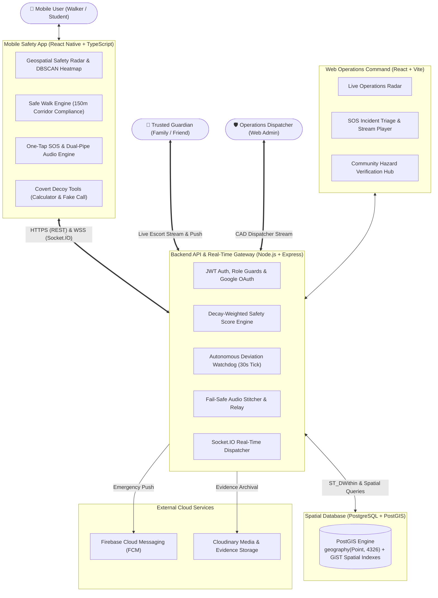

# SAFORA — Community Safety & Safe Walk Platform

[-61DAFB?logo=react&logoColor=black)](https://reactnative.dev)
[](https://www.typescriptlang.org/)
[](https://nodejs.org)
[](https://expressjs.com)
[](https://www.postgresql.org)
[](https://postgis.net)
[](docs/v1/testing-and-submission.md)

> **Academic Context**: Minor Project-I submitted in partial fulfilment of the requirements for the degree of **Bachelor of Technology in Computer Science & Engineering**  
> **Institution**: Dev Bhoomi Uttarakhand University (DBUU), Dehradun  
> **Batch**: 2026 – 2027  
> **Supervisor**: Mr. Mukesh Rajput (Assistant Professor, Department of CSE, SoEC, DBUU)  
> **Project Team**: Arushi Saxena (24BTCSE0241), Anurag Suyal (24BTCSE0264), Aman Singh Kunwar (24BTCSE0321), Shubham Kumar (24BTCSE0333)

---

## 🌟 Executive Summary

**SAFORA** is a community-powered personal safety navigation and emergency response platform designed for university campuses and urban corridors. While conventional navigation platforms optimize purely for distance and travel time, SAFORA empowers pedestrians—particularly women and students traveling after dark—to proactively evaluate route safety, share live journeys with trusted guardians, and dispatch instant SOS alerts backed by real-time audio evidence.

The platform combines crowdsourced hazard telemetry, PostGIS spatial clustering, native background walk monitoring, progressive dual-pipe audio streaming, and an operations dispatcher console into an integrated safety ecosystem.



---

## 🚀 Core Platform Capabilities

### 1. Geospatial Safety Radar & Community Telemetry
* **Algorithmic Safety Score (0–100)**: Evaluates location risk combining hazard severity, proximity falloff, exponential time decay ($t_{\text{half}} = 24\text{h}$), and community confirmations.
* **DBSCAN Density Clustering**: PostGIS `ST_ClusterDBSCAN` groups spatial risk density within ~330m radius, rendered as an interactive dynamic heatmap.
* **Crowdsourced Hazard Verification**: Citizen reports (lighting, harassment spots, waterlogging, isolated trails) with camera evidence, address reverse-geocoding, and duplicate prevention.
* **Offline Queuing**: Unsent hazard reports save to local storage when offline and auto-sync immediately upon network restoration.

### 2. Safe Walk & Live Guardian Escort
* **Active Corridor Compliance**: Server-side 150-meter corridor monitoring against planned walking geometry.
* **Synchronized Live Escort**: Real-time position broadcasting over Socket.IO to trusted guardians, who observe live walker movement on an interactive map.
* **Android Foreground Service**: Continuous background GPS tracking surviving screen locks and Doze mode, displaying real-time road distance and walking ETA in persistent system notifications.
* **Autonomous Deviation Watchdog**: 60-second on-phone safe countdown backed by a cloud watchdog that automatically escalates alerts to trusted guardians if the phone disconnects or is destroyed.

### 3. Emergency SOS & Dual-Pipe Audio Evidence
* **Instant Emergency Broadcast**: Single-tap dispatch streaming coordinates, battery telemetry, and emergency alerts to guardians and dispatchers.
* **Dual-Pipe Audio Streaming Engine**:
  * *Pipe 1 (Real-Time Progressive Delivery)*: Slices 16kHz PCM microphone audio into sequential 5-second WAV chunks emitted live over WebSockets for sub-second guardian awareness.
  * *Pipe 2 (Continuous Master Archival)*: Concurrently streams raw audio into an unbroken 30-second local master file for Cloudinary cloud preservation.
  * *Fail-Safe Server Concatenator*: If the device is destroyed mid-broadcast, an 8-second server watchdog automatically stitches received chunks with standard WAV headers and preserves the partial evidence.
* **Dual-Mode Deterrence**: User-configurable high-decibel audible alarm (`STREAM_ALARM`) versus covert stealth mode.

### 4. Tactical Safety Suite
* **Calculator Decoy**: Fully operational 4-function calculator that silently triggers background emergency SOS and haptic feedback upon entering duress PIN `9999=`.
* **Incoming Fake Call Simulator**: Configurable bilingual (English/Hindi) caller simulator designed to facilitate safe, discrete exit from uncomfortable situations.
* **One-Tap Emergency Dialers**: Direct native shortcuts to emergency services (`112`, `108`, `1090`).

### 5. Web Operations Command Center
* **Live Radar & Telemetry**: Real-time spatial tracking of active journeys with instant corridor deviation highlights.
* **SOS Incident Queue**: Chronological alert triage with inline audio streaming, duration timers, and one-click coordinate links to external satellite navigation.
* **Hazard Moderation Hub**: Community report audit table with high-resolution photo inspection, reporter verification, and status updates (Resolved / Duplicate / Dismissed).

---

## 🛠️ Technology Stack

| Layer | Technologies | Key Rationale |
|---|---|---|
| **Mobile Application** | React Native `0.87.1`, TypeScript | Native Android performance utilizing **Hermes** engine and **Fabric (New Architecture)**. |
| **Mobile Map Canvas** | Leaflet in Hardware-Accelerated WebView | High-performance vector tile rendering, smooth layer switching, and offline tile caching. |
| **Native Android Bridge** | Kotlin Foreground Service | Background location retention and continuous microphone capture surviving system lock. |
| **Backend API Gateway** | Node.js, Express, TypeScript | Asynchronous REST API, rate-limiting guards, and Socket.IO real-time event distribution. |
| **Spatial Database** | PostgreSQL 15+, PostGIS extension | Native `geography(Point, 4326)` spatial math, GiST indexing, and `ST_DWithin` proximity queries. |
| **Web Admin Console** | React 18, Vite, Tailwind CSS | Fast CAD-style command interface with Web Audio API stream decoding and keyboard shortcuts. |
| **Authentication** | JWT, bcrypt, Google OAuth2 | Stateless authorization with native Google Play Services bottom-sheet account linking. |
| **Cloud Services** | Firebase Cloud Messaging, Cloudinary | Cross-platform push notifications and court-admissible media evidence storage. |

---

## 📊 Testing & Quality Assurance

The codebase enforces rigorous automated test coverage and comprehensive manual physical device field verification:

### Automated Test Matrix (100% Pass Rate)
Execute all test suites monorepo-wide with a single command:
```bash
npm test
```

| Workspace | Test Framework | Suites | Tests | Scope & Assertions |
|---|---|:---:|:---:|---|
| **`apps/backend`** | Jest + Supertest | 8 | 72 | Rate limiters, safety score decay, JWT guards, Google OAuth token verification, dual-pipe audio stitcher, 8s watchdog rescue. |
| **`apps/frontend`** | Vitest + Happy-DOM | 2 | 12 | Command palette routing, CAD keyboard shortcuts, offline failover banner, badge variants. |
| **`apps/mobile`** | Jest + React Test Renderer | 5 | 20 | Safety search capsule, HUD components, hold-to-confirm button, grace-period overlay, duress calculator decoy. |
| **Total** | **Unified Runner** | **15** | **104** | **104 / 104 tests passing across all packages.** |

* **TypeScript Verification**: `npx tsc --noEmit` reports **0 errors** across all workspaces.
* **Physical Device Manual Testing**: **130 / 143 test items verified (90.9%)** on physical Android hardware. See [`docs/v1_manual_testing_checklist.md`](docs/v1_manual_testing_checklist.md) for granular field notes.

---

## ⚡ Quick Start & Local Setup

### 1. Prerequisites
* **Node.js**: `v20.x` or `v22.x` & `npm`
* **PostgreSQL**: `15+` with `postgis` spatial extension enabled
* **Android SDK**: Platform 34/35, NDK `27.1.12297006`, OpenJDK 17

### 2. Installation
```bash
# Clone the repository
git clone https://github.com/your-org/safora.git
cd safora

# Install monorepo dependencies
npm install
```

### 3. Run Backend Server
```bash
cd apps/backend
npm run dev
```
* Backend API: `http://localhost:5000/api`
* Health Endpoint: `http://localhost:5000/api/health`
* Diagnostics: `http://localhost:5000/api/diagnostics`

### 4. Run Web Admin Command Console
```bash
cd apps/frontend
npm run dev
```
* Web Admin: `http://localhost:5173`

### 5. Launch Android Mobile Application
```bash
cd apps/mobile
npm start -- --reset-cache
# In a separate terminal:
npm run android
```

---

## 📚 Documentation Index

Comprehensive documentation is structured into the following guides:

| Document | Description |
|---|---|
| **[`docs/v1/architecture.md`](docs/v1/architecture.md)** | Complete system architectural diagrams, data flows, and subsystem specifications. |
| **[`docs/v1/api.md`](docs/v1/api.md)** | REST API endpoint reference, request/response JSON schemas, and WebSocket events. |
| **[`docs/v1/database.md`](docs/v1/database.md)** | Database relational schema, PostGIS spatial tables, GiST indexes, and migration scripts. |
| **[`docs/v1/dual-pipe-audio-streaming.md`](docs/v1/dual-pipe-audio-streaming.md)** | Technical specification for progressive 5s audio chunking and fail-safe server stitching. |
| **[`docs/v1/safety-algorithms.md`](docs/v1/safety-algorithms.md)** | Mathematical formulation of spatial risk scoring, exponential decay, and corridor math. |
| **[`docs/v1/testing-and-submission.md`](docs/v1/testing-and-submission.md)** | Master testing matrix, release build verification, and academic evaluation prep. |
| **[`docs/v1_manual_testing_checklist.md`](docs/v1_manual_testing_checklist.md)** | Field verification checklist covering 143 granular test cases across physical hardware. |
| **[`docs/SAFORA_Synopsis_Formatted.pdf`](docs/SAFORA_Synopsis_Formatted.pdf)** | Academic project synopsis submitted to Dev Bhoomi Uttarakhand University. |

---

## 📄 License & Academic Attribution

This project is developed as an academic Minor Project-I under the School of Engineering and Computing (SoEC), **Dev Bhoomi Uttarakhand University (DBUU)**, Dehradun.  
All rights reserved by the project team and institution.