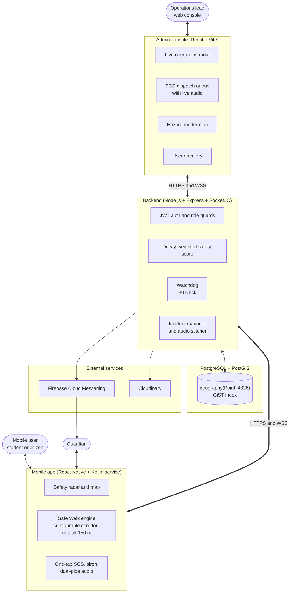

# Safora – Community Safety and Safe Walk App

[-61DAFB?logo=react&logoColor=black)](https://reactnative.dev)
[](https://www.typescriptlang.org/)
[](https://nodejs.org)
[](https://expressjs.com)
[](https://www.postgresql.org)
[](https://postgis.net)
[](docs/v1/testing-and-submission.md)

| | |
|---|---|
| **Academic context** | Minor Project-I, submitted in partial fulfilment of the requirements for the degree of Bachelor of Technology in Computer Science & Engineering |
| **Institution** | Dev Bhoomi Uttarakhand University (DBUU), Dehradun |
| **Batch** | 2026 – 2027 |
| **Supervisor** | Mr. Mukesh Rajput, Assistant Professor, Department of CSE, SoEC, DBUU |
| **Team** | Arushi Saxena (24BTCSE0241), Anurag Suyal (24BTCSE0264), Aman Singh Kunwar (24BTCSE0321), Shubham Kumar (24BTCSE0333) |
| **Status** | **Version 1 complete** (all objectives implemented, deployed and verified) |
| **Live backend** | https://safora-backend.onrender.com/ |
| **Live admin console** | https://safora-admin.onrender.com/ |

## Summary

Safora is a community-powered personal-safety navigation and emergency-response application for campus and urban settings. Standard navigation applications optimise for distance and speed. Safora helps walkers, especially women and students travelling at night or in unfamiliar areas, to judge risk and to get help.

- Users **report hazards** (poor lighting, road hazards, waterlogging, isolated areas, traffic and others), and the reports become a live **safety score** and **heat map**.
- A **Safe Walk** shares the live location with trusted contacts. If the walker leaves the planned corridor and does not confirm safety within 60 seconds, a **server-side watchdog** alerts the guardians, even if the phone has stopped working.
- A **one-tap SOS** sends the position and battery level at once, streams 30 seconds of audio to guardians and dispatchers while it is still being recorded, can sound a loud siren, and falls back to a pre-filled SMS without internet.
- A **web console** lets staff moderate reports, watch live walks and handle alerts.

## System Overview



## Documentation

All specifications, diagrams and guides are in [`docs/`](docs/README.md). Start with the master index.

| Version | Status | Contents |
|---|---|---|
| [**V1**](docs/v1/README.md) | Complete | Architecture and data-flow diagrams, API, database, safety algorithms, audio pipeline, mobile and admin features, tests |
| [**V2**](docs/v2/README.md) | Planned | Product roadmap: accounts and e-mail, guardian handshake, full watchdog, routing and voice, no-unlock triggers, chat, compliance |
| [**V3**](docs/v3/README.md) | Research | AI safe-route recommendation, offline mesh messaging, hazard image detection, voice-activated SOS |
| [Requirements and use cases](docs/v1/srs.md) | Complete | SRS with identifiers, use cases, traceability to tests |
| [Developer setup](docs/setup.md) | – | Prerequisites, environment, running, building |
| [Operations runbook](docs/v1/operations-runbook.md) | – | Deployment, checks, incidents, backups |
| [Field checklist](docs/v1_manual_testing_checklist.md) | Complete | The 143-case verification checklist |
| [Synopsis](docs/SAFORA_Synopsis_Formatted.pdf) | – | The approved project synopsis |

## Modules (Version 1)

1. **User authentication and onboarding.** JWT and bcrypt, Google Sign-In, a four-slide onboarding flow, a terms and age notice, guest mode and a rehydration splash screen.
2. **Community hazard reporting.** Six categories, severity 1 to 5, camera or gallery photos, rate limiting (20 reports per 15 minutes), an offline queue that synchronises when the connection returns, and an in-memory cache.
3. **Safety score and routing.** A 0 to 100 score from severity, distance, recency decay (half-life 7 days with a floor) and community confirmations; PostGIS DBSCAN clustering (ε about 330 m); route preview with calibrated travel times for walking (1.60 m/s), two-wheeler and car.
4. **Safe Walk.** Corridor monitoring (default 150 m, 20 to 1000 m configurable by staff), live guardian view, a 60-second confirmation prompt, a server-side watchdog, a Kotlin foreground service for lock-screen tracking, and an offline map cache for a radius of 10 km.
5. **Guardian SOS and evidence.** Immediate push alert, dual-pipe 30-second audio (live 5-second slices plus a lossless master and a server rescue), a loud siren or stealth mode, a pre-filled SMS fallback, a guardian live SOS screen, a Safety Alerts Centre, Test SOS drills, and a decoy suite (calculator with duress PIN, fake call).
6. **Administration and diagnostics.** Moderation (active, resolved, duplicate, fake), a live walker radar, an SOS queue with live audio, user roles, a command palette and dispatcher shortcuts, and diagnostics with service checks.

## Technology Stack

| Layer | Technology |
|---|---|
| Mobile | React Native 0.87.1 (Hermes, New Architecture), React 19, TypeScript, Zustand, native Kotlin foreground service |
| Map | Leaflet in a WebView with OpenStreetMap and Esri tiles; OSRM routing; Photon search with MapTiler fallback |
| Backend | Node.js 22+, Express 5, TypeScript, Zod, Socket.IO 4.8, `pg` |
| Database | PostgreSQL 15+ with PostGIS (Neon), GiST spatial index |
| Admin console | React 19, Vite 6, Tailwind CSS 3.4, Recharts |
| Services | Firebase Cloud Messaging, Cloudinary, Google Sign-In |
| Quality | Jest and Supertest, Vitest, React Test Renderer, GitHub Actions |

Details and versions: [`docs/v1/tech-stack.md`](docs/v1/tech-stack.md).

## Repository Structure

```text
safora/
├── apps/
│   ├── backend/            Express + TypeScript API, Socket.IO gateway, watchdog (port 5000)
│   │   └── src/            config, controllers, middleware, repositories, routes, services, sockets, __tests__
│   ├── frontend/           React + Vite + Tailwind admin console (port 5173)
│   │   └── src/            components, context, pages, services, __tests__
│   └── mobile/             React Native application
│       ├── android/        Gradle project, Kotlin SafeWalkService (arm64-v8a)
│       ├── src/            screens, components, navigation, services, store, theme
│       └── __tests__/
├── packages/
│   └── shared-types/       Shared TypeScript interfaces
├── docs/                   Documentation (v1, v2, v3), field checklist, synopsis
├── .github/                CI workflows
├── .husky/                 Git hooks
├── render.yaml             Render deployment blueprint
└── README.md
```

## Quick Start

### Prerequisites
- Node.js 22.11 or later and npm
- PostgreSQL 15+ with the `postgis` extension (for example on Neon)
- Android SDK (platform 34 or 35), NDK `27.1.12297006`, OpenJDK 17

### Install and run

```bash
npm install                       # from the repository root

# Backend (API at http://localhost:5000/api, health at /api/health)
cd apps/backend && npm run dev

# Admin console (http://localhost:5173)
cd apps/frontend && npm run dev

# Mobile: in two terminals
cd apps/mobile && npm start -- --reset-cache
cd apps/mobile && npm run android
```

### Tests

```bash
npm test                # 15 suites, 104 tests (backend 72, admin 12, mobile 20)
```

### Build an Android package

```bash
cd apps/mobile/android
./gradlew assembleDebug           # standalone debug APK
./gradlew assembleRelease         # signed release APK, about 34 MB (arm64-v8a)
```

On Windows use `gradlew.bat` or `.\gradlew`. The release APK is written to `apps/mobile/android/app/build/outputs/apk/release/app-release.apk`. Full instructions, environment variables and troubleshooting are in [`docs/setup.md`](docs/setup.md).

## Scope

- **Included in V1:** the six modules above, verified by 104 automated tests and 143 field test cases.
- **Version 2 (planned):** account hardening and e-mail, a verified guardian handshake, a complete watchdog, per-mode routing with voice guidance, no-unlock triggers, chat, a medical card, Hindi and Uttarakhand content, and public-launch compliance.
- **Version 3 (research):** AI safe-route recommendation, offline Bluetooth or Wi-Fi Direct messaging, AI hazard classification from photos, and voice-activated SOS.

## Known Limitations (V1)

Android only; the three travel modes share one road geometry; the guardian model has no acceptance step; the free-tier backend can sleep when idle; sessions use a seven-day token. These and the plan to address them are documented in [`docs/v1/README.md`](docs/v1/README.md).

## Licence and Attribution

Developed as an academic Minor Project-I at the School of Engineering and Computing (SoEC), Dev Bhoomi Uttarakhand University (DBUU), Dehradun. All rights are reserved by the project authors and the institution.
