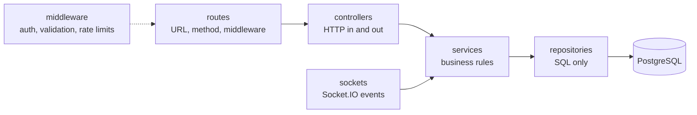

# Engineering Standards

| | |
|---|---|
| **Applies to** | All code and documentation in the repository |
| **Purpose** | Keep a four-person student project consistent, reviewable and safe to change |

## 1. Repository Layout

```text
apps/backend/      Express + TypeScript API, Socket.IO, watchdog, audio stitcher
apps/frontend/     React + Vite admin console
apps/mobile/       React Native app and native Kotlin service
packages/shared-types/   interfaces shared by all three applications
docs/              documentation (v1, v2, v3)
```

- Shared data shapes (categories, DTOs, enumerations) live in `packages/shared-types` and are imported by all applications. Never copy a type between applications.
- A new file belongs to the layer it works in. If you are unsure, read a neighbouring file.

## 2. Backend Layering



| Layer | Allowed | Not allowed |
|---|---|---|
| Routes | Wire a path to middleware and a controller | Logic |
| Controllers | Read the request, call a service, shape the response (public or staff DTO) | SQL, calculations |
| Services | Rules and algorithms (score, corridor, watchdog), orchestration | HTTP objects, direct SQL strings |
| Repositories | Parameterised SQL; mapping rows to models | Business rules |
| Middleware | JWT, role and ownership guards, validation, rate limits | Domain logic |

## 3. Coding Rules

1. **TypeScript strictness.** No `any` in new code without a comment explaining why.
2. **Validate at the boundary.** Every request body and query parameter has a Zod schema. Services receive validated, typed data.
3. **Parameterised SQL only.** Never build SQL with string concatenation of user input.
4. **Spatial data.** Store points as `GEOGRAPHY(Point, 4326)`; query radii with `ST_DWithin`; keep a GiST index on any queried spatial column.
5. **Two representations of a person-linked record.** Anything that can expose identity has a public and a staff DTO. A new endpoint must choose one explicitly.
6. **Honest states.** Never show invented data. Show loading, error with retry, and empty states.
7. **Constants in one place.** A formula constant lives in one named constant and is mirrored in [`v1/safety-algorithms.md`](v1/safety-algorithms.md) in the same commit.
8. **Cache invalidation.** Writes that change reports must invalidate the report cache.
9. **Errors.** Return `{ "error": "CODE", "message": "..." }` with the right HTTP status; never leak stack traces.
10. **Mobile.** Business rules stay in services; screens render state. Long-running emergency work runs in the native service, not in the JavaScript thread.
11. **Logging.** Do not log tokens, passwords, codes or raw coordinates.

## 4. Security Rules

- No secrets, keys or credentials in source, in `.env.example`, in logs or in the APK. A key used by a client is public; keep keys server-side and proxy.
- Every protected route has an explicit guard (`requireAuth`, `requireStaff` or `requireAdmin`). Journeys, alerts and audio also check ownership.
- Rate-limit anything that writes, sends a message or is expensive.
- Do not claim more than the system does (for example "alerts the police").
- New personal data needs a line in [`v1/security-and-privacy.md`](v1/security-and-privacy.md) (and in the V2 data inventory).

## 5. Testing Rules

| Change | Required |
|---|---|
| A formula or constant | A unit test with values at the boundaries (for example age 0, a half-life, the floor) |
| A new guard or role rule | A test of the allowed and the forbidden case |
| A new endpoint | A request/response test and a rate-limit decision |
| A UI component with logic | A component test |
| A background or hardware feature | A line in the field checklist and a run on a physical device |

`npm test` must pass before a pull request is merged. CI runs lint and the whole suite on every push and pull request.

## 6. Git Workflow

- Work on a branch; merge through a pull request into `main`.
- **Commit messages** start with the work item identifier when there is one: `SYN-1: remove fake safety score fallback`.
- A pull request has: what changed, why, how it was tested, and any document updated.
- Husky runs the hooks; do not skip them.
- Never commit `.env`, keystores, service-account files or build output.

### Pull request checklist

- [ ] Tests added or updated and passing.
- [ ] No secret, key or personal data in the diff.
- [ ] Public and staff representations considered.
- [ ] Documentation updated: API, database, algorithms or feature file as needed.
- [ ] Failure behaviour described (what does the user see if this fails?).

## 7. Documentation Rules

- Diagrams are Mermaid text; keep them next to the explanation.
- Each document starts with a short table (version, purpose, related documents).
- Facts that can be checked must be checked: values come from the code, not from memory.
- Mark unknowns honestly ("not stated", "to be confirmed") instead of guessing.
- Update [`changelog.md`](changelog.md) and [`project-status.md`](project-status.md) when something user-visible changes.

## 8. Release Process

1. All checks green and the documentation updated.
2. Backend and admin console deployed from `main` (database migration first when needed).
3. Android release build signed, installed fresh on two phones and walked through the core scenarios.
4. Record the version, the date and the size in the changelog.

See the [operations runbook](v1/operations-runbook.md).
