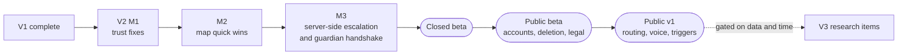

# Project Status

| | |
|---|---|
| **Date** | 20 November 2026 |
| **Version** | **V1 complete** |
| **Next** | V2 (planned) and V3 (research) |

## 1. Summary

Version 1, the college submission release, is finished. All six modules of the synopsis are implemented, deployed and verified. The automated suite has 104 passing tests, the field checklist has 143 passing cases, and the production backend and admin console are online.

## 2. Module Scorecard

| # | Module | State | Evidence |
|--:|---|:---:|---|
| 1 | Authentication, onboarding and session management | ✅ Complete | `authGuards`, `googleAuth` tests; field sections 1, 2, 17 |
| 2 | Community hazard reporting with offline queue | ✅ Complete | Field sections 5 and 6; rate-limit tests |
| 3 | Safety score, clusters and routing | ✅ Complete | `safetyDecay` tests (14); field sections 4 and 6 |
| 4 | Safe Walk with live guardian view, watchdog and foreground service | ✅ Complete | `journeyOwnership` tests; field sections 7, 8, 9, 15 |
| 5 | Guardian SOS, audio evidence, siren, decoys | ✅ Complete | `audioStitcher`, `sosGuards` tests; field sections 10 and 11 |
| 6 | Administration and diagnostics | ✅ Complete | `cadComponents`, `uiElements` tests; field sections 12–14 |

## 3. Quality Figures

| Measure | Value |
|---|---|
| Automated tests | 104 in 15 suites (backend 72, admin console 12, mobile 20), all passing |
| Field test cases | 143 in 18 areas, all passing |
| Source size | 50,997 lines of TypeScript and Kotlin in 177 files |
| API surface | 52 REST endpoints, 7 Socket.IO listeners, 7 database tables |
| Release build | About 34 MB (34,118,032 bytes), arm64-v8a, verified 20 November 2026 |
| CI | GitHub Actions: lint and tests on every push and pull request |

## 4. Deliverables

| Deliverable | Where |
|---|---|
| Source code and CI | `safora-safety/Safora` |
| Live backend and admin console | See the root README |
| Documentation (V1, V2, V3) | `docs/` |
| Field verification record | [`v1_manual_testing_checklist.md`](v1_manual_testing_checklist.md) |
| Synopsis | `docs/SAFORA_Synopsis_Formatted.pdf` |

## 5. Known Limitations

Android only; one road geometry for all travel modes; a simplified guardian model; a free-tier backend that can sleep; no e-mail workflows; a 7-day token in unsecured local storage. See [`v1/README.md`](v1/README.md#known-limitations-stated-openly) and [`v1/security-and-privacy.md`](v1/security-and-privacy.md#3-known-gaps-in-v1-stated-openly).

## 6. Housekeeping Before a Public Release

| Item | Why |
|---|---|
| Corridor threshold alignment | Backend default standardized to 150 m, perfectly matching the mobile Cockpit HUD display |
| Remove the unused `typeorm` and `reflect-metadata` packages | Dependencies that are not used |
| Keep the scheduler interval documented as 60 s everywhere | Earlier documents said 5 minutes |
| Add the 30-day retention job | Data minimisation |

## 7. What Comes Next

See [`v2/roadmap.md`](v2/roadmap.md) and [`v3/README.md`](v3/README.md).
