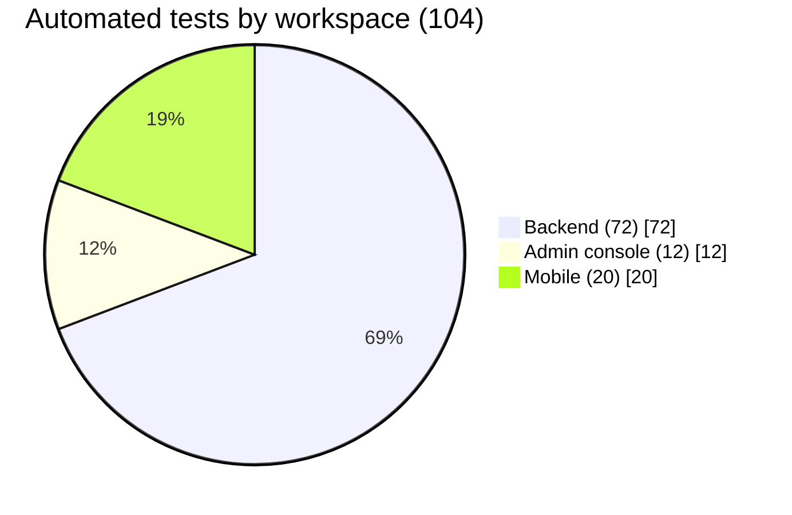

# Requirements Traceability Matrix

| | |
|---|---|
| **Version** | V1 |
| **Purpose** | Show for every requirement group where it is implemented and how it is verified |
| **Requirements** | [`v1/srs.md`](v1/srs.md) |
| **Tests** | Automated suites listed in [`v1/testing-and-submission.md`](v1/testing-and-submission.md); field sections 0–17 of the [checklist](v1_manual_testing_checklist.md) |

## 1. Matrix

| Requirement group | Main implementation | Automated verification | Field verification (section) |
|---|---|---|---|
| **FR-AUTH-1…8** accounts and sessions | `authService.ts`, `authRoutes.ts`, `rateLimiter.ts`; mobile `RootNavigator`, `TermsScreen` | `authGuards` (10), `googleAuth` (6), `rateLimiter` (7) | 1 launch and consent, 2 authentication, 17 Google sign-in |
| **FR-HAZ-1…8** hazard reporting | `reportRoutes.ts`, `reportController.ts`, `reportRepository.ts`, `cloudinaryService.ts`; mobile `ReportHazardModal`, `reportService.ts` | `rateLimiter` (report limit), `safetyDecay` (confirmations) | 5 hazard reporting, 6 community map and moderation |
| **FR-SCORE-1…6** score, clusters, map | `reportService.ts`, `reportRepository.ts`, `cache.ts`; mobile `HomeScreen`, `MapScreen`, `OpenMapView` | `safetyDecay` (14) | 4 home radar and scores, 6 community map |
| **FR-ROUTE-1…3** routing and search | mobile `routingService.ts`, `OpenMapView` (tile cache) | `services.test.ts` (3) | 4, 6 |
| **FR-WALK-1…11** Safe Walk | `journeyService.ts`, `journeyController.ts`, `watchdogService.ts`, `journeySocket.ts`; mobile `SafeWalkScreen`, `SafeWalkService.kt` | `journeyOwnership` (8), `phase4Components` (5: countdown), `phase2And3Components` (7: cockpit, hold-to-confirm) | 7 walker, 8 guardian, 9 watchdog, 15 GPS, network and battery |
| **FR-SOS-1…15** SOS and evidence | `sosRoutes.ts`, `sosService.ts`, `sosAudioService.ts`, `audioStitcherService.ts`, `firebaseService.ts`; mobile `SafeWalkService.kt`, `audioRecorderService.ts`, `sirenService.ts`, `CalculatorDecoyModal`, `FakeCallModal`, `GuardianSosLiveModal` | `sosGuards` (19), `audioStitcher` (6), `phase4Components` (5), `phase5Components` (4) | 10 SOS and audio, 11 decoy suite |
| **FR-ADM-1…9** administration | `apps/frontend/src/pages/*`, `SocketContext.tsx`, `CommandPalette.tsx` | `cadComponents` (6), `uiElements` (6) | 12 portal authentication, 13 live radar and moderation, 14 SOS queue, users, analytics |
| **NFR-REL-1…6** reliability | `watchdogService.ts`, `audioStitcherService.ts`, honest states in screens | `audioStitcher`, `journeyOwnership` | 9, 10, 15, 16 |
| **NFR-SEC-1…7** security | guards, rate limiter, validation, DTO mapping | `authGuards`, `sosGuards`, `rateLimiter`, `seedGuard` | 2, 12, curl checks T9 and the tick endpoint test |
| **NFR-PERF-1…4** performance | `cache.ts`, in-memory corridor check, GiST index, audio compression | `safetyDecay` (cache-related behaviour) | 4, 16 |
| **NFR-USE-1…5** usability | mobile components and theme | Component tests (phases 2–5) | 1, 3, 7, 11, 16 |
| **NFR-MNT-1…4** maintainability | monorepo, layering, CI | The whole suite (104) | – |
| **NFR-COST-1…2** cost | Render, Neon, Firebase, Cloudinary free tiers; open-source map stack | – | 0 infrastructure |

## 2. Coverage by Test Type

| Test type | Count | Purpose |
|---|---:|---|
| Backend unit and integration | 72 | Rules, guards, formulas, limits, audio assembly |
| Admin console component | 12 | Dispatcher tools and shared elements |
| Mobile component and service | 20 | Safety-critical interface elements and service logic |
| Field cases | 143 | End-to-end behaviour on physical devices |

## 3. Synopsis Objectives to Modules

The six modules of the synopsis are the six requirement groups above (AUTH, HAZ, SCORE and ROUTE, WALK, SOS, ADM). Section 4.2 of the synopsis defines them; each is covered end to end by at least one field section and one automated suite.

## 4. Gaps and How They Are Handled

| Gap | Handling |
|---|---|
| UI behaviour that cannot be unit-tested (GPS, battery, vendor skins) | Covered by field sections 15 and 16 on physical devices |
| Long-duration battery behaviour and a wide range of phone brands | Planned for V2 ([`v2/testing-and-beta.md`](v2/testing-and-beta.md)) |
| Load testing | Not needed at college scale; planned for V2 |
