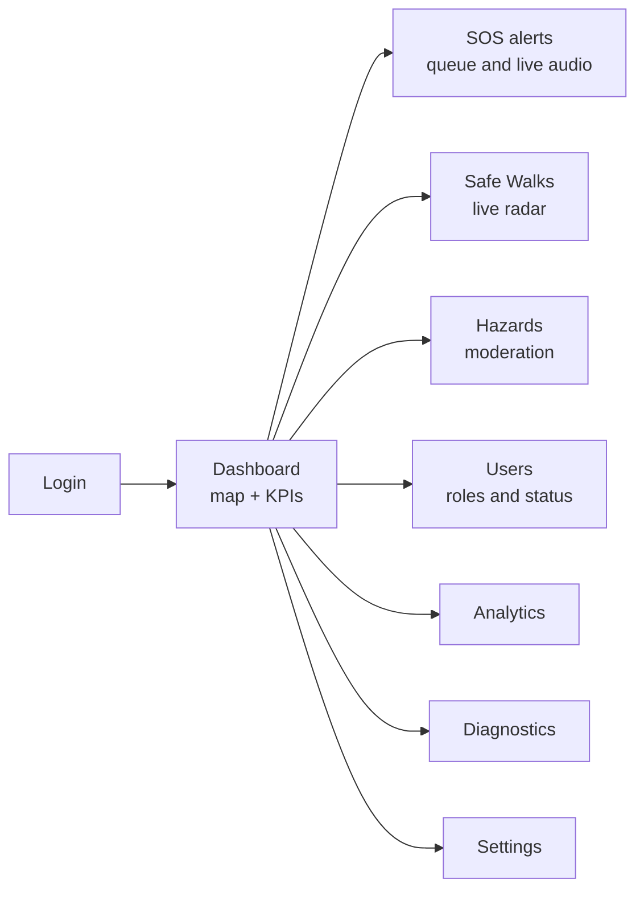
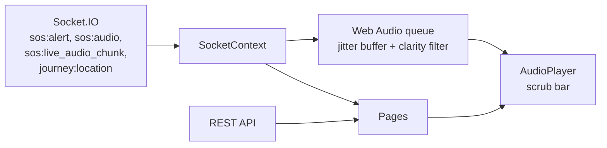

# Admin Console

| | |
|---|---|
| **Version** | V1 (complete) |
| **Stack** | React 19, Vite 6, TypeScript, Tailwind CSS 3.4, Recharts, Leaflet |
| **Access** | Staff only (roles `admin` and `moderator`) |
| **Hosting** | Render static site |

## 1. Pages



| Page | Content |
|---|---|
| **Login** | Staff authentication. Citizen accounts are refused |
| **Dashboard** | Map and KPI cards. Every card opens its module. A live API latency ping is shown in milliseconds, and the priority queue links to the alert |
| **SOS alerts** | Queue with status triage. Includes alerts from the watchdog (`source = watchdog`). Live audio plays slice by slice with a `LIVE STREAMING CHUNK #N/6` badge and then switches to the archived master recording |
| **Hazards** | KPI cards that filter the table; "Add resolution notes" dialog with municipal preset chips; batch selection with a floating action bar; high-resolution photo viewer with time stamp and coordinates |
| **Safe Walks** | Live radar of active walkers with breadcrumb trails. The sample-data fallback was removed: when no walk is active the page shows an empty state. A corridor view opens a map link, and a call button dials the walker |
| **Analytics** | Incident trends, heat maps and hourly distribution |
| **Users** | Role cards (admins, moderators, citizens), role and status changes, and an "Add staff or citizen" dialog |
| **Diagnostics** | Health and latency checks for PostGIS, Cloudinary, Firebase, MapTiler, Nominatim and the Express service, each with a "Test" button. Also shows watchdog latency |
| **Settings** | Credentials, corridor threshold (20 to 1000 m), audible alarm toggle with a test chime |
| **Sidebar** | Badge counters for active SOS alerts and pending community hazards |

## 2. Dispatcher Tools (CAD features)

| Tool | Description |
|---|---|
| **Command palette** (`Ctrl+K` / `Cmd+K`) | Fuzzy action launcher, jump to any page, start an emergency drill (`Alt+S`), toggle voice clarity (`C`) |
| **Shortcut manual** (`?`) | Cheat sheet for navigation, triage, audio controls and batch actions |
| **Offline-failover banner** | Drops down when the WebSocket link is interrupted and offers a manual reconnect |
| **Alert mute switch** (`M`) | Silences non-critical chimes during a busy operation |
| **Evidence lightbox** | Full-size photo with EXIF time, verified coordinates, a map shortcut and one-click moderation |
| **Range selection** | `Shift` + click selects a continuous range of reports for batch approval or dismissal |
| **Tabular numerals** | `font-variant-numeric: tabular-nums` prevents jitter in clocks, coordinates and latency values |

## 3. Why the Sample-Data Fallback Was Removed

An evaluator who sees moving "journeys" that correspond to nothing real loses trust in the whole product. The fallback function was deleted, and the radar now renders loading, error and empty states honestly.

```ts
// apps/frontend/src/services/journeyService.ts
export async function getActiveJourneys(): Promise<Journey[]> {
  const res = await api.get('/journeys/active');
  return res.data; // an empty array is a valid, real answer
}
```

## 4. Data Flow



Live audio handling (de-duplication, ordering, filters) is described in [Dual-pipe audio](./dual-pipe-audio-streaming.md).

## 5. File Map

| Subject | File |
|---|---|
| Empty and error states for the radar | `src/pages/SafeWalksPage.tsx`, `src/services/journeyService.ts` |
| Watchdog alerts in the SOS queue | `src/pages/SosAlertsPage.tsx` (reads `GET /api/sos/alerts`, which contains `source = 'watchdog'` rows) |
| Live audio queue | `src/context/SocketContext.tsx`, `src/components/common/AudioPlayer.tsx` |
| Command palette, shortcuts, failover banner | `src/components/common/CommandPalette.tsx`, `KeyboardShortcutsModal.tsx`, `OfflineFailoverBanner.tsx` (wired in `src/App.tsx`) |
| Reporter identity for staff | `src/pages/HazardsPage.tsx` uses staff-guarded endpoints that return the staff representation |

## 6. Deferred to V2

Campus or organisation scoping, a dispatch workflow (assign responder, call-back log), response-time analytics, PDF evidence export and a chat moderation queue.
