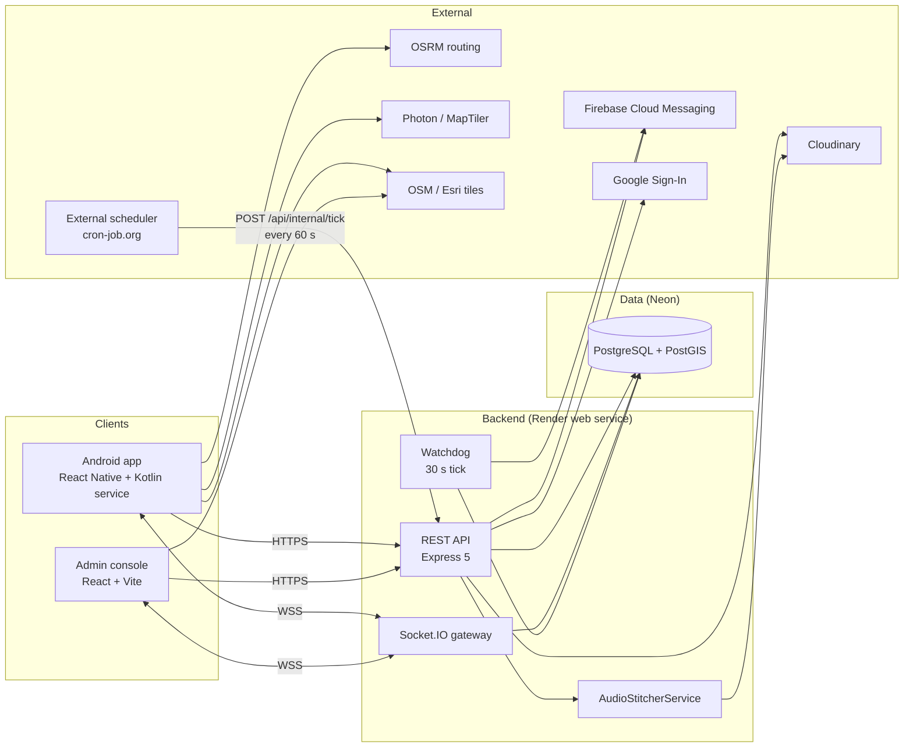
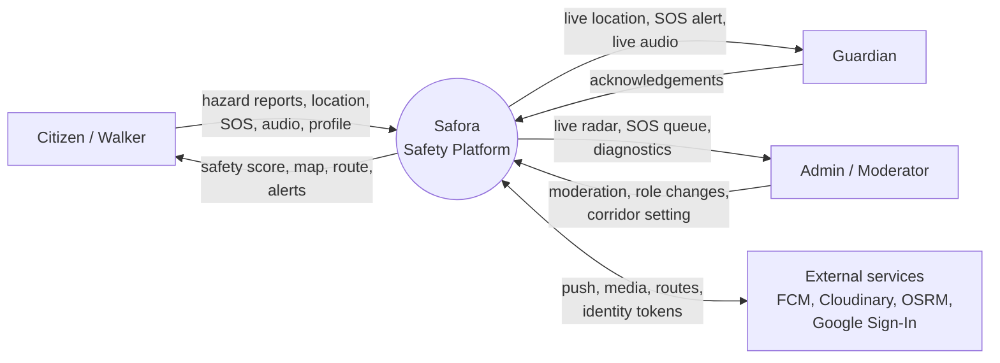
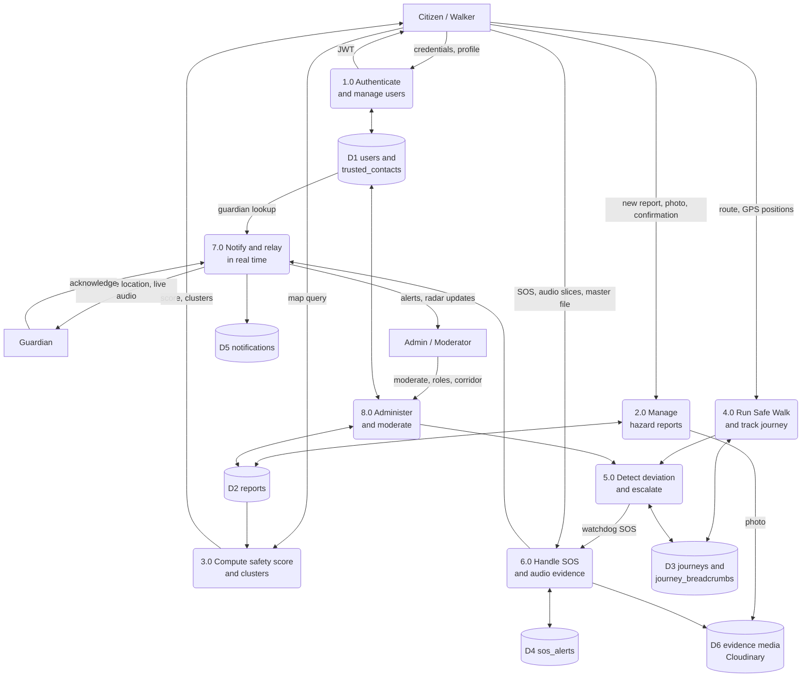
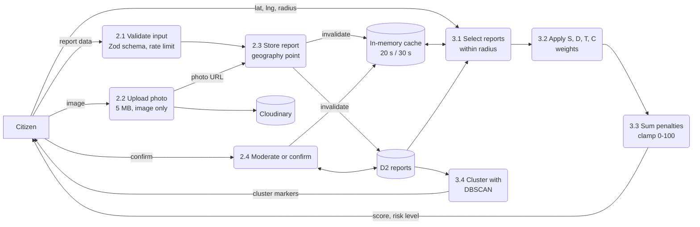
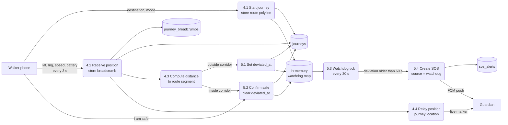
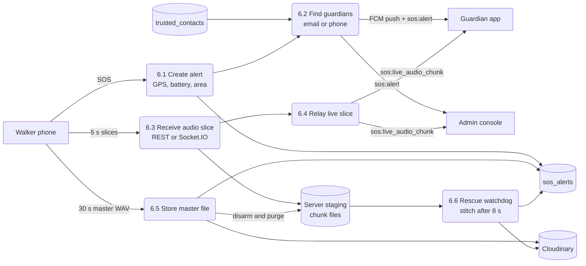
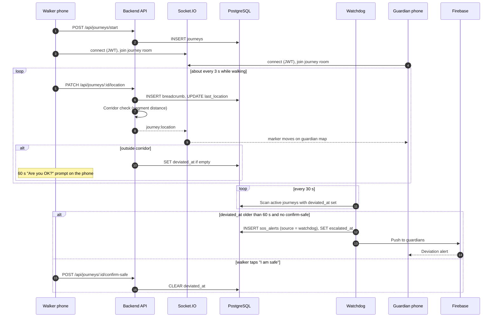
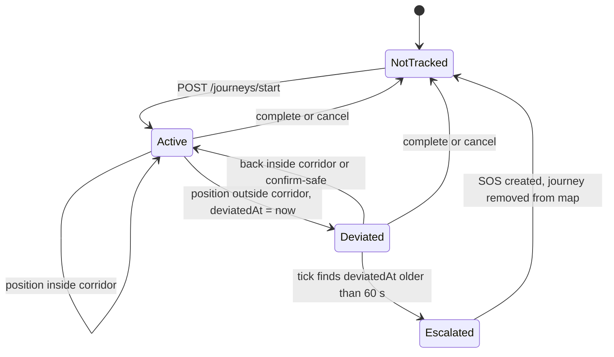
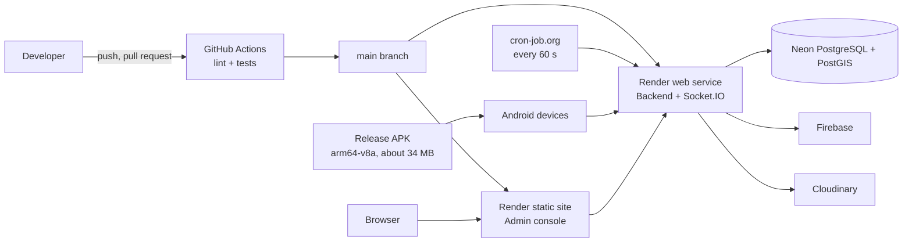

# Architecture

| | |
|---|---|
| **Version** | V1 (complete) |
| **Audience** | Developers, evaluators, maintainers |
| **Related** | [API](./api.md) · [Database](./database.md) · [Safety algorithms](./safety-algorithms.md) · [Dual-pipe audio](./dual-pipe-audio-streaming.md) |

## 1. Overview

Safora is a three-tier system organised as an npm monorepo (`apps/mobile`, `apps/backend`, `apps/frontend`, `packages/shared-types`).

| Tier | Components |
|---|---|
| Client | React Native Android app with a native Kotlin foreground service; React admin console |
| Service | Node.js and Express REST API, Socket.IO gateway, in-process watchdog, audio stitcher |
| Data and external | PostgreSQL with PostGIS (Neon), Firebase Cloud Messaging, Cloudinary, OSRM, Photon and MapTiler, OpenStreetMap and Esri tiles |

## 2. System Context

## 3. Data Flow Diagrams

The diagrams use these conventions: rectangles are external entities, rounded boxes are processes, and cylinders are data stores.

### 3.1 Level 0 – Context Diagram

### 3.2 Level 1 – Main Processes

### 3.3 Level 2 – Hazard Reporting and Scoring (processes 2.0 and 3.0)

### 3.4 Level 2 – Safe Walk and Escalation (processes 4.0 and 5.0)

### 3.5 Level 2 – SOS and Audio Evidence (process 6.0)

## 4. What Is New in V1 Compared with the Original Codebase

| Layer | Pre-existing | Added in V1 |
|---|---|---|
| Mobile | Screens, offline hazard queue, map, route preview, SOS countdown, decoy and fake call | Socket.IO client, photo picker, heat-map layer, honest error state on the score card, Google Sign-In, terms and age notice, guardian live SOS screen, foreground service, dual-pipe audio, siren, hold-to-confirm walk end, UI modernisation (five phases) |
| Backend | Auth, hazard CRUD, SOS trigger, corridor distance function | Breadcrumb persistence, live location relay, watchdog tick, `confirm-safe`, public report DTO, audio stitcher, live audio relay, Google OAuth, rate limiting, configurable corridor |
| Database | users, reports, trusted_contacts, journeys, sos_alerts, notifications | `journey_breadcrumbs`; `journeys.last_location`, `last_seen_at`, `deviated_at`, `escalated_at`; `users.age`, `age_notice_ack`, `terms_accepted_at`, Google columns |
| Admin console | Dashboard, SOS queue, hazard moderation | Real Safe Walk radar, live audio queue, command palette, shortcuts manual, offline-failover banner, batch moderation, diagnostics tests |
| Maps and routing | Leaflet with OSM and Esri tiles, Photon and MapTiler search | Unchanged in V1. Per-mode routing and a new basemap are V2 items |

## 5. Safe Walk with Live Tracking (core V1 flow)

## 6. Watchdog

The watchdog implements one rule in V1: unconfirmed deviation.

- It runs as a 30-second in-process loop inside the Express service. No separate worker is needed.
- It keeps a `Map<journeyId, { deviatedAt, lastLocation }>` of active journeys. A tick with no active journeys performs no database query.
- A position outside the corridor sets `deviatedAt` if it is empty. A position back inside the corridor, or a `confirm-safe` call, clears it.
- When `deviatedAt` is more than 60 seconds old, the watchdog creates an SOS alert with `source = 'watchdog'`, sets `escalated_at`, pushes to the guardians and removes the journey from the map. It therefore fires once per deviation, between 60 and 90 seconds after the deviation.
- On start-up the map is rebuilt from `SELECT id, deviated_at FROM journeys WHERE status = 'active'`.
- An external scheduler calls `POST /api/internal/tick` every 60 seconds with the `X-Internal-Secret` header, so the free-tier instance does not sleep and the watchdog keeps running.

### Phone-side and server-side layers

The phone shows its own 60-second "Are you OK?" countdown, which is the first and fastest layer. The server-side watchdog is the safety net when the phone-side layer is defeated, for example when the app is killed or the phone is destroyed. Both can fire. Tapping "I am safe" calls `confirm-safe`, which prevents the server-side alert.

## 7. Foreground Service

`com.mobile.SafeWalkService` (Kotlin) starts when a Safe Walk begins and stops when it ends.

1. Location updates continue with the screen locked. Without the service, Android can throttle location callbacks and the deviation watchdog would degrade silently.
2. A persistent notification shows the distance and estimated time to the destination, for example "Safe Walk active – 320 m to destination, about 4 min". It is refreshed on every location update and uses straight-line distance and the calibrated speed constants in [Safety algorithms](./safety-algorithms.md).
3. If an SOS is triggered while the service is running, audio recording uses the same service (see [Dual-pipe audio](./dual-pipe-audio-streaming.md)).

### Microphone constraint on Android

Android generally does not allow an application to start microphone access from the background. A foreground service that is already running with the microphone type is one of the few permitted exceptions. Consequently:

- An SOS during an active Safe Walk records audio even with the screen locked.
- An SOS with no active walk and a locked screen may be unable to start recording on newer Android versions. In that case the SOS is sent immediately with GPS and battery data and without audio; recording starts later if the screen is unlocked. The application never pretends that audio was recorded.
- The behaviour varies by Android version and vendor and was verified on the project's test devices.

## 8. Failure Modes

| Failure | Expected behaviour |
|---|---|
| Socket.IO drops during a walk | Location continues over REST. The socket only carries real-time delivery to the guardian, so the watchdog still works |
| `/api/internal/tick` called with a wrong or missing secret | HTTP 401 with no body detail; nothing is scanned |
| FCM push fails (invalid token) | The `sos_alerts` row still exists and appears in the admin queue. Retry and alternative channels are a V2 item |
| Two location updates arrive out of order | `last_location` reflects the last processed update, not the latest `recorded_at`. Ordering by `recorded_at` is a V2 item |
| Journey without a route polyline | The distance to the straight line from origin to destination is used |
| Journey without a destination | No deviation is possible, so no deviation check is made |
| Backend restarts during a walk | The in-memory map is rebuilt from the database; a deviation that occurred in the few seconds around the restart may be missed (V2 makes the rules idempotent and clock-driven) |

## 9. Deployment

All hosting is on free tiers. Known consequences are listed in [Tech stack](./tech-stack.md).

## 10. Deferred to V2

Session hardening, account deletion, e-mail, a verified guardian invitation handshake, on-device SMS delivery reporting, tracking links for guardians without the app, an open basemap, tuned search, per-mode routing, voice guidance, no-unlock SOS triggers, chat, Hindi and Uttarakhand-specific content, a medical card, and legal compliance work. See `docs/v2/`.

**V1 guardian model (simplified).** A trusted contact who has a Safora account and is logged in when the walk starts can see the live location and receive the deviation alert, with no separate acceptance step. This is weaker than the V2 design and is stated as a known limitation.
