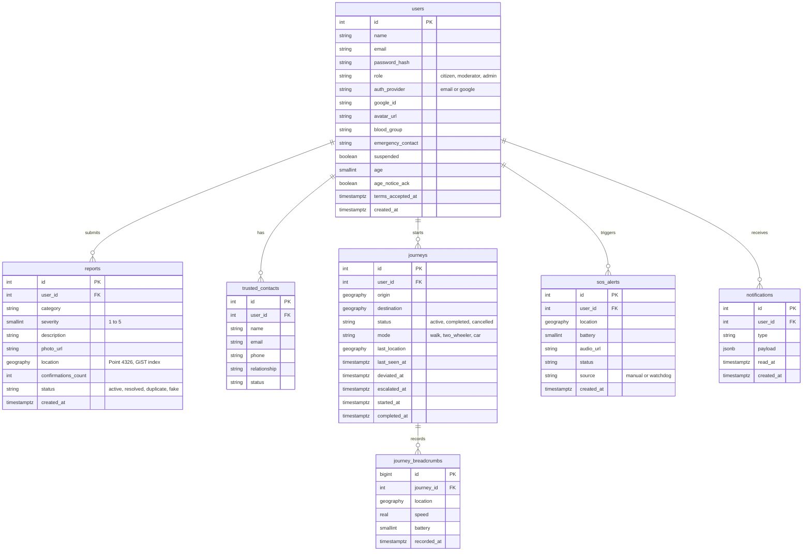

# Database Schema

| | |
|---|---|
| **Version** | V1 (complete) |
| **Engine** | PostgreSQL 15+ with the PostGIS extension, hosted on Neon (free tier) |
| **Access** | `pg` with raw SQL; no ORM |
| **Migrations** | Inline in `initDatabase()` (`apps/backend/src/config/database.ts`). A migration tool is a V2 item |

## 1. Tables

V1 has seven tables. Spatial columns use `GEOGRAPHY(Point, 4326)` so that distances are computed on the WGS 84 ellipsoid.

| Table | Purpose |
|---|---|
| `users` | Identity, role, authentication provider, age notice and terms acceptance |
| `reports` | Community hazard reports with a spatial point, category, severity, photo and moderation state |
| `trusted_contacts` | Guardians and emergency contacts of a user |
| `journeys` | Safe Walk sessions, including watchdog state |
| `journey_breadcrumbs` | **New in V1.** High-frequency GPS track of a journey |
| `sos_alerts` | Emergency alerts with position, battery, audio evidence and source |
| `notifications` | In-app notification inbox |

## 2. Entity Relationship Diagram



## 3. Additions in V1

| Area | Change | Used by |
|---|---|---|
| Live tracking | Table `journey_breadcrumbs` with index `(journey_id, recorded_at DESC)` | Location persistence, admin radar |
| Watchdog | `journeys.last_location`, `last_seen_at`, `deviated_at`, `escalated_at` and a partial index on `status = 'active'` | Watchdog tick, active-journey list |
| Age and terms | `users.age`, `age_notice_ack`, `terms_accepted_at` | Terms and age notice screen |
| Google Sign-In | `users.auth_provider`, `users.google_id`, `users.avatar_url` | `POST /api/auth/google` |
| Evidence source | `sos_alerts.source` with values `manual` and `watchdog`; `audio_url` filled by the master upload or the rescue watchdog | SOS queue, audio engine |

### 3.1 How `audio_url` is populated

1. **Normal path.** The phone uploads the 30-second master WAV to Cloudinary and updates the alert through `PATCH /api/sos/:id/audio`.
2. **Rescue path.** If the phone is destroyed or loses connectivity mid-stream, the server's 8-second watchdog concatenates the received slices into `interrupted_stitched.wav`, uploads it and sets `audio_url`.

### 3.2 Reporter identity

`reports.user_id` is always stored. Identity is removed in the repository and DTO layer: the public representation omits `userId`, `reporterName` and `reporterEmail`, and staff-guarded endpoints return the full staff representation. No schema change is needed for this.

## 4. Indexes

```sql
CREATE INDEX IF NOT EXISTS idx_reports_location ON reports USING GIST (location);
CREATE INDEX IF NOT EXISTS idx_breadcrumbs_journey ON journey_breadcrumbs (journey_id, recorded_at DESC);
CREATE INDEX IF NOT EXISTS idx_journeys_active ON journeys (status) WHERE status = 'active';
```

The partial index keeps the watchdog and the admin radar fast as the journey history grows.

## 5. V1 Migration Script

Idempotent, so it is safe to run more than once. Keep a copy in the repository as `apps/backend/scripts/v1-migration.sql`.

```sql
BEGIN;

CREATE TABLE IF NOT EXISTS journey_breadcrumbs (
  id BIGSERIAL PRIMARY KEY,
  journey_id INTEGER NOT NULL REFERENCES journeys(id) ON DELETE CASCADE,
  location GEOGRAPHY(Point,4326) NOT NULL,
  speed REAL,
  battery SMALLINT,
  recorded_at TIMESTAMPTZ NOT NULL DEFAULT now()
);
CREATE INDEX IF NOT EXISTS idx_breadcrumbs_journey
  ON journey_breadcrumbs (journey_id, recorded_at DESC);

ALTER TABLE journeys
  ADD COLUMN IF NOT EXISTS last_location GEOGRAPHY(Point,4326),
  ADD COLUMN IF NOT EXISTS last_seen_at TIMESTAMPTZ,
  ADD COLUMN IF NOT EXISTS deviated_at TIMESTAMPTZ,
  ADD COLUMN IF NOT EXISTS escalated_at TIMESTAMPTZ;
CREATE INDEX IF NOT EXISTS idx_journeys_active
  ON journeys (status) WHERE status = 'active';

ALTER TABLE users
  ADD COLUMN IF NOT EXISTS age SMALLINT,
  ADD COLUMN IF NOT EXISTS age_notice_ack BOOLEAN NOT NULL DEFAULT false,
  ADD COLUMN IF NOT EXISTS terms_accepted_at TIMESTAMPTZ;

CREATE INDEX IF NOT EXISTS idx_reports_location ON reports USING GIST (location);

COMMIT;
```

### Rollback (development databases only)

```sql
BEGIN;
ALTER TABLE users DROP COLUMN IF EXISTS terms_accepted_at,
                  DROP COLUMN IF EXISTS age_notice_ack, DROP COLUMN IF EXISTS age;
DROP INDEX IF EXISTS idx_journeys_active;
ALTER TABLE journeys DROP COLUMN IF EXISTS escalated_at, DROP COLUMN IF EXISTS deviated_at,
                     DROP COLUMN IF EXISTS last_seen_at, DROP COLUMN IF EXISTS last_location;
DROP TABLE IF EXISTS journey_breadcrumbs;
COMMIT;
```

### Running the migration

- **Fresh database:** start the backend; `initDatabase()` creates everything.
- **Existing database with data:** run the script once in `psql` or the Neon SQL editor **before** deploying the V1 backend, so the code never starts against a schema it does not have.

## 6. Growth

`journey_breadcrumbs` grows fastest: one row about every 3 seconds during a walk, which is roughly 400 rows for a 20-minute walk. This is negligible at college scale. If a build stays online for weeks, periodically delete breadcrumbs of completed journeys. A 30-day retention job is part of V2.

## 7. Deferred to V2

`refresh_tokens`, `otp_codes`, `email_outbox`, `guardian_invites`, `report_confirmations`, `alert_deliveries`, `checkins`, `contacts`, `threads`, `messages`, `medical_cards`, `advisories`, `safe_places`, `place_audits`, `tracking_links`, `organizations` and the others listed in [`docs/v2/database.md`](../v2/database.md).
