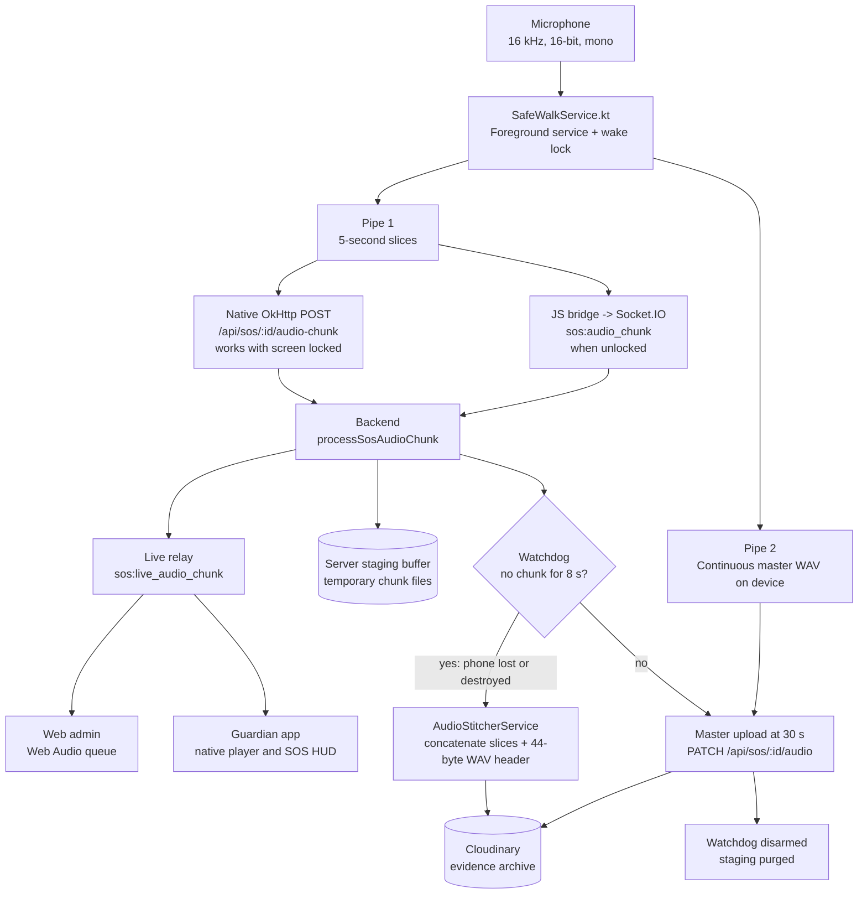
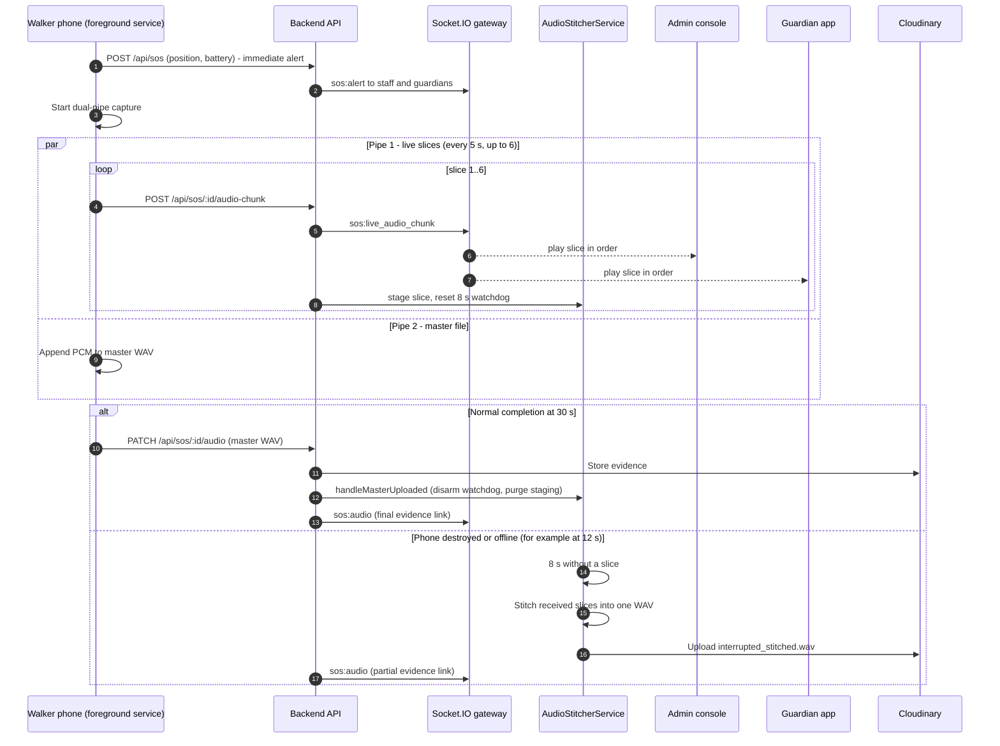

# Dual-Pipe Audio Streaming and Resilient Archival

| | |
|---|---|
| **Version** | V1 (production) |
| **Status** | Implemented, verified and hardened |
| **Components** | `SafeWalkService.kt`, `SafeWalkServiceModule.kt`, `audioRecorderService.ts`, `sosAudioService.ts`, `audioStitcherService.ts`, `journeySocket.ts`, `SocketContext.tsx`, `AudioPlayer.tsx`, `GuardianSosLiveModal.tsx` |

## 1. Purpose

During an SOS, Safora records 30 seconds of ambient audio. A conventional design records one file and uploads it when the recording ends. That design has two weaknesses:

1. **Silence during the critical period.** Guardians and dispatchers hear nothing until the upload finishes.
2. **Total loss of evidence.** If the phone is destroyed, submerged or loses power before the upload, nothing reaches the server.

The dual-pipe engine removes both weaknesses. It delivers audio to guardians and dispatchers in 5-second slices while it is still being recorded, keeps one unbroken master recording on the device, and lets the server rescue the evidence if the phone stops transmitting.

## 2. Design Summary

| Item | Value |
|---|---|
| Capture format | 16 kHz, 16-bit, mono linear PCM (32,000 bytes per second) |
| Total recording length | 30 seconds |
| Live slice length | 5 seconds (6 slices; 160,000 bytes of PCM each before compression) |
| Server chunk-loss timeout | 8 seconds |
| Live-delivery rate limit | 60 chunks per minute per user |
| Master-upload rate limit | 30 uploads per 15 minutes per user |
| Request body limit | 10 MB (Base64 audio) |

The engine has two independent pipes fed by the same microphone stream:

- **Pipe 1 – live slices.** The Kotlin foreground service cuts the stream into 5-second slices and posts each one directly to the backend over native HTTP (OkHttp). While the screen is unlocked the same slice is also emitted to the JavaScript layer for delivery over Socket.IO, so there are two redundant transports.
- **Pipe 2 – local master file.** The raw PCM stream is written continuously to `sos_<alertId>_master.wav` on the device. When the 30 seconds end, the 44-byte WAV header is finalised and the file is uploaded to cloud storage.
- **Server rescue watchdog.** If no slice arrives for 8 seconds, the server stitches the slices it already holds and stores them as the evidence file.

## 3. Why Native Transmission

An earlier version emitted the slices from React Native JavaScript over a Socket.IO client. When the user locked the phone or put it in a pocket, Android entered Doze mode and throttled the JavaScript thread. The socket stopped sending, and the slices were delivered in one late burst after the phone was unlocked, which defeated real-time intervention.

The current design moves transmission into a typed Android foreground service (`FOREGROUND_SERVICE_TYPE_MICROPHONE` and `FOREGROUND_SERVICE_TYPE_LOCATION`) that holds a partial wake lock. This pattern is also used by body-worn cameras and push-to-talk platforms. The service continues to capture and post audio with the screen off.

## 4. End-to-End Flow



## 5. Sequence



## 6. Protocol

### 6.1 Native slice upload

`POST /api/sos/:id/audio-chunk` with `Authorization: Bearer <token>` and a JSON body:

```json
{
  "alertId": 142,
  "seq": 1,
  "totalChunksExpected": 6,
  "durationSec": 5.0,
  "sampleRate": 16000,
  "mimeType": "audio/wav",
  "data": "<Base64 audio>",
  "isLast": false
}
```

### 6.2 Socket.IO fallback

The JavaScript layer emits `sos:audio_chunk` with the same fields (without `sampleRate`) while the screen is unlocked. The server acknowledges every slice with `sos:audio_chunk_ack`.

### 6.3 Live relay

The backend relays each accepted slice as `sos:live_audio_chunk` to three audiences: the room `sos:alert:{alertId}`, the `staff` room, and the guardian rooms `user:{guardianId}`. The payload repeats the slice fields and adds an ISO `timestamp`.

### 6.4 Authorisation

A slice is accepted only if the alert belongs to the authenticated user or the caller has the `admin` or `moderator` role. Room subscription (`sos:join`) follows the same rule and also admits verified guardians.

## 7. Implementation Notes

### 7.1 Android engine (`SafeWalkService.kt`)

- Foreground service types: microphone and location, with a partial wake lock. It survives screen-off, pocket storage and Doze mode.
- Dual-sink thread: one sink writes raw PCM to the master file; the other accumulates 5 seconds, wraps the data with a header (or compresses it, see section 9.3), Base64-encodes it and calls `postAudioChunkNatively`. The same slice is emitted to the JavaScript bridge as `onSosAudioChunk`.
- OkHttp timeouts: connect 15 s, read 20 s, write 20 s, with connection-failure retry. A failed post is retried up to twice with a 1.5 s back-off to survive cell-tower hand-over.
- Alert-ID buffering: if the first slice completes before the HTTP request that creates the alert has returned, the slice waits in `pendingNativeChunks` and is flushed when `ACTION_UPDATE_ALERT_ID` arrives.
- Triple-redundant token: the JWT is passed in the start intent, re-passed when the alert ID is associated, and, as a last resort, read from the local React Native storage.

### 7.2 Mobile bridge (`audioRecorderService.ts`)

Starts the service with `startEmergencyAudioWithToken(alertId, token)`, forwards the alert ID when it becomes known, and uploads the master file when `onSosAudioMasterCompleted` fires. If the hardware `AudioRecord` cannot start, it falls back to the standard recorder.

### 7.3 Backend (`sosAudioService.ts`, `audioStitcherService.ts`)

- `processSosAudioChunk` treats REST and WebSocket slices identically.
- A slice that arrives before the alert row is visible is retried up to four times at 500 ms intervals.
- The 8-second watchdog is reset by every slice. On expiry it assembles the staged PCM, adds a standard 44-byte RIFF/WAVE header, uploads the file and updates `sos_alerts.audio_url`.
- `handleMasterUploaded` disarms the watchdog and deletes the staging directory when the full master file arrives.

### 7.4 Admin playback (`SocketContext.tsx`, `AudioPlayer.tsx`, `SosAlertsPage.tsx`)

- Duplicate slices (same `alertId:seq` from both transports) are discarded.
- A Web Audio queue plays slices strictly in order with 6 ms gain ramps at slice edges to remove clicks.
- A custom scrub bar supports click-to-seek and never stalls the playhead during drag.
- The browser autoplay restriction is handled by queueing audio until the first user gesture resumes the audio context.

### 7.5 Guardian application

`SafeWalkServiceModule.playLiveAudioChunk` decodes each slice to cache storage and plays it with Android `MediaPlayer`, chaining to the next slice when `onLiveAudioChunkFinished` fires. `GuardianSosLiveModal` is mounted globally and shows the live beacon, vibration, slice progress, a mute toggle, and one-tap actions to navigate to the position, call the companion or call 112. After the 30 seconds it switches to the master recording.

## 8. Failure Handling

| # | Scenario | Risk without mitigation | Mitigation |
|---|---|---|---|
| 1 | Screen locked immediately after SOS | JavaScript thread paused; nothing arrives until unlock | Native foreground service posts each slice itself |
| 2 | Phone destroyed or battery dies at 12 s | All evidence lost | Slices 1 and 2 are already on the server; the 8 s watchdog stitches and stores them |
| 3 | Network dip during cell hand-over | Slice upload fails | OkHttp retries twice with back-off; Socket.IO is a second path when unlocked |
| 4 | First slice finishes before the alert ID exists | Slice rejected as unowned | Slice is buffered and flushed when the ID arrives |
| 5 | Same slice arrives over both transports | Audio plays twice | Admin client de-duplicates by `alertId:seq` |
| 6 | Browser blocks autoplay | Dispatcher hears nothing | Slices are queued; first click resumes playback |
| 7 | Normal 30-second completion | Race between stitched and master files | Master upload disarms the watchdog and takes precedence |
| 8 | Slices arrive out of order | Garbled audio | Jitter buffer (section 9.1) |

## 9. Hardening Phases (all completed)

### 9.1 Jitter buffer and sequencer

During mobility, slice 3 can arrive 100–300 ms before slice 2. The admin client holds an out-of-order slice for a 450 ms playout window. When the missing predecessor arrives, the contiguous run is released in order. If it does not arrive in time, playback advances to the lowest buffered slice and logs a warning. Slices with `seq <= lastPlayedSeq` are dropped, and state is cleared per alert when playback stops.

### 9.2 Voice-clarity processing

A dispatcher-side Web Audio chain makes speech easier to understand when the phone is in a pocket or outdoors: a 175 Hz high-pass filter (Q 0.707), a +3.5 dB peaking filter at 2.4 kHz (Q 1.1), and a dynamics compressor (3 ms attack, −24 dB threshold, 4:1 ratio). A "Clarity" switch turns the chain on or off and remembers the choice.

### 9.3 Hardware compression

Uncompressed slices of about 160 KB are too large for 2G and congested networks. The service picks the best available encoder:

| Tier | Condition | Codec | Container | Bit rate | Slice size |
|---|---|---|---|---|---|
| 1 | Android 10+ | Opus | Ogg | 24 kbps | about 16 KB |
| 2 | Android 7+ | AAC-LC | MP4/M4A | 32 kbps | about 18 KB |
| 3 | Encoder unavailable | PCM | WAV | – | about 160 KB |

The master file is always lossless PCM. The stitcher detects compressed slices by their signature (`OggS` or `ftyp`) so rescue evidence also works with compressed input.

### 9.4 OEM battery-exemption engine

Vendor battery managers (Xiaomi, Samsung, Oppo/Realme/OnePlus, Huawei/Honor, Vivo/iQOO) can stop foreground services even when they are declared. Safora requests the `REQUEST_IGNORE_BATTERY_OPTIMIZATIONS` exemption, checks its status through `PowerManager`, and deep-links to the vendor's auto-start or protected-apps screen when the direct request is blocked. Settings shows a live "Lock-screen and battery protection" status, a brand-specific step-by-step guide, and the Safe Walk screen shows a dismissible reminder with a one-tap fix.

## 10. Comparison with Comparable Systems

| Property | Safora | Push-to-talk platforms | Body-worn cameras |
|---|---|---|---|
| Ingestion | Chunked HTTPS (5 s) with WebSocket fallback | Low-latency streaming | Chunked HTTPS (2–5 s) plus local flash |
| Survives locked screen | Yes (foreground service) | Yes | Yes (dedicated device) |
| Local lossless master | Yes | Optional | Yes |
| Server-side rescue | Yes (8 s watchdog) | Server archive | Yes (evidence management system) |
| Operator playback | Web Audio queue with jitter buffer and clarity DSP | Proprietary dispatch hub | Evidence web player |
