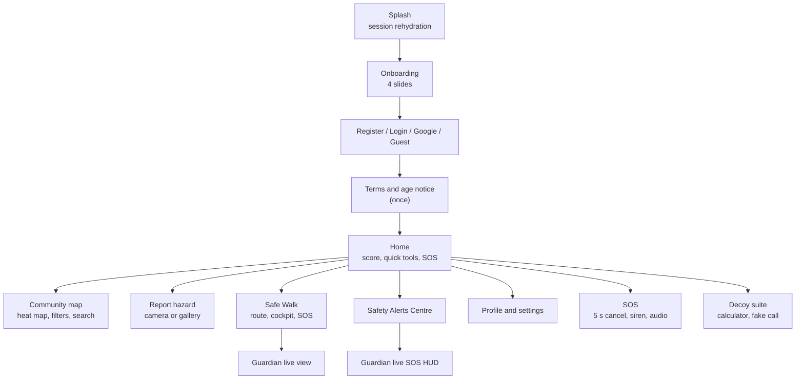

# Mobile Application Features

| | |
|---|---|
| **Version** | V1 (complete) |
| **Platform** | Android (React Native 0.87.1 with a native Kotlin service) |
| **Legend** | **Existing** = already in the code base before V1 · **New** = added in V1 · **Changed** = behaviour changed in V1 |

## 1. Screen Map

## 2. Onboarding and Accounts

| Feature | Status |
|---|---|
| Four-slide onboarding | Existing |
| E-mail registration and login (JWT) | Existing |
| **Google Sign-In** – account picker through Google Play Services, automatic linking with an existing e-mail account | **New** |
| Guest mode | Existing |
| **Terms and age notice** – a plain-language terms page, an age field and a note for users under 18 asking them to make sure a parent or guardian knows they use the app. Shown once after registration. It records disclosure only; a parental-consent workflow is a V2 item | **New** |
| Profile editing, change password (`ChangePasswordModal`) | Existing / **New** modal |
| Light and dark theme | Existing |

## 3. Home

| Feature | Status |
|---|---|
| Quick-action cards | Existing |
| Safety-score card. On failure it shows a retry state and never an invented value | **Changed** |
| "Live heat map" card. Now opens a real density map instead of a plain pin map | **Changed** |
| Personal panic-siren quick card: one tap sounds the siren without notifying anyone | **New** |
| Pull-to-refresh on Home and Profile (re-evaluates the real score) | **New** |

## 4. Hazard Reporting

| Feature | Status |
|---|---|
| Category (lighting, road hazard, waterlogging, isolated area, traffic, other), severity 1 to 5, description | Existing |
| Offline queue in AsyncStorage that synchronises on reconnect, with a sync banner and manual sync action | Existing / **Changed** |
| **Camera or gallery photo picker** uploading to `POST /api/reports/upload-photo` (previously only preset images) | **New** |
| Confirm a report | Existing |
| Public report cards do not show the reporter's identity; staff see it | **Changed** |

## 5. Map

| Feature | Status |
|---|---|
| Leaflet in a WebView with four base layers (streets, dark, satellite and others) | Existing |
| **Rendering engine upgrade** – staggered `invalidateSize(false)`, no 3D tilt distortion, resize observer so that tiles appear without a manual zoom | **New** |
| Search (Photon, with MapTiler fallback) | Existing |
| Route preview with Walk, Two-wheeler and Car tabs. Times are calculated per mode; the road geometry is the same for all three (known limitation, fixed in V2) | Existing |
| **Heat-map layer** from `/api/reports/clusters` | **New** |
| Offline map cache for a radius of 10 km around the user (raster tiles at zoom 15, up to 25 preloaded images) | Existing. Bulk prefetch of OpenStreetMap tiles is discouraged by the tile usage policy; the replacement is a V2 item |
| Floating search capsule with a safety-score ring, hazard filter chips, safety quick-action drawer and one-handed zoom | **New** |

## 6. Safe Walk

| Feature | Status |
|---|---|
| Start a walk with route preview | Existing |
| Server-side corridor check (default 150 m, configurable by staff from 20 to 1000 m) | Existing / **Changed** |
| **Live location for a trusted contact** who is also a Safora user, over Socket.IO | **New** |
| 60-second "Are you OK?" countdown on the phone, with three-pulse haptic feedback | Existing |
| **Server-side deviation alert** if the phone-side prompt is missed or the app is killed (escalation 60 to 90 seconds after the deviation) | **New** |
| **Background tracking with the screen locked** through the native foreground service | **New** |
| **Distance and ETA notification** that stays in the notification bar for the whole walk | **New** |
| **In-cockpit SOS button** next to "End walk" | **New** |
| **Hold-to-confirm** end-of-walk button (1.5 s hold) with auto-fitting text | **New** |
| Heads-up display with speed and ETA in tabular figures; safe-arrival celebration dialog; "I reached safely" message by SMS or WhatsApp | **New** |
| Battery-protection reminder banner with a one-tap fix (vendor battery managers) | **New** |
| Lost-contact and overdue-arrival alerts, check-in timer | Not in V1 (V2) |

> The cockpit displays "150 m SAFE CORRIDOR ACTIVE", which directly aligns with the backend server default threshold of 150 m (configurable 20 to 1000 m by staff).

## 7. SOS and Emergency Deterrent

| Feature | Status |
|---|---|
| 5-second cancel countdown with abort overlay; GPS, battery and area dispatched immediately | Existing |
| **Dual-pipe audio** – 30 seconds recorded as 16 kHz mono PCM, streamed in 5-second slices and saved as a master file | **New** |
| **Guardian live SOS HUD** – full-screen emergency view with vibration, slice progress `#1..6`, soundwave, mute, navigate, call companion, call 112 | **New** |
| **Fail-safe archival** – the server stitches received slices if the phone stops transmitting | **New** |
| **High-decibel siren** – looping siren on the alarm stream at maximum volume, even in silent mode | **New** |
| **Dual-mode SOS** – `@safora_pref_loud_siren` selects a loud deterrent or silent (stealth) streaming | **New** |
| FCM push to guardians | Existing |
| Pre-filled SMS fallback (`sms:` intent; the user confirms the send because Android does not allow silent SMS) | Existing |
| Test SOS drill; guardian contact management with e-mail check | Existing |
| Decoy suite: calculator with duress PIN `9999=` that silently sends an SOS, bilingual (English and Hindi) fake incoming call | Existing / **New** visuals |
| In-app alerts inbox with a live unread counter that follows `sos:alert` and `sos:audio` events | Existing / **Changed** |

## 8. Settings and Profile

| Feature | Status |
|---|---|
| Account password and security modal | **New** |
| Loud-siren preference (persisted) | **New** |
| Lock-screen and battery protection card with live status and brand-specific guide | **New** |
| Preference toggles for countdown, haptics and battery behaviour (stored in AsyncStorage) | Existing |

## 9. Interface Modernisation (five phases, completed)

| Phase | Content | Main components |
|---|---|---|
| 1. Brand and typography | OLED midnight theme (`#0A0D14`), adaptive launcher icons for all densities, tabular figures so that counters do not jitter | `colors.ts`, `typography.ts`, `res/mipmap-*` |
| 2. Living map canvas | Floating search capsule with safety ring, hazard filter chips, thumb-zone FAB and drawer | `FloatingSearchCapsule`, `HazardFilterChips`, `SafetyFabDrawer`, `OpenMapView` |
| 3. Active escort cockpit | Multi-modal route sheet, safest-versus-fastest strategy, corridor halo, HUD, hold-to-confirm | `MultiModalRouteSheet`, `ActiveWalkCockpitHud`, `HoldToConfirmButton` |
| 4. Emergency and modals | 5-second abort overlay with haptics, live microphone waveform, 60-second deviation countdown | `SosGracePeriodOverlay`, `AudioWaveformBars`, `DeviationCountdownModal` |
| 5. Decoys and polish | Calculator decoy with duress PIN, fake call, arrival celebration | `CalculatorDecoyModal`, `FakeCallModal`, `ArrivalCelebrationModal` |

Each phase is covered by automated component tests (20 mobile tests in total).

## 10. Not in V1

Chat, turn-by-turn voice guidance, hardware volume-key SOS triggers, a medical card and a web companion link for guardians without the app. These are described in `docs/v2/`.

## 11. File Map

| Feature | Files |
|---|---|
| Terms and age notice | `screens/TermsScreen.tsx`, gate in `navigation/RootNavigator.tsx` |
| Score card | `screens/HomeScreen.tsx`, `services/reportService.ts` |
| Heat map | `screens/MapScreen.tsx`, `screens/HomeScreen.tsx`, `components/OpenMapView.tsx` |
| Photo picker | `components/ReportHazardModal.tsx` |
| Socket connection | `services/socketService.ts` (initialised on login) |
| Guardian live view | `screens/GuardianLiveScreen.tsx`, `components/GuardianSosLiveModal.tsx` |
| Confirm-safe prompt | `screens/SafeWalkScreen.tsx`, `DeviationCountdownModal` |
| Foreground service | `android/app/src/main/java/com/mobile/SafeWalkService.kt`, `SafeWalkServiceModule.kt` |
| Audio streaming | `services/audioRecorderService.ts`, `services/socketService.ts` |
| Siren and panic button | `services/sirenService.ts`, `screens/HomeScreen.tsx`, `screens/SettingsScreen.tsx` |
| Battery exemption | `services/batteryOptimizationService.ts`, `screens/SettingsScreen.tsx` |
| Offline reports | `services/reportService.ts` |
| Routing constants | `services/routingService.ts` |
