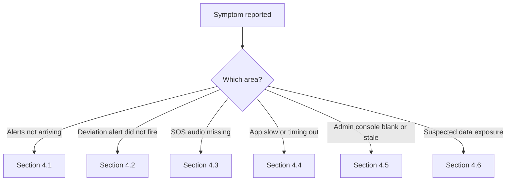

# Operations Runbook

| | |
|---|---|
| **Version** | V1 (as deployed) |
| **Audience** | Whoever runs Safora: deployments, checks, incidents and releases |
| **Related** | [Architecture §9](./architecture.md#9-deployment) · [Tech stack](./tech-stack.md) · [Setup](./setup.md) |

## 1. Environments and Services

| Component | Where | URL or location |
|---|---|---|
| Backend and Socket.IO | Render web service (free) | https://safora-backend.onrender.com/ |
| Admin console | Render static site (free) | https://safora-admin.onrender.com/ |
| Database | Neon PostgreSQL with PostGIS (free) | Neon project |
| Push | Firebase Cloud Messaging | Firebase project |
| Media | Cloudinary | Cloud account |
| Scheduler | cron-job.org job | `POST /api/internal/tick` every 60 s |
| Android package | Release APK, arm64-v8a | `apps/mobile/android/app/build/outputs/apk/release/app-release.apk` |
| Source and CI | GitHub, GitHub Actions | `safora-safety/Safora` |

Local development needs only a PostgreSQL database with PostGIS; see [Setup](../setup.md).

## 2. Routine Checks

| Check | How | Expected |
|---|---|---|
| Backend alive | `GET /api/health` | HTTP 200 |
| Service health and latency | Admin console → Diagnostics, or `GET /api/diagnostics` (staff) | PostGIS, Cloudinary, Firebase, MapTiler, geocoder and Express each pass with a latency in ms |
| Watchdog scheduler | Render logs, or the cron-job.org history | A request every 60 s, each with status 200 |
| Watchdog reachable | `curl -X POST .../api/internal/tick -H "X-Internal-Secret: <secret>"` | `{"scanned":N,"escalated":N}` |
| Wrong secret rejected | The same call with a wrong secret | HTTP 401 |
| Public report privacy | `curl .../api/reports` | No `userId`, name or e-mail |
| Test suite | `npm test` | 15 suites, 104 tests pass |

## 3. Deployment

### 3.1 Backend and admin console
1. Merge to `main` after CI passes (lint and 104 tests).
2. Render builds from the repository using `render.yaml`. Environment variables are set in the Render dashboard.
3. After the deploy, run the routine checks in section 2.
4. If the release changes the database, apply the migration to Neon **first** (see [Database §5](./database.md#5-v1-migration-script)), then deploy the code.

### 3.2 Environment variables

| Variable | Purpose |
|---|---|
| Database connection string | Neon PostgreSQL |
| `JWT_SECRET`, `JWT_EXPIRES_IN` | Token signing and lifetime (default `7d`) |
| `INTERNAL_TICK_SECRET` | Authenticates the watchdog trigger |
| `CORRIDOR_THRESHOLD_METERS` | Default corridor (default `100`) |
| Cloudinary, Firebase and Google settings | Media, push and sign-in |
| MapTiler key | Geocoding fallback, server only |

Never put these into the repository or the APK.

### 3.3 Android release
1. Pull `main`, run `npm install` and `npm test`.
2. `cd apps/mobile/android && ./gradlew assembleRelease` (use `gradlew.bat` on Windows).
3. Sign with the release key (kept outside the repository).
4. Install the APK **fresh** (not over a development build) on two phones and repeat scenarios T1 to T4 of [Testing](./testing-and-submission.md).
5. Check that no secret is in the package: `strings app-release.apk | grep -i key`.
6. Record the file size (about 34 MB) and the build date.

## 4. Incident Playbook



### 4.1 Push alerts do not arrive
1. Open the alert in the admin SOS queue. If it is there, the alert exists and only push delivery failed.
2. Check Firebase credentials in Render and the Diagnostics page.
3. The guardian's push token may be invalid or missing. Ask the guardian to sign in again so that the token is re-registered.
4. Remember the fallback: the walker's pre-filled SMS and a phone call. V1 has no automatic retry through another channel (V2 adds it).

### 4.2 A deviation alert did not fire
1. Check that the journey is `active` and that `deviated_at` was set (database or admin radar).
2. Check the scheduler history and the Render logs for the tick. A sleeping instance wakes on the next request, so the delay can be up to one scheduler interval plus the start-up time.
3. Check that the walker was really outside the corridor. The corridor is 150 m by default and can be changed under Settings (20 to 1000 m); a larger value reduces alerts.
4. A journey without a destination never deviates. A journey without a route polyline is measured against the straight line.
5. If the backend restarted during the deviation, the watchdog map was rebuilt from the database and the event may have been missed by a few seconds.
6. A walker who confirmed safety before 60 seconds correctly produces no alert.

### 4.3 SOS audio is missing
1. If there is an alert but no audio, check the walker's phone: microphone permission, and whether the alert was raised during an active walk (the foreground service). With no active walk and a locked screen, Android may not allow recording to start; the alert is still sent.
2. Check `audio_url` of the alert. If it is `interrupted_stitched.wav`, the phone stopped transmitting and the server rescued the received slices.
3. Check the rate limits (60 slices per minute, 30 uploads per 15 minutes) and the Cloudinary status on Diagnostics.
4. A vendor battery manager may have stopped the service: ask the user to open Settings → Lock-screen and battery protection.

### 4.4 The app or API is slow
1. The first request after idle time is slow on free tiers (Render sleeps after 15 minutes, Neon compute after 5). This is expected and documented.
2. Check Diagnostics for database latency.
3. Check that the PostGIS index exists (`idx_reports_location`).
4. If a map query is slow repeatedly, check the cache invalidation (frequent writes invalidate it).

### 4.5 Admin console is blank or stale
1. Check the WebSocket link: the failover banner shows when it drops. Use "Reconnect".
2. Sign out and in again if the staff token has expired (7 days).
3. Make sure the browser has allowed audio (the first click resumes playback).

### 4.6 Suspected data exposure
1. Rotate `JWT_SECRET` (this signs everyone out) and any exposed key.
2. Review `/api/reports` for identity fields.
3. Remove the leaked data from the source and the Git history if necessary and tell the supervisor.
4. See the incident playbook in [`../v2/security-privacy-compliance.md`](../v2/security-privacy-compliance.md) §8.

## 5. Backups and Data Care

- Neon's free plan has a short history window and no scheduled backups. Before any migration or demonstration, take a dump:

  ```bash
  pg_dump "$DATABASE_URL" --no-owner -Fc -f safora-$(date +%F).dump
  ```

- Periodically remove breadcrumbs of completed journeys, and old audio, if the build stays online for weeks. Automatic retention is a V2 item.
- Do not seed a database that already contains real reports (the seed guard prevents it).

## 6. Access and Secrets

- Keep the release signing key and the production secrets with two team members.
- Staff accounts: create them from the admin Users page and assign the role; remove access for people who leave.
- Rotate keys when a team member leaves.

## 7. Contacts for This Deployment

Keep a current list of the people able to redeploy, access Render, Neon, Firebase and Cloudinary, and the supervisor, in the team's private notes, not in this repository.
