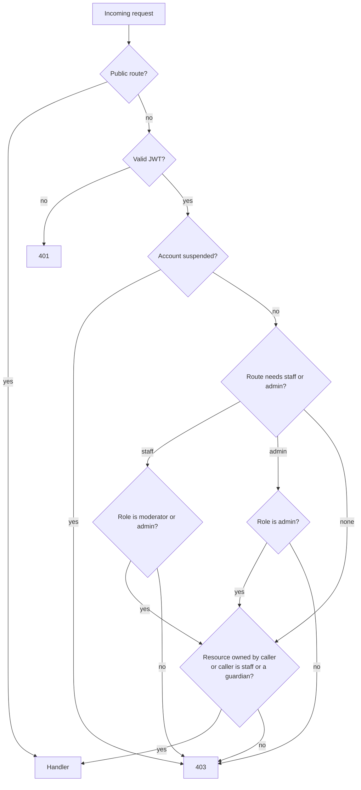

# Roles and Permissions

| | |
|---|---|
| **Version** | V1 (as built) |
| **Related** | [API](./api.md) · [Security and privacy](./security-and-privacy.md) · [SRS FR-AUTH-5](./srs.md) |

Safora has three server roles: **citizen**, **moderator** and **admin**. *Staff* means moderator or admin. A **guest** is not signed in. A **guardian** is not a role: it is a relationship between two citizens (a trusted contact), evaluated when an alert or walk is shared.

## 1. Permission Matrix

✔ allowed · – not allowed · *own* only the user's own records · *guard* only for people the user guards

| Capability | Guest | Citizen | Moderator | Admin |
|---|:---:|:---:|:---:|:---:|
| View map, public reports, clusters and scores | ✔ | ✔ | ✔ | ✔ |
| Register, sign in, Google sign-in | ✔ | ✔ | ✔ | ✔ |
| Edit own profile, change password | – | ✔ | ✔ | ✔ |
| Create a hazard report, upload a photo | – | ✔ | ✔ | ✔ |
| Confirm someone else's report | – | ✔ | ✔ | ✔ |
| See reporter identity on reports | – | – | ✔ | ✔ |
| Moderate reports (active, resolved, duplicate, fake) | – | – | ✔ | ✔ |
| Start, update, complete and cancel a Safe Walk | – | *own* | *own* | *own* |
| See a walker's live position | – | *guard* | all active walks | all active walks |
| Confirm safety on a deviation | – | *own* | *own* | *own* |
| Manage trusted contacts | – | *own* | *own* | *own* |
| Raise an SOS, upload audio slices and the master file | – | *own* | *own* | *own* |
| Join the live audio of an alert | – | *own*, *guard* | ✔ | ✔ |
| See the SOS queue and change alert status | – | – | ✔ | ✔ |
| See the user list and statistics | – | – | ✔ | ✔ |
| Change a user's role or status | – | – | – | ✔ |
| Read or change the corridor threshold | – | – | ✔ | ✔ |
| Use diagnostics | – | – | ✔ | ✔ |
| Delete a journey | – | – | ✔ | ✔ |

The list is derived from the route guards (`requireAuth`, `requireStaff`, `requireAdmin`) and the endpoint table in the API reference. Entries about moderators and diagnostics follow the same guards; confirm them against the route files if a specific action must be certain.

## 2. How Access Is Enforced

- **Ownership checks** apply to journeys, alerts and audio. They are covered by `journeyOwnership.test.ts` and `sosGuards.test.ts`.
- **Socket rooms** follow the same rule: the audio room of an alert (`sos:join`) admits the owner, staff and verified guardians.
- **Public responses** use the public report representation, so identity cannot leak by a missing role check.
- The admin console refuses to sign in a citizen account.

## 3. Roles Planned for V2

V2 gives the moderator role a distinct interface, with an abuse-flag queue in which moderators *flag* accounts and admins *decide* (see [`../v2/accounts-email-local.md`](../v2/accounts-email-local.md) §8). It adds the `guardian-of` and `parent-of` *relationships* instead of new roles ([ADR-016](../v2/architecture-decisions.md)).
