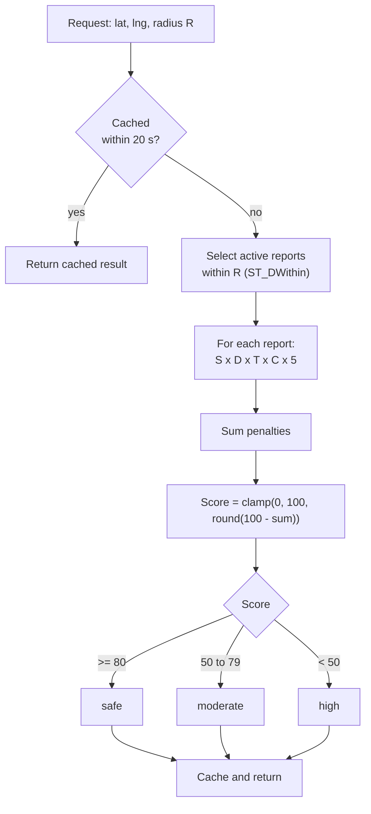
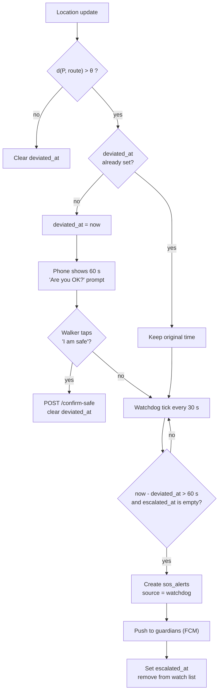

# Safety Algorithms

| | |
|---|---|
| **Version** | V1 (complete) |
| **Source of truth** | `apps/backend/src/services/reportService.ts`, `apps/backend/src/repositories/reportRepository.ts`, `apps/backend/src/services/journeyService.ts`, `apps/backend/src/services/watchdogService.ts` |

The formulas and constants below are taken from the implementation. If a constant changes in the code, update this page in the same commit.

## 1. Safety Score

For a location and a search radius *R*, every active report within the radius produces a penalty. The score is 100 minus the sum of the penalties, limited to the range 0 to 100.

```
penalty(report) = S(severity) × D(distance) × T(age) × C(confirmations) × 5
Ψ               = clamp(0, 100, round(100 − Σ penalty))
```

| Factor | Definition | Values |
|---|---|---|
| **S** – severity weight | Non-linear so that critical hazards dominate | Severity 1, 2, 3, 4, 5 → 1.0, 1.5, 2.5, 4.0, 6.0 |
| **D** – distance falloff | `max(0, 1 − d / R)` | 1 at the point, 0 at the radius. Default *R* = 1000 m |
| **T** – recency decay | `max(0.25, 2^(−t / 168))`, *t* in hours | Half-life 168 h (7 days); floor 0.25, reached after 14 days |
| **C** – confirmations | `1 + 0.15 × min(max(0, c), 5)` | 1.0 to 1.75; five confirmations saturate |

**Risk level:** Ψ ≥ 80 is *safe*, 50 ≤ Ψ < 80 is *moderate*, Ψ < 50 is *high*.

**Why a floor on recency.** A broken streetlight stays broken until it is repaired. With a plain exponential decay, such a report would vanish from the map within weeks. The floor of 0.25 keeps unresolved hazards visible while they are marked `active`; moderators mark a report `resolved` when it is repaired.

**Same half-life for all categories.** Per-category half-lives are a V2 item.



### 1.1 Worked example

A severity-4 report, 50 m away (R = 200 m), 6 hours old, with 2 confirmations:

| Factor | Calculation | Value |
|---|---|---|
| S | severity 4 | 4.0 |
| D | 1 − 50 / 200 | 0.75 |
| T | max(0.25, 2^(−6/168)) | 0.976 |
| C | 1 + 0.15 × 2 | 1.30 |
| Penalty | 4.0 × 0.75 × 0.976 × 1.30 × 5 | about 19.0 |

The location scores 100 − 19 = 81 and is classed as *safe*.

### 1.2 Caching

Nearby-report results are cached in memory for 20 seconds, cluster results for 30 seconds, and other entries for 15 seconds by default. The cache is invalidated by pattern (`reports_`) whenever a report is created, moderated or confirmed.

### 1.3 No fabricated score

If the score request fails, the Home screen shows a retry state. Earlier builds fell back to an invented value. This was removed because a fabricated safety number is the opposite of what a safety application should show.

## 2. Hazard Clustering (DBSCAN)

`GET /api/reports/clusters` groups nearby active reports so that the map shows density rather than overlapping pins.

```sql
SELECT cid, COUNT(*), ROUND(AVG(severity), 1),
       ST_Y(ST_Centroid(ST_Collect(location::geometry))) AS center_lat,
       ST_X(ST_Centroid(ST_Collect(location::geometry))) AS center_lng
FROM (
  SELECT id, severity, location,
         ST_ClusterDBSCAN(location::geometry, eps := 0.003, minpoints := 2) OVER () AS cid
  FROM reports WHERE status = 'active'
) sub
WHERE cid IS NOT NULL
GROUP BY cid HAVING COUNT(*) >= 2;
```

| Parameter | Value |
|---|---|
| ε (`eps`) | 0.003° (about 330 m at this latitude); can be overridden with `?eps=` |
| `minpoints` | 2 (`?min_points=`) |
| Input | Reports with `status = 'active'` |

The map draws one circle per cluster, with the radius scaled by the number of reports and the colour by the average severity.

## 3. Safe Walk Corridor Check

On every location update the server measures how far the walker is from the planned route. The route is a polyline; the distance is the smallest distance to any of its segments.

### 3.1 Projection

Latitude and longitude are converted to a locally flat metric plane (equirectangular projection) for each segment *AB* and position *P*:

```
avgLat = ((latA + latB + lat) / 3) × π / 180
kx     = cos(avgLat) × 111320        (metres per degree of longitude)
ky     = 110540                      (metres per degree of latitude)
P = (lng × kx, lat × ky)    A = (lngA × kx, latA × ky)    B = (lngB × kx, latB × ky)
```

### 3.2 Distance to a segment

```
t = clamp(0, 1, ((P − A) · (B − A)) / |B − A|²)
d = | P − (A + t × (B − A)) |
```

The calculation runs in memory. It deliberately avoids a PostGIS query on every GPS update.

### 3.3 Threshold

| Setting | Value |
|---|---|
| Default threshold θ | **150 m** (`CORRIDOR_THRESHOLD_METERS`) |
| Allowed range | 20 m to 1000 m |
| Changed by | Staff, via `PATCH /api/journeys/config/corridor`, or the admin Settings page |
| Stored in | Process memory; resets to the environment value on restart |

If `d > θ`, the journey is marked as deviated. A journey without a route polyline is measured against the straight line from origin to destination. A journey without a destination cannot deviate.

> **Note.** The mobile cockpit displays "150 m safe corridor", which is in full alignment with the backend server default threshold of 150 m (configurable 20 to 1000 m via `CORRIDOR_THRESHOLD_METERS` or staff settings).

## 4. Deviation Escalation (Watchdog)



```
IF   journeys.deviated_at IS NOT NULL
 AND now() − deviated_at > 60 seconds
 AND no confirm-safe call since deviated_at
THEN create sos_alerts (source = 'watchdog'), notify guardians, set escalated_at
```

The tick interval is 30 seconds, so escalation occurs between 60 and 90 seconds after the deviation, and only once per deviation. The full watchdog (lost contact, overdue arrival, check-in timer) is a V2 item; see [`docs/v2/safety-and-tracking.md`](../v2/safety-and-tracking.md).

## 5. Travel-Time Estimates

The route preview shows the same road geometry for every mode. Times differ because they are calculated from calibrated speeds:

| Mode | Speed | Buffer | Minimum |
|---|---|---|---|
| Walk | 1.60 m/s (5.8 km/h) | none | 60 s |
| Two-wheeler | 8.88 m/s (32 km/h) | +20 s | 60 s |
| Car | 7.22 m/s (26 km/h) | +45 s (signals) | 90 s |

Real per-mode routing is a V2 item.

## 6. Unchanged from the Original Code

Report severity input (1 to 5, chosen by the user), confirmation counting, and the hazard categories: `lighting`, `road_hazard`, `waterlogging`, `isolated_area`, `traffic` and `other`. Per-category decay, "still there / cleared" voting and safest-route ranking are V2 items.

## 7. Test Coverage

`safetyDecay.test.ts` (14 tests) covers time decay, distance falloff, the confirmation cap and the floor. `journeyOwnership.test.ts` (8 tests) covers segment-distance projection, corridor deviation and ownership rules.
