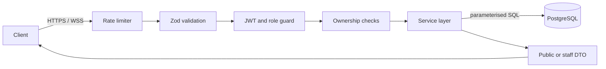

# Security and Privacy – Version 1

| | |
|---|---|
| **Version** | V1 (as built) |
| **Scope** | The controls that exist in the delivered system, the data it handles, and the known gaps. The forward-looking plan (DPDP mapping, threat model, anti-coercion rules, launch checklist) is in [`../v2/security-privacy-compliance.md`](../v2/security-privacy-compliance.md) |
| **Note** | This is an engineering description, not legal advice |

## 1. Security Controls Delivered

| Area | Control | Evidence |
|---|---|---|
| Transport | HTTPS for REST, secure WebSockets for Socket.IO | Deployment on Render |
| Authentication | E-mail and password with bcrypt (10 rounds); JWT HS256 valid for 7 days; Google ID-token verification with an audience check and `email_verified` requirement | `authService.ts`, `authGuards.test.ts`, `googleAuth.test.ts` |
| Authorisation | Role guards (`requireStaff`, `requireAdmin`); ownership checks on journeys, alerts and audio; socket room scoping | `journeyOwnership.test.ts`, `sosGuards.test.ts` |
| Brute-force protection | Login: 10 failed attempts per e-mail and 100 per IP per 15 minutes. Registration: 5 per e-mail and 60 per IP per 15 minutes | `rateLimiter.ts`, `rateLimiter.test.ts` |
| Abuse limits | Reports 20 per 15 minutes; SOS 10 per minute; audio slices 60 per minute; audio upload 30 per 15 minutes; guardian check 30 per 15 minutes; drill 5 per 15 minutes | `rateLimiter.ts` |
| Input validation | Zod schemas for request bodies and query parameters; severity and category enumerations; coordinate ranges | `validation/schemas.ts` |
| SQL injection | Repositories use parameterised queries (`$1`, `$2` placeholders) | `reportRepository.ts` |
| Upload safety | Photos limited to 5 MB and `image/*`, held in memory and streamed to Cloudinary; audio limited by request size and rate | `reportRoutes.ts`, `cloudinaryService.ts` |
| Internal endpoint | `POST /api/internal/tick` requires `X-Internal-Secret`; a wrong or missing secret returns 401 without detail | `internalRoutes.ts` |
| Identity exposure | Public report responses omit user id, name and e-mail; staff responses include them | `Report.ts` |
| Secrets | No secrets in source or in the APK; geocoding key is server-side; `.env` files are ignored by Git; a pre-commit hook is installed | Repository configuration |
| Honest claims | No claim of dispatching police or "military-grade" encryption; 112 is one tap away | SEC-4 in [Tasks](./tasks.md) |
| Integrity of data shown | No fabricated score and no sample journeys | SYN-1, SEC-9 |

## 2. Data Handled in V1

| Data | Stored where | Purpose | Who can see it |
|---|---|---|---|
| Name, e-mail, password hash, role, age notice data, Google identifiers | `users` | Account | The user; staff for administration |
| Hazard reports (place, text, photo, severity) | `reports`, Cloudinary | Community map and score | Everyone (public view without identity); staff with identity |
| Trusted contacts (name, phone, e-mail) | `trusted_contacts` | Alerts and SMS fallback | The owner; used by the server to find guardians |
| Walk route and GPS breadcrumbs | `journeys`, `journey_breadcrumbs` | Corridor check, live view, evidence | The walker; guardians during a walk; staff on the radar |
| SOS position and battery | `sos_alerts` | Response | The walker, the guardians, staff |
| SOS audio (30 s) | Cloudinary; staged chunks on the server disk until the master file arrives | Evidence | The walker, the guardians, staff |
| Push token | `users` | Delivery | The server |
| Offline queue and cached hazards | Phone storage | Offline use | The phone |

### Consent and notice
- A terms and age notice is shown once after registration and records the acknowledgement and age.
- The microphone is used only during an SOS or a walk-related recording, and the operating system asks for permission.
- Location is used during a Safe Walk (foreground service with a visible notification) and when the user views the map.

## 3. Known Gaps in V1 (stated openly)

| Gap | Effect | Planned fix |
|---|---|---|
| The JWT is stored in AsyncStorage without secure hardware storage | A stolen or backed-up phone could expose a token valid for 7 days | V2 SEC-5: short-lived access token, rotating refresh token, Keychain or Keystore |
| No e-mail verification | An account can use an unverified address | V2 ACC-2 |
| Guardian model without an acceptance step | A person who registers with a contact's e-mail or phone number before the real guardian would receive that contact's alerts | V2 ACC-5 handshake |
| No automatic data retention or purge | Breadcrumbs and audio are kept until removed manually | V2 retention jobs |
| No account-deletion endpoint | A user cannot delete their account in the app | V2 SEC-6 |
| Terms and privacy text is not legally reviewed | Not suitable for a public launch | V2 PUB-1, PUB-4 |
| One server instance | A restart can lose in-memory watchdog state for a few seconds; it is rebuilt from the database | V2 idempotent rules |
| Rate limiter is in memory | Limits reset on restart and are per instance | V2 shared store if scaled |

## 4. What Was Fixed During V1

- The fabricated fallback safety score was removed.
- Public report responses were stripped of reporter identity.
- The admin console no longer shows sample journeys.
- Overclaiming wording was corrected.
- Rate limits were added to the registration, login, report, SOS and audio endpoints.
- The geocoding key is used only on the server.

## 5. Security Test Coverage

| Suite | Tests | What it checks |
|---|---:|---|
| `authGuards.test.ts` | 10 | JWT and role guards |
| `googleAuth.test.ts` | 6 | Google token verification and linking |
| `sosGuards.test.ts` | 19 | Roles, ownership of audio attachments, upload limits, staff-only access |
| `journeyOwnership.test.ts` | 8 | Ownership and staff override |
| `rateLimiter.test.ts` | 7 | Per-IP and per-user limits, login throttling |
| `seedGuard.test.ts` | 2 | Protection against re-seeding a live database |

Field verification adds section 12 (staff authentication and role separation) and section 13 (admin operations) of the [checklist](../v1_manual_testing_checklist.md), and the curl checks in [Testing](./testing-and-submission.md#5-backend-spot-checks).
