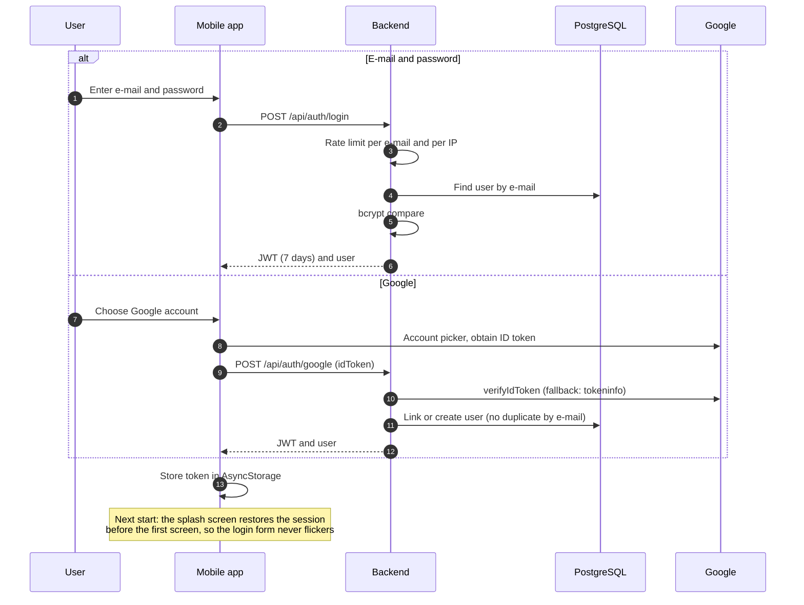
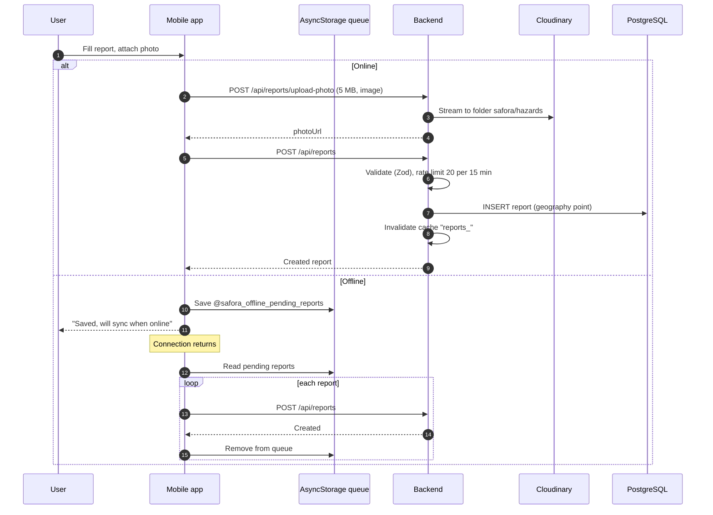
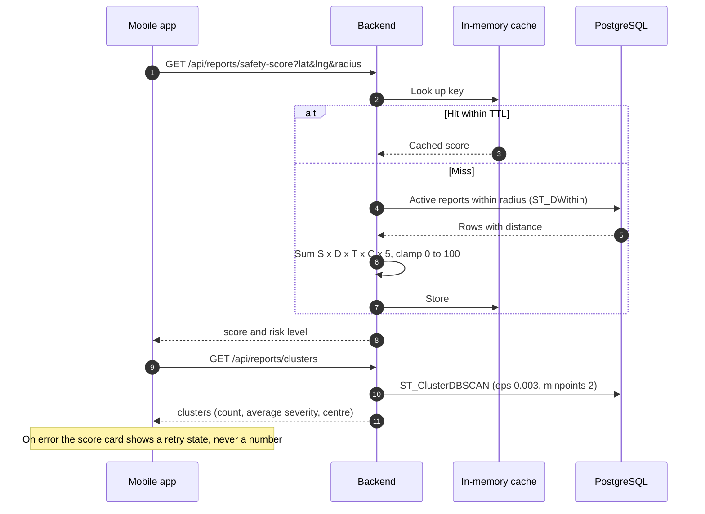
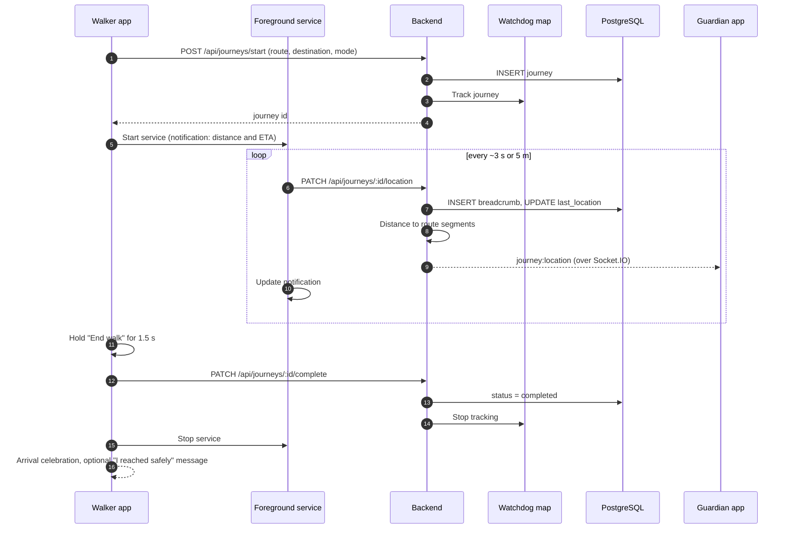
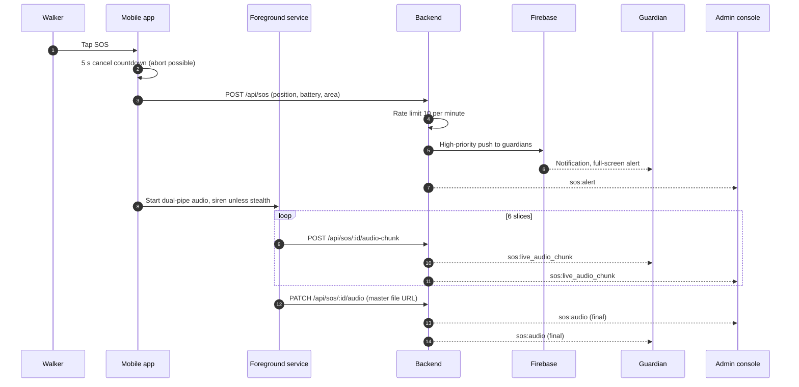
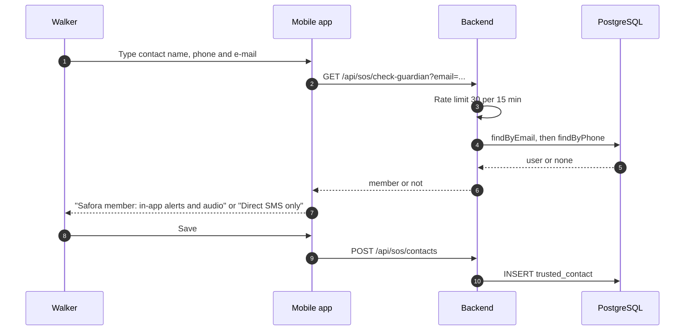
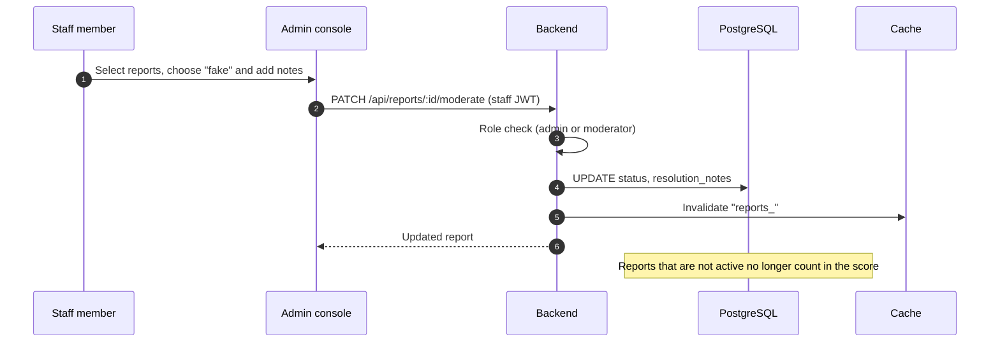
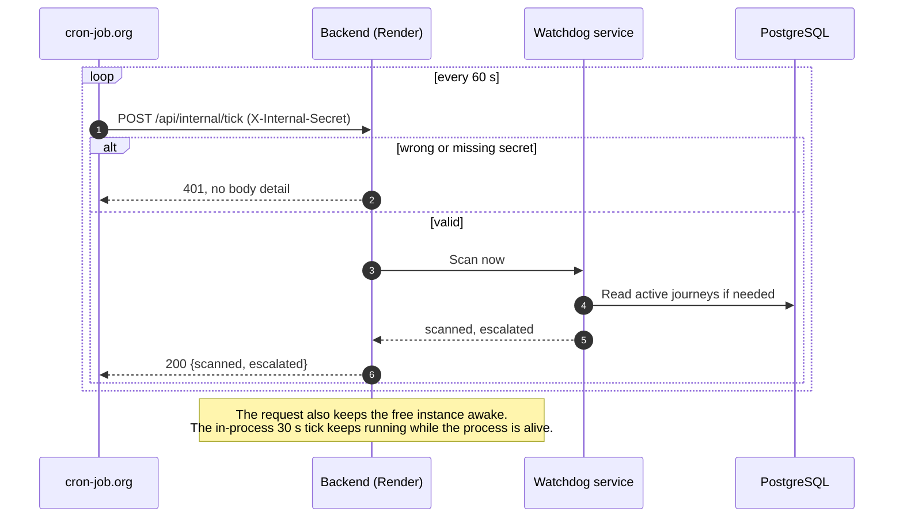

# Sequence Diagrams

| | |
|---|---|
| **Version** | V1 (as built) |
| **Purpose** | The main runtime interactions, step by step. The Safe Walk and SOS audio flows are also shown in [Architecture](./architecture.md) and [Dual-pipe audio](./dual-pipe-audio-streaming.md) |

## 1. Sign-In and Session Restore

## 2. Hazard Report with Offline Queue

## 3. Safety Score and Heat Map Request

## 4. Safe Walk from Start to Completion

## 5. SOS: Alert, Live Audio and Master Upload

## 6. Guardian Contact Check

## 7. Hazard Moderation

## 8. Watchdog Trigger by the External Scheduler

