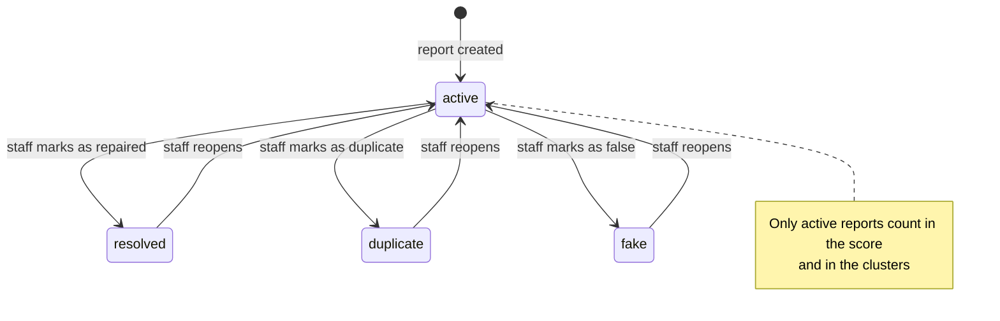
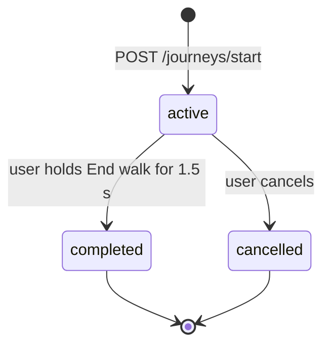
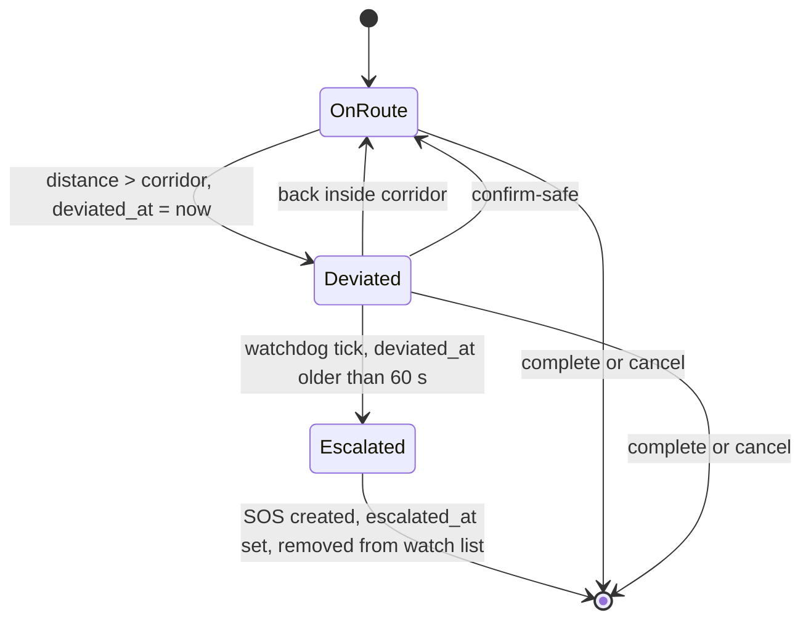
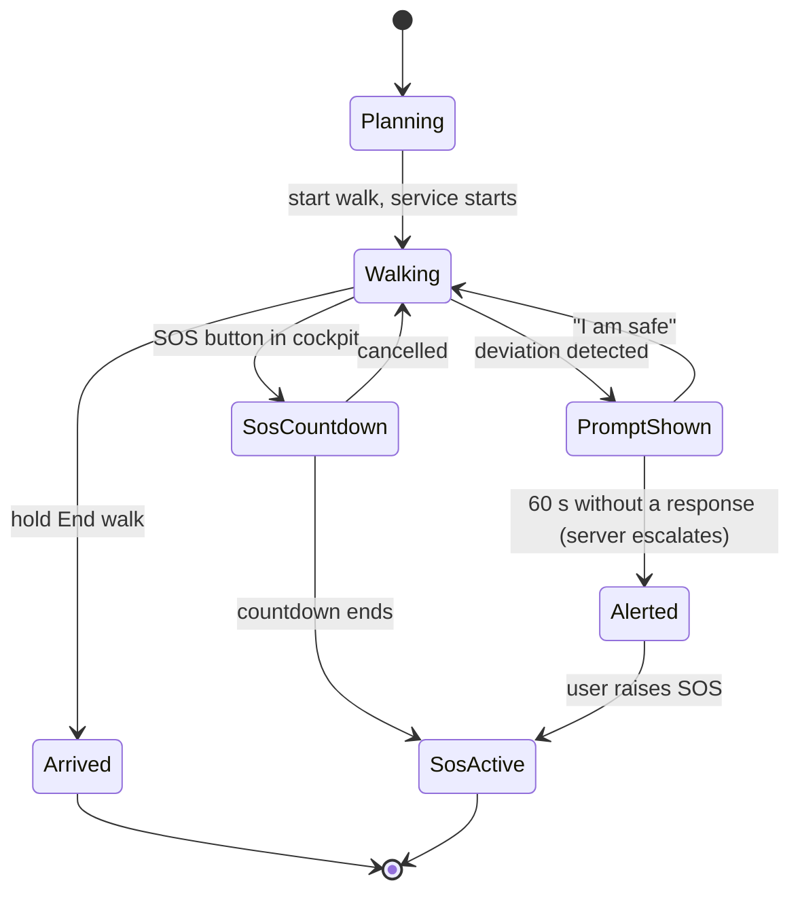
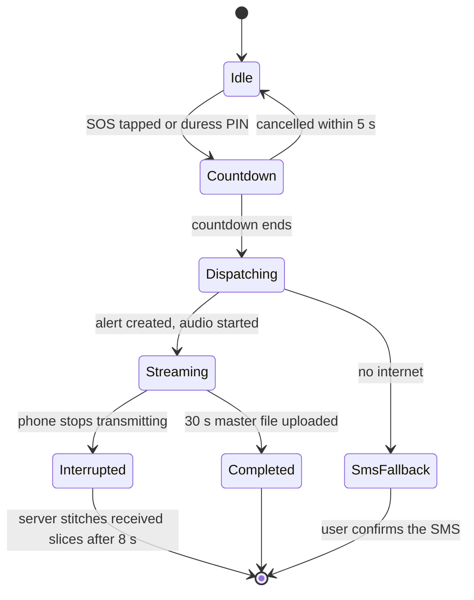
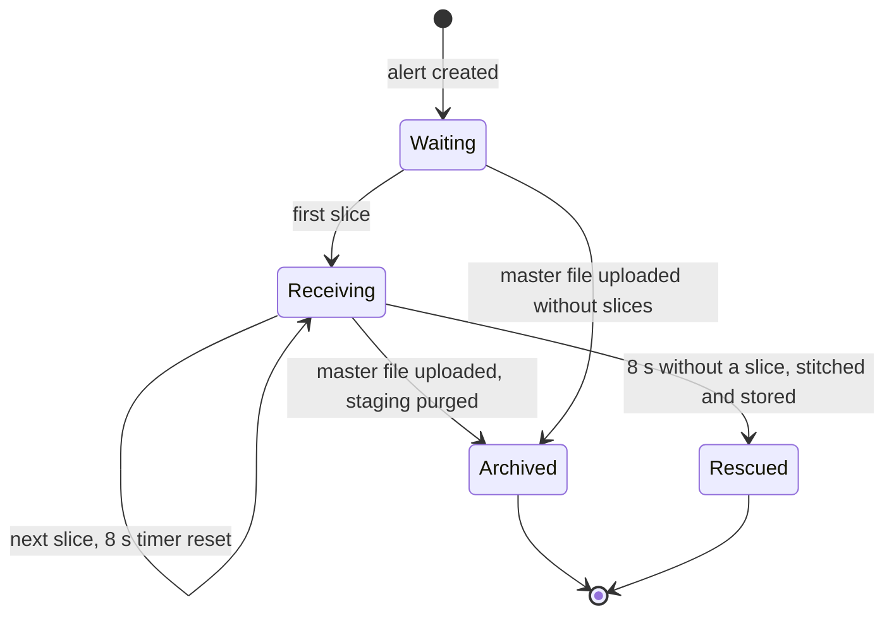
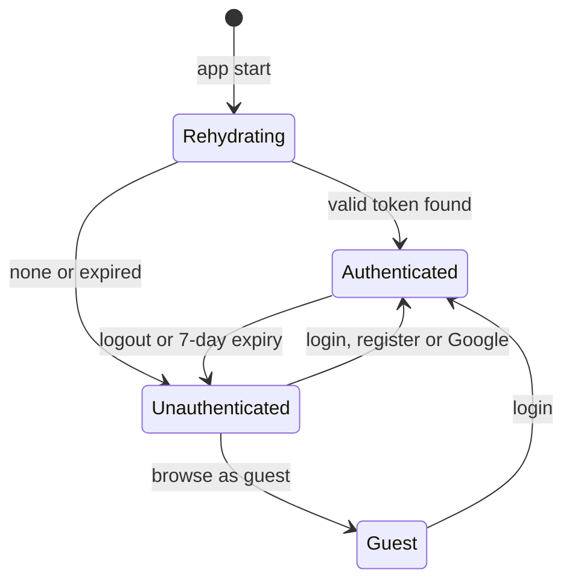
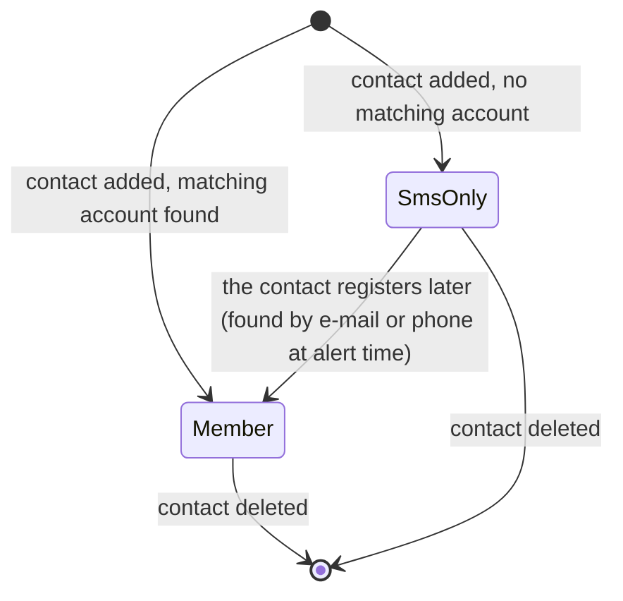

# State Machines

| | |
|---|---|
| **Version** | V1 (as built) |
| **Purpose** | The life cycle of the main objects and of the interface during emergencies |

## 1. Hazard Report

Confirmations increase `confirmations_count` while the report is active (capped at five in the score).

## 2. Journey (Safe Walk)

The deviation state is stored as the timestamps `deviated_at` and `escalated_at` on an active journey (see section 3).

## 3. Deviation and Escalation (per active journey)

## 4. Walker Screen During a Walk

## 5. SOS on the Phone

## 6. SOS Audio on the Server (per alert)

## 7. Session

## 8. Trusted Contact (V1)

V1 has no acceptance step. The verified handshake (`pending`, `verified`, `revoked`) is a V2 item described in [`../v2/safety-and-tracking.md`](../v2/safety-and-tracking.md) §1.
