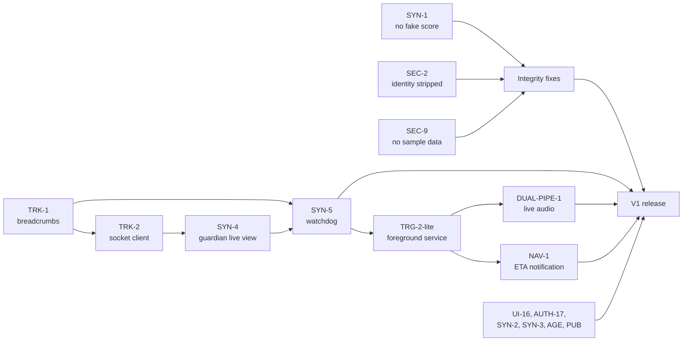

# V1 Delivery Record

| | |
|---|---|
| **Version** | V1 (complete) |
| **Purpose** | Record of every V1 work item: what was changed, where, and how it was verified |
| **Status** | All items delivered and verified |

This page started as the V1 task list. Now that V1 is complete it serves as the delivery record. Work item identifiers (SYN, SEC, TRK, TRG, NAV, AGE, PUB, UI, AUTH) are used in commit messages and in the V2 documents.

## 1. Summary

| Group | Items | Status |
|---|---|---|
| Must-do | SYN-1, SEC-2, SEC-9, TRK-1, TRK-2, SYN-4, SYN-5 | Delivered |
| Should-do | SYN-2, SEC-4, AGE-lite, PUB-1-lite | Delivered |
| Added 22 Sep 2026 (strengthen the core objective) | TRG-2-lite, TRG-6-lite and DUAL-PIPE-1, NAV-1 | Delivered |
| Added during delivery | UI-16, AUTH-17 and MAP-PERF | Delivered |
| Nice-to-have | SYN-3 | Delivered |



The items TRK-1, TRK-2, SYN-4, SYN-5 and TRG-2-lite together implement the objective "a Safe Walk alerts a guardian". They were never optional, and TRG-2-lite is what keeps them reliable once the screen is locked.

## 2. Repository Map

```text
apps/backend/src/
  routes/         reportRoutes.ts, journeyRoutes.ts, sosRoutes.ts, authRoutes.ts, internalRoutes.ts, ...
  services/       reportService.ts, journeyService.ts, watchdogService.ts, audioStitcherService.ts, sosAudioService.ts, firebaseService.ts
  repositories/   reportRepository.ts, journeyRepository.ts, sosRepository.ts, userRepository.ts
  middleware/     rateLimiter.ts, auth guards
  sockets/        journeySocket.ts
apps/mobile/src/
  screens/        HomeScreen, MapScreen, SafeWalkScreen, SettingsScreen, ProfileScreen, TermsScreen
  components/     ReportHazardModal, OpenMapView, GuardianSosLiveModal, ...
  services/       reportService, socketService, audioRecorderService, sirenService, routingService, locationService
apps/mobile/android/.../com/mobile/   SafeWalkService.kt, SafeWalkServiceModule.kt
apps/frontend/src/
  pages/          Dashboard, SafeWalks, Hazards, SosAlerts, Users, Analytics, Diagnostics, Settings, Login
  context/        SocketContext.tsx
packages/shared-types/
```

## 3. Integrity and Security Fixes

### SYN-1 – Remove the fake safety-score fallback
- **Problem.** When the score request failed, the app showed an invented value ("84, safe"). A fabricated safety number is the opposite of what a safety application should show.
- **Change.** The fallback object was deleted. The Home score card has `loading`, `error` (with retry) and `success` states.
- **Files.** `HomeScreen.tsx`, `reportService.ts`.
- **Verification.** Airplane mode shows the retry state and no number; restoring connectivity and retrying loads the real score.

### SEC-2 – Strip reporter identity from public responses
- **Change.** Two representations: `PublicReportDto` (no `userId`, `reporterName`, e-mail or phone) and `StaffReportDto`. Public routes use the first; staff-guarded routes use the second. The SQL and the `reports.user_id` column are unchanged.
- **Files.** `reportRepository.ts`, `Report.ts` (mapping), `reportRoutes.ts`.
- **Verification.** `curl /api/reports` shows no identity fields; the staff route still includes them.

### SEC-9 – Remove the admin sample data
- **Change.** `getMockActiveJourneys` was deleted. The Safe Walks page shows an empty state when the API returns `[]` and a separate error state when the call fails.
- **Files.** `journeyService.ts` (admin), `SafeWalksPage.tsx`.
- **Verification.** With no active walk anywhere, the radar shows the empty state.

## 4. Safe Walk Core

### TRK-1 – Persist journey breadcrumbs
`updateLocation` now inserts a breadcrumb, updates `last_location` and `last_seen_at`, runs the corridor check and sets `deviated_at` when needed. Files: `journeyService.ts`, `journeyRepository.ts`, and the migration in [`database.md`](./database.md). Verified by querying `journey_breadcrumbs` after a test walk.

### TRK-2 – Mobile Socket.IO client
`socketService.ts` connects after login with the JWT, joins the journey room and exposes `onJourneyLocation`. Location updates continue over REST when the socket drops, so tracking never depends on the socket. Verified with two devices.

### SYN-4 – Live location visible to a guardian
A guardian who is also a Safora user sees a map with the walker's marker, name and last-updated time (`GuardianLiveScreen`, reusing `OpenMapView`). *Simplification:* V1 has no invitation and acceptance step. This is weaker than the V2 handshake and is stated as a known limitation.

### SYN-5 – Server-side deviation watchdog
`watchdogService.ts` holds an in-memory map of active journeys and runs a 30-second tick. A deviation older than 60 seconds without `confirm-safe` creates an alert with `source = 'watchdog'` through the existing SOS service, pushes to guardians and sets `escalated_at`. `POST /api/journeys/:id/confirm-safe` clears the deviation. `POST /api/internal/tick` (shared-secret header) runs a scan on demand so an external scheduler can keep the free instance awake. Verified: the alert appears about 60 seconds after the deviation and does not appear when the walker confirms safety first.

## 5. Mobile Platform Work

### TRG-2-lite – Foreground service
`SafeWalkService.kt` keeps location updates flowing with the screen locked and shows a persistent notification. It is started from `SafeWalkScreen` through the `SafeWalkServiceModule` bridge and declared with `FOREGROUND_SERVICE_LOCATION` and microphone types in `AndroidManifest.xml`. Verified: breadcrumb timestamps stay continuous after locking the screen.

### TRG-6-lite and DUAL-PIPE-1 – Dual-pipe SOS audio
Live 5-second slices, a lossless master file and a server rescue watchdog. See [Dual-pipe audio](./dual-pipe-audio-streaming.md). Verified by `audioStitcher.test.ts` and the end-to-end scenarios T15 to T17.

### NAV-1 – Distance and ETA notification
The foreground notification shows the real route distance and walking ETA (for example "4.1 km, 51 min remaining"), updated through `updateRouteProgress(distanceKm, etaMin)` so that it matches the cockpit HUD. Verified with mock locations.

### SYN-2 – Heat map
`MapScreen` calls `/api/reports/clusters` and draws a circle per cluster (radius by count, colour by average severity). The Home "Live heat map" card now opens this view.

### SYN-3 – Photo picker
Camera and gallery picker in `ReportHazardModal.tsx` uploading through `POST /api/reports/upload-photo`.

## 6. Accounts and Compliance

| Item | Delivered |
|---|---|
| **AGE-lite** | One screen after registration with an age field and a note for users under 18; stored through `PATCH /api/auth/profile` as `age` and `ageNoticeAck` |
| **PUB-1-lite** | Plain-language terms and privacy screen (`TermsScreen.tsx`) that records `termsAcceptedAt`. It has **not** been legally reviewed; the V2 compliance document describes the real version for a public release |
| **SEC-4** | Overclaiming copy removed (for example claims of "dispatching to police" or "256-bit encrypted coordinates"). A persistent note states that Safora does not replace calling 112 |
| **AUTH-17** | Google Sign-In with account linking and a `tokeninfo` fallback; verified by the eight cases of checklist section 17 |

## 7. Added During Delivery

### UI-16 – Interface modernisation, admin ergonomics and unified tests
- Five-phase mobile interface upgrade (see [Mobile features](./mobile-app-features.md#9-interface-modernisation-five-phases-completed)).
- Admin command palette, shortcut manual, mute switch, failover banner, evidence lightbox and range selection (see [Admin console](./admin-panel.md)).
- One command, `npm test`, runs all 15 suites and 104 tests.

### MAP-PERF and cockpit SOS
Map canvas rendering fixes (`invalidateSize(false)` at staggered intervals, a resize observer, no 3D tilt), an in-cockpit SOS button next to "End walk", and an auto-fitting hold-to-confirm label.

## 8. Effort

The original plan estimated about 34 focused days after the three foreground-service items were added on 22 September 2026, against 18 to 20 days originally budgeted. The target therefore moved from the personal mid-November buffer to the end-November college deadline. V1 was completed within that deadline.

## 9. Delivery Rules Followed

- The specific test for each item was run before it was closed.
- Each item has a line in the project report: what it does, why it was needed and any known limitation.
- Commit messages reference the item identifier, for example `SYN-1: remove fake safety score fallback`.
