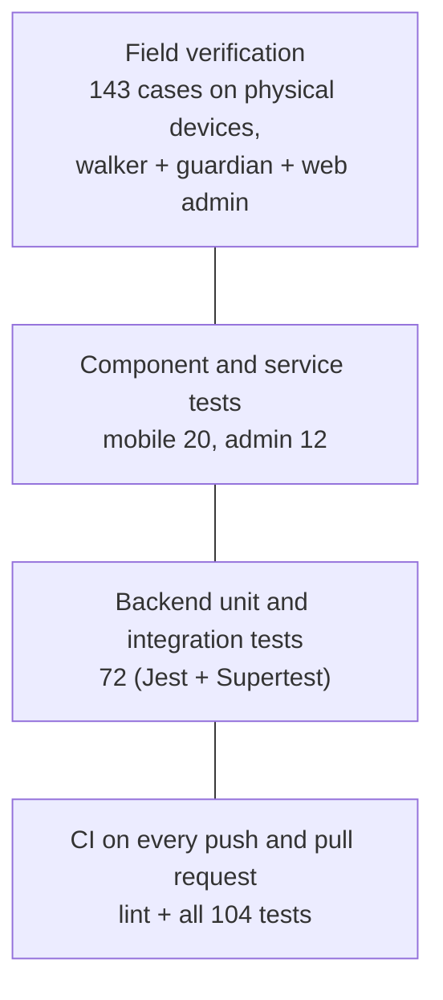

# Testing and Submission Readiness

| | |
|---|---|
| **Version** | V1 (complete) |
| **Automated tests** | 104 tests in 15 suites, all passing |
| **Field tests** | 143 cases in 18 areas, all passing ([checklist](../v1_manual_testing_checklist.md)) |

## 1. Strategy

Testing is scoped to what a demonstration and a viva expose: the core user journeys, the safety-critical flows, and the failure cases that would damage trust. Wider device coverage, long-duration battery behaviour and load testing are V2 activities (`docs/v2/testing-and-beta.md`).



## 2. Automated Test Suite

Run everything from the repository root:

```bash
npm test                 # all 15 suites, 104 tests
npm run test:backend     # 8 suites, 72 tests  (Jest + Supertest)
npm run test:frontend    # 2 suites, 12 tests  (Vitest + Happy-DOM)
npm run test:mobile      # 5 suites, 20 tests  (Jest + React Test Renderer)
```

| Workspace | Test file | Tests | Scope |
|---|---|---:|---|
| Backend | `sosGuards.test.ts` | 19 | Citizen and admin roles, audio attachment ownership, upload limits, staff-only access |
| Backend | `safetyDecay.test.ts` | 14 | Time decay, distance falloff, confirmation cap, floor |
| Backend | `authGuards.test.ts` | 10 | JWT and role guards |
| Backend | `journeyOwnership.test.ts` | 8 | Segment distance, corridor deviation, ownership, staff override |
| Backend | `rateLimiter.test.ts` | 7 | Window decay, IP isolation, per-user limits, login throttling |
| Backend | `audioStitcher.test.ts` | 6 | Five-second assembly, WAV header, 8 s rescue upload |
| Backend | `googleAuth.test.ts` | 6 | Google ID-token verification and account linking |
| Backend | `seedGuard.test.ts` | 2 | Blocks re-seeding when active reports exist |
| Admin | `cadComponents.test.tsx` | 6 | Command palette, shortcut manual, offline-failover banner |
| Admin | `uiElements.test.tsx` | 6 | Badges, stat cards, modals |
| Mobile | `phase2And3Components.test.tsx` | 7 | Search capsule with score ring, filter chips, safety drawer, walk cockpit, hold-to-confirm, route sheet |
| Mobile | `phase4Components.test.tsx` | 5 | SOS abort overlay, audio waveform, 60 s deviation countdown |
| Mobile | `phase5Components.test.tsx` | 4 | Calculator decoy with duress PIN, fake call, arrival screen |
| Mobile | `services.test.ts` | 3 | Mobile service-layer functions |
| Mobile | `App.test.tsx` | 1 | Root mount, navigation tree, providers |
| **Total** | **15 files** | **104** | |

## 3. Field Test Checklist

The full checklist is [`v1_manual_testing_checklist.md`](../v1_manual_testing_checklist.md). It was executed on physical Android devices (walker device A and guardian device B), the production web admin and the Render deployment.

| # | Area | Cases |
|---:|---|---:|
| 0 | Infrastructure, scheduler and database deployment | 5 |
| 1 | App launch, onboarding and consent | 10 |
| 2 | Authentication, guest mode and sessions | 7 |
| 3 | Profile and settings | 7 |
| 4 | Home radar, safety score and quick tools | 10 |
| 5 | Hazard reporting, camera and geocoding | 10 |
| 6 | Community map, heat map and moderation | 9 |
| 7 | Safe Walk – walker experience | 9 |
| 8 | Safe Walk – guardian live escort | 9 |
| 9 | Deviation escalation and watchdog | 6 |
| 10 | SOS dispatch and ambient audio | 10 |
| 11 | Decoy suite and tactical tools | 5 |
| 12 | Web admin: portal authentication | 6 |
| 13 | Web admin: live radar and moderation | 12 |
| 14 | Web admin: SOS queue, users and analytics | 8 |
| 15 | Cold GPS, network drops and battery | 5 |
| 16 | Production upgrades verification | 7 |
| 17 | Google Sign-In and OAuth | 8 |
| | **Total** | **143** |

## 4. Core Scenarios

| # | Check | Purpose | Setup |
|---|---|---|---|
| T1 | Register, accept terms, report a hazard, see it on the map and heat map, watch the score change | Main demonstration path | One phone |
| T2 | Switch on airplane mode during use | The score card must show an honest retry state, never an invented value | One phone |
| T3 | Start a Safe Walk and leave the route | The server-side alert fires about 60 seconds after the deviation | One phone and mock GPS |
| T4 | Guardian device receives live location and the deviation alert | The promise of the third synopsis objective | Two devices |
| T5 | Confirm a report from a second account; try to confirm your own | Confirmation rules | Two accounts |
| T6 | Open the admin radar with no active walks | No sample data is shown | Browser |
| T7 | Photo report end to end | Evidence claim | One phone |
| T8 | Walkthrough with someone who has not seen the app | Finds confusing screens | 15–20 minutes |
| T9 | `GET /api/reports` without a token | No `userId`, e-mail or phone in the response | curl |
| T10 | Lock the screen during a walk for five minutes or more | Breadcrumb timestamps stay continuous | One phone |
| T11 | SOS during an active walk with the screen locked | Audio recording starts and reaches the alert | One phone |
| T12 | SOS with no active walk and a locked screen | The alert is still sent; audio may be missing but nothing fails silently | One phone |
| T13 | Notification during a walk | Distance and ETA update; cannot be swiped away | One phone |
| T14 | Force-stop the app during a walk | Documents that the foreground service does not survive a force stop; the server watchdog still escalates on its own timeline | One phone |
| T15 | Live audio chunks reach the admin console in order | Web Audio queue and `LIVE STREAMING CHUNK #N/6` badge | Phone and browser |
| T15-B | Guardian HUD appears instantly, vibrates, streams slices and switches to the master file | Guardian experience | Two phones |
| T16 | Kill the app at about 12 seconds | Server stitches slices 1 and 2 and stores `interrupted_stitched.wav` | Phone and admin |
| T17 | Let the 30-second recording finish | Master file uploaded, watchdog disarmed, staging purged | Phone and admin |
| T18 | Five-phase interface modernisation | Capsule, score ring, one-handed zoom, corridor halo, hold-to-confirm, abort overlay, duress calculator, fake call | Mobile app |
| T19 | Admin dispatcher tools | Command palette, shortcuts, mute, failover banner, photo lightbox, range selection | Web admin |

**T14** is worth stating in the report: a locked screen and a force-stopped app are different failure modes. The foreground service protects only against the first. The server-side watchdog catches the second, on its own slower timeline. **T16** shows resilience against destruction of the phone during an emergency recording.

### 4.1 T3 – deviation alert on one device

1. Start a Safe Walk with a real destination so that a route polyline exists.
2. Walk off the route, or use Android's mock-location developer option with a location simulator.
3. Do not touch the "Are you OK?" prompt.
4. Watch the admin SOS queue or a guardian device. An alert should appear about 60 seconds after the deviation was recorded, not immediately and not never.
5. Repeat, but tap "I am safe" before 60 seconds. No alert must fire.

### 4.2 T4 – guardian view on two devices

1. Device A: the walker. Add device B's account as a trusted contact.
2. Device B: signed in as the contact with the app open on the live guardian screen.
3. Device A: start a Safe Walk. The marker on device B moves with device A.
4. Cause a deviation on device A as in T3. Device B receives the push and in-app alert.
5. If no second phone is available, two emulators on one machine are an acceptable fallback.

## 5. Backend Spot Checks

```bash
# Public reports carry no reporter identity
curl -s https://<backend>/api/reports | jq '.reports[0]'

# The internal tick endpoint rejects a wrong secret (expect 401)
curl -s -X POST https://<backend>/api/internal/tick \
     -H "X-Internal-Secret: wrong" -o /dev/null -w "%{http_code}\n"

# ... and accepts the real one (expect {"scanned":N,"escalated":N})
curl -s -X POST https://<backend>/api/internal/tick \
     -H "X-Internal-Secret: <secret>"
```

## 6. Release Checklist

- [x] All must-do items in [`tasks.md`](./tasks.md) pass their test.
- [x] Release APK built, signed, installed fresh (not over a development build) and re-run through T1–T4.
- [x] `INTERNAL_TICK_SECRET` set on Render and the external scheduler firing (verified in the Render logs).
- [x] No secrets in the APK (`strings` check; the MapTiler key is server-side only).
- [x] Automated suite green: 15 suites, 104 tests.
- [x] Field checklist complete: 143 of 143.

## 7. Demonstration and Viva Preparation

**Script.** Register, report a hazard, show it on the heat map, start a Safe Walk with a second device as guardian, deviate, show the alert arriving on the guardian and in the admin queue, trigger SOS and play the live audio on the admin console.

**Know the limitations.** The three route modes show the same road geometry. The application is Android only. The guardian model is simplified. The free-tier backend can sleep. State these openly; it reads as competence.

**Bring.** `docs/v1/tasks.md`, `docs/v2/roadmap.md` and `docs/v3/README.md` as evidence of a real plan, and the deviation table in [`tech-stack.md`](./tech-stack.md#8-differences-from-the-original-synopsis) if asked why the technologies differ from the synopsis.
