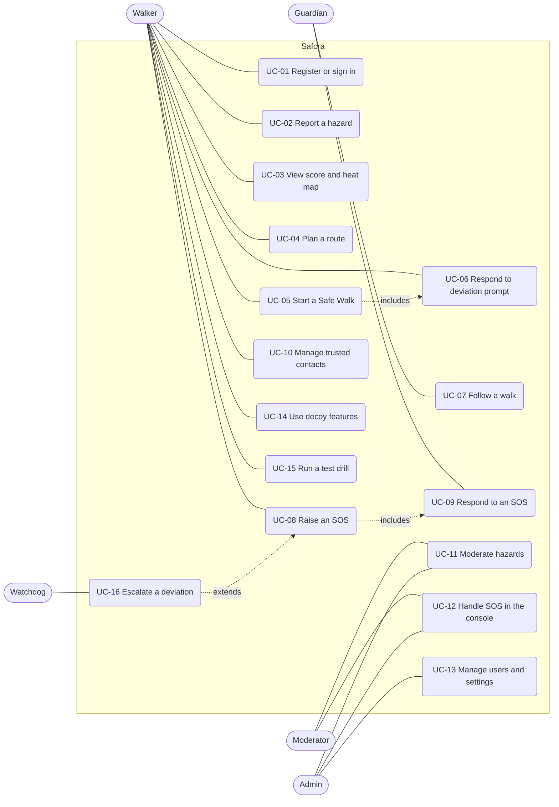

# Use Cases

| | |
|---|---|
| **Version** | V1 (as built) |
| **Related** | [SRS](./srs.md) · [Sequence diagrams](./sequence-diagrams.md) · [Architecture](./architecture.md) |

## 1. Actors

| Actor | Description |
|---|---|
| **Walker** | A signed-in citizen who reports hazards, walks and raises SOS alerts |
| **Guardian** | A trusted contact of a walker, who receives alerts and watches walks |
| **Moderator** | Staff member who moderates reports and handles alerts |
| **Admin** | Staff member who additionally manages users, roles and settings |
| **Watchdog** | The server-side process that escalates unconfirmed deviations |
| **External services** | Firebase, Cloudinary, routing and geocoding providers, Google |

## 2. Use Case Diagram

## 3. Use Case Specifications

### UC-01 Register or sign in
| | |
|---|---|
| **Actors** | Walker |
| **Goal** | Obtain a session |
| **Preconditions** | The app is installed. For Google sign-in, a Google account is on the phone |
| **Main flow** | 1. The user opens the app (splash, onboarding on first launch). 2. The user registers or signs in with e-mail and password, or chooses Google. 3. The server validates the input and issues a JWT. 4. On first registration the terms and age notice appears and is acknowledged. 5. The home screen opens |
| **Alternatives** | A. The user chooses guest mode and can only browse. B. Too many failed attempts: the request is throttled. C. Google token verification fails: the server tries the `tokeninfo` fallback and otherwise rejects it |
| **Postconditions** | A valid session is stored and restored on the next start |
| **Requirements** | FR-AUTH-1 to FR-AUTH-8 |

### UC-02 Report a hazard
| | |
|---|---|
| **Actors** | Walker |
| **Preconditions** | Signed in; location available |
| **Main flow** | 1. The user opens the report form, picks the position. 2. Chooses category and severity and writes a description. 3. Optionally takes or picks a photo. 4. Submits. 5. The server validates, stores the report, invalidates the cache and returns it |
| **Alternatives** | A. Offline: the report is queued in local storage and submitted later. B. Rate limit exceeded: the user is told to wait. C. Photo larger than 5 MB: rejected |
| **Postconditions** | The report is visible on the map and counts towards the score |
| **Requirements** | FR-HAZ-1 to FR-HAZ-4, FR-HAZ-8 |

### UC-03 View the safety score and heat map
| | |
|---|---|
| **Actors** | Walker, Guest |
| **Main flow** | 1. The user opens Home or the map. 2. The app requests the score and the clusters. 3. The server answers from the cache or calculates them. 4. The score card and the heat map are shown |
| **Alternatives** | The request fails: a retry state is shown instead of a number |
| **Requirements** | FR-SCORE-1 to FR-SCORE-6 |

### UC-04 Plan a route
| | |
|---|---|
| **Actors** | Walker |
| **Main flow** | 1. The user searches a destination. 2. The app shows a route preview with times for walk, two-wheeler and car. 3. The user may start a Safe Walk from it |
| **Alternatives** | The search provider fails: the fallback provider is used |
| **Requirements** | FR-ROUTE-1, FR-ROUTE-2 |

### UC-05 Start a Safe Walk
| | |
|---|---|
| **Actors** | Walker, Guardian |
| **Preconditions** | Signed in; at least one trusted contact is recommended; location permission granted |
| **Main flow** | 1. The user starts a walk from the route preview. 2. The server creates the journey and registers it with the watchdog. 3. The foreground service starts with a persistent notification. 4. The app sends positions about every 3 seconds. 5. Guardians who are Safora users see the walker's marker move. 6. The user ends the walk with a 1.5-second hold or the walk is cancelled |
| **Alternatives** | A. The user leaves the corridor (UC-06). B. The socket drops: REST updates continue. C. Battery optimisation blocks the service: the app shows a reminder with a one-tap fix |
| **Postconditions** | The journey is `completed` or `cancelled` and removed from the watchdog |
| **Requirements** | FR-WALK-1 to FR-WALK-4, FR-WALK-9, FR-WALK-10 |

### UC-06 Respond to the deviation prompt
| | |
|---|---|
| **Actors** | Walker |
| **Trigger** | The server finds the position outside the corridor |
| **Main flow** | 1. The app shows a 60-second countdown with haptic feedback. 2. The walker taps "I am safe". 3. The app calls `confirm-safe`. 4. The server clears the deviation |
| **Alternatives** | The walker does not respond: UC-16 |
| **Requirements** | FR-WALK-5, FR-WALK-6 |

### UC-07 Follow a walk (guardian)
| | |
|---|---|
| **Actors** | Guardian |
| **Preconditions** | The guardian has a Safora account and is a trusted contact of the walker |
| **Main flow** | 1. The guardian opens the live view. 2. The app joins the journey room. 3. The marker, speed and last update time are shown |
| **Alternatives** | The guardian is not signed in: no live view; they would receive an alert if an escalation occurs and they are in the contact list |
| **Requirements** | FR-WALK-3 |

### UC-08 Raise an SOS
| | |
|---|---|
| **Actors** | Walker |
| **Main flow** | 1. The user taps SOS (or enters the duress PIN in the calculator decoy). 2. A 5-second cancel countdown runs. 3. The alert is created with position, battery and area. 4. Push notifications go to the guardians; the staff queue updates. 5. The dual-pipe audio starts. 6. The siren sounds unless stealth mode is chosen. 7. At 30 seconds the master file is uploaded |
| **Alternatives** | A. The user cancels during the countdown: nothing is sent. B. No internet: a pre-filled SMS is offered and the user confirms the send. C. The phone stops transmitting: the server stitches the received slices after 8 seconds. D. SOS with no active walk and a locked screen: the alert is sent, audio may not start |
| **Postconditions** | An alert and its evidence exist for staff and guardians |
| **Requirements** | FR-SOS-1 to FR-SOS-10, FR-SOS-15 |

### UC-09 Respond to an SOS (guardian)
| | |
|---|---|
| **Actors** | Guardian |
| **Main flow** | 1. A push notification arrives. 2. The guardian app opens a full-screen alert with vibration. 3. The guardian hears the live audio slices, opens the position on a map, calls the walker or calls 112 |
| **Postconditions** | The alert appears in the Safety Alerts Centre with the audio |
| **Requirements** | FR-SOS-13, FR-SOS-14 |

### UC-10 Manage trusted contacts
| | |
|---|---|
| **Actors** | Walker |
| **Main flow** | 1. The user adds a contact with name, phone and e-mail. 2. The app checks the e-mail against the database. 3. It shows "Safora member" or "Direct SMS only". 4. The user can edit or delete the contact |
| **Requirements** | FR-SOS-11 |

### UC-11 Moderate hazards
| | |
|---|---|
| **Actors** | Moderator, Admin |
| **Main flow** | 1. Staff open the hazards page and filter by status or category. 2. They inspect photos and details. 3. They mark reports active, resolved, duplicate or fake, singly or in batches, and add notes |
| **Postconditions** | The cache is invalidated and the score changes |
| **Requirements** | FR-HAZ-7, FR-ADM-4 |

### UC-12 Handle an SOS in the console
| | |
|---|---|
| **Actors** | Moderator, Admin |
| **Main flow** | 1. A new alert appears with a chime and a sidebar badge. 2. Staff listen to the live slices as they arrive. 3. They open the map link or call the walker. 4. They update the status and, when finished, review the archived master recording |
| **Requirements** | FR-ADM-3, FR-ADM-5, FR-ADM-9 |

### UC-13 Manage users and settings
| | |
|---|---|
| **Actors** | Admin |
| **Main flow** | 1. The admin opens Users and changes a role or suspends an account. 2. On Settings the admin changes the corridor threshold. 3. On Diagnostics the admin tests each external service |
| **Requirements** | FR-ADM-6 to FR-ADM-8 |

### UC-14 Use decoy features
| | |
|---|---|
| **Actors** | Walker |
| **Main flow** | 1. The user opens the calculator decoy. 2. Normal calculations work. 3. Entering the duress PIN followed by `=` silently starts an SOS and a haptic pulse. 4. Alternatively the user starts the simulated incoming call |
| **Requirements** | FR-SOS-15 |

### UC-15 Run a test drill
| | |
|---|---|
| **Actors** | Walker, Guardian |
| **Main flow** | 1. The walker taps Test SOS. 2. The guardian receives a clearly marked test alert. 3. Both check that delivery works |
| **Requirements** | FR-SOS-12 |

### UC-16 Escalate a deviation (watchdog)
| | |
|---|---|
| **Actors** | Watchdog |
| **Trigger** | A tick finds a deviation older than 60 seconds with no confirmation |
| **Main flow** | 1. The watchdog creates an SOS alert with source `watchdog` at the last known position. 2. It sets `escalated_at`. 3. It sends push notifications to the guardians. 4. It removes the journey from the watch list |
| **Postconditions** | The alert appears in the staff queue and the guardians' alert centres. It is raised once per deviation |
| **Requirements** | FR-WALK-7, FR-WALK-8 |
