# Safora Documentation – Version 2 (Product)

> V2 builds on [`../v1/`](../v1/README.md), the completed college release. It is the roadmap for turning the submission build into a product that can be trusted and offered to the public.
>
> **Updated 22 September 2026 and October 2026:** the moderator role with an abuse-flag queue (SEC-10), an escalation ladder (TRK-11), a battery dead-man's switch (TRK-10), "walk with me" (TRK-12), scheduled walks (TRK-13), a chat duress code word (CHT-4), verified "safe stops" (MAP-7b), a reporter trust score (MAP-9c), duplicate detection (MAP-9d), a photo EXIF check (MAP-9e), vibration-pattern accessibility (LOC-5), a `parent-of` relationship (AGE-2), a forensic PDF dossier (ADM-4), a 112 ERSS and campus CAD connector (ADM-5), and weather and earthquake data (WX-1 to WX-3). **Dropped:** the `volunteer_responder` role and all institution-scoped features.

## What V2 Changes

V1 ships a deviation-only watchdog, a minimal guardian model without an accept step, no e-mail, no session hardening, no OpenFreeMap, no chat, and the existing MapTiler-based map and search. V2 replaces or extends every one of these.

```mermaid
flowchart LR
    V1["V1 (complete)<br/>deviation watchdog,<br/>simple guardians,<br/>live audio"] --> M1["M1 Trust fixes"]
    M1 --> M2["M2 Map quick wins"]
    M2 --> M3["M3 Server-side escalation<br/>and guardian handshake"]
    M3 --> CB(["Closed beta"])
    CB --> M4["M4 Accounts for the public"]
    M4 --> PB(["Public beta"])
    PB --> M5["M5 Routing and voice"]
    M5 --> M6["M6 No-unlock triggers"]
    M6 --> PV1(["Public v1"])
    PV1 --> M7["M7 Chat"]
    M7 --> M8["M8 Local fit and readiness"]
```

## Document Index

| Document | Contents |
|---|---|
| [`roadmap.md`](./roadmap.md) | Work items, capacity, milestones and gates, cut list, risks, open questions |
| [`architecture-decisions.md`](./architecture-decisions.md) | ADR-001 to ADR-018: every major technical decision and its reasoning |
| [`migration-plan.md`](./migration-plan.md) | How to move a running V1 system to V2 safely: data steps, switches, rollout and rollback |
| [`api.md`](./api.md) | Index of the endpoints and events introduced in V2 |
| [`database.md`](./database.md) | Index of the tables and columns introduced in V2, with a relationship diagram |
| [`safety-and-tracking.md`](./safety-and-tracking.md) | Guardians, alert fan-out, full watchdog, check-in timer, tracking link, on-device SMS, no-unlock triggers, staged chat, forensic PDF and CAD connector |
| [`map-routing-search.md`](./map-routing-search.md) | OpenFreeMap basemap, offline packs, search v2, per-mode routing, voice guidance, safest route, safe places, hazard alerts, trust score, duplicate detection |
| [`environmental-hazards.md`](./environmental-hazards.md) | Weather overlay (Open-Meteo), earthquake advisories (USGS), static seismic-zone weighting |
| [`accounts-email-local.md`](./accounts-email-local.md) | Brevo e-mail, session hardening, account deletion, age policy, Hindi, Uttarakhand content, admin operations, medical card, moderator role |
| [`security-privacy-compliance.md`](./security-privacy-compliance.md) | Threat model, data inventory, DPDP mapping (including children's data), anti-coercion rules, public-launch checklist |
| [`testing-and-beta.md`](./testing-and-beta.md) | Device matrix, scenario tests, CI gates, closed beta plan |
| [`references.md`](./references.md) | Every external source, `[R1]` to `[R72]`, and what is still to verify |

## Status Labels

✅ verified in code or review · 📄 documented only · 🔬 needs a test or check · 🗓 planned.

Sizes: **S** about 1.2 to 1.5 focused days · **M** about 4 to 5 · **L** about 9 to 12 · **XL** about 19 to 25.
