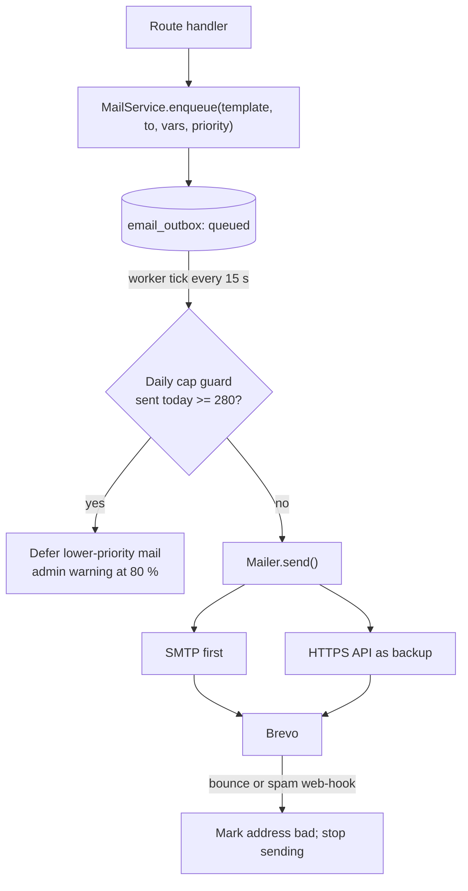
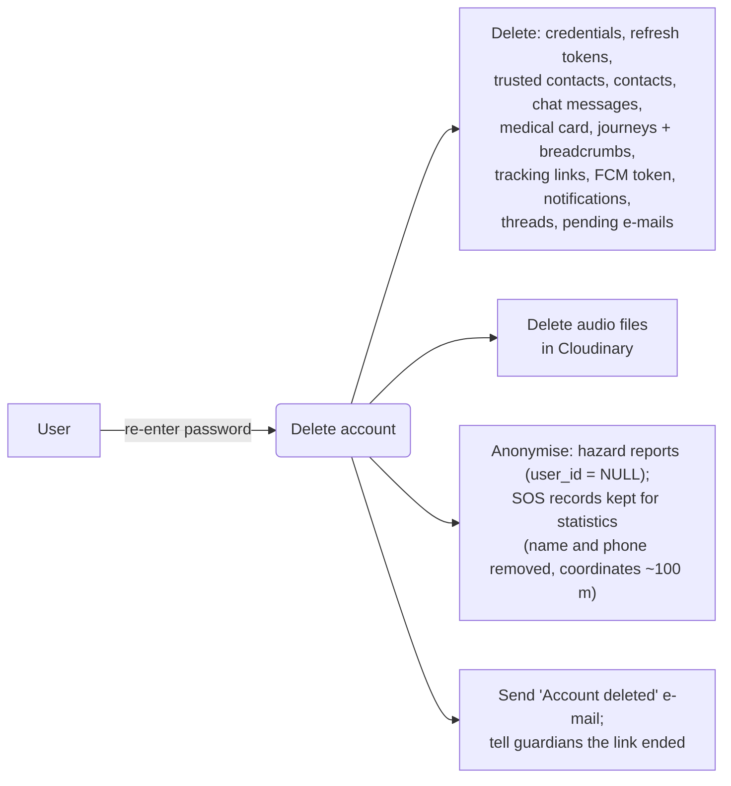
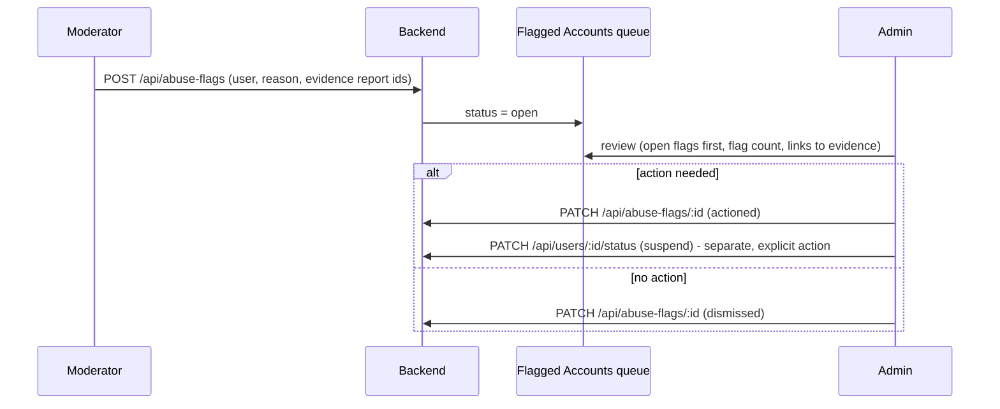

# Specification – Accounts, E-mail, Report Privacy, Language, Local Content, Admin and Roles

| | |
|---|---|
| **Version** | V2 – planned |
| **Covers** | SEC-2 to SEC-7, SEC-10, ACC-1 to ACC-4, AGE-1, AGE-2, MED-1, LOC-1 to LOC-5, ADM-1 to ADM-4 |
| **Status tags** | ✅ verified · 📄 documented only · 🔬 needs a test · 🗓 planned |
| **Updates** | 21 Sep 2026: SMTP confirmed working, no domain, display name on reports, age policy revised, medical card added. 22 Sep 2026: moderator role with an abuse-flag queue (SEC-10), `parent-of` relationship (AGE-2), vibration patterns (LOC-5) |

> **V1 state.** V1 already delivers SEC-2 in a stricter form (the public report omits the reporter), SEC-4 (copy corrections), SEC-9 and the age and terms screen. The rest of this specification is V2.

## 1. Transactional E-mail with Brevo (ACC-1 to ACC-4)

### Decision
Use Brevo through a **`Mailer` interface** with two implementations:

1. **`BrevoSmtpMailer`** (nodemailer) is the primary path. SMTP was tested on Render's free plan and works. (An earlier research source said that Render's free plan blocks outbound ports 25, 465 and 587 [R33]; the direct test overrides it. The working port is to be recorded, open question Q5.)
2. **`BrevoApiMailer`** (`POST https://api.brevo.com/v3/smtp/email`, header `api-key`) is the HTTPS backup if SMTP stops working after a change of host. The API key and the SMTP key are different credentials [R32].

A `ConsoleMailer` is used locally and in tests. Brevo's free plan allows 300 e-mails per day with full transactional access and no credit card [R32].

### Messages

| E-mail | Trigger | Content | Priority |
|---|---|---|:---:|
| **Welcome and verify** | Registration | Greeting, six-digit code (valid 10 minutes), what Safora is, "not a replacement for 112" | 1 |
| **Verification code (resend)** | The user taps resend (60-second cool-down) | Code | 1 |
| **Password reset** | Forgot password | Six-digit code (10 minutes), "ignore if this was not you" | 1 |
| **Password changed** | After a change or reset | Time, device hint, "if this was not you, reset now", a note that other sessions were signed out | 2 |
| **Guardian invitation** | The walker adds a contact with an e-mail | Who added you, what you will receive, accept link or QR, "I don't know this person" link | 2 |
| **Account deleted** | After deletion | Confirmation and what was removed | 3 |
| *Optional later:* Safe Walk summary, new-device sign-in | – | – | 4 |

E-mail is **never** part of SOS delivery, because it is slow and capped. SOS uses FCM push, on-device SMS and, later, the tracking link.

### Design



- **Templates are repository files** (`apps/backend/src/mail/templates/*.html|.txt`; English now, Hindi later) with `{{variables}}`, so wording is reviewed in pull requests and does not live in a dashboard.
- **Retries:** three attempts with exponential back-off; permanent failures (invalid address) are not retried.
- **Daily cap:** excess transactional mail is held in a retry queue of up to 1,000 by Brevo and beyond that is not delivered [R32]. The guard stops at 280 and defers lower-priority mail; an admin warning appears at 80 %.
- **Branding:** the free plan adds a small "Sent with Brevo" footer [R32], which is acceptable for the beta.

### Sender identity without a domain
No domain is planned for two years, so mail cannot be authenticated with the project's own DKIM and SPF records.

- Brevo sends from a **verified single sender address**. If that address is on a large free-mail provider with strict authentication rules (for example Gmail), Brevo may rewrite the sender to its own domain [R32]. Mail still goes out, but it looks less personal and is more likely to land in spam.
- **E-mail is therefore non-critical.** Codes are short and forgiving: a 10-minute life, resend after 60 seconds, and the app says "Check your spam folder".
- Use a plain, consistent subject ("Your Safora code: 482913"), no images, a short text alternative and the same sender every time. Never send marketing.
- If deliverability is poor in the beta, the cheapest fixes are a free student-pack domain [R43] or another transactional provider behind the same `Mailer` interface.

### Data model

```sql
ALTER TABLE users
  ADD COLUMN email_verified_at TIMESTAMPTZ,
  ADD COLUMN email_bounced_at TIMESTAMPTZ,
  ADD COLUMN token_version INTEGER NOT NULL DEFAULT 0,
  ADD COLUMN language VARCHAR(5) NOT NULL DEFAULT 'en';

CREATE TABLE otp_codes (
  id BIGSERIAL PRIMARY KEY, user_id INTEGER REFERENCES users(id) ON DELETE CASCADE,
  email VARCHAR(255) NOT NULL, purpose VARCHAR(20) NOT NULL,        -- verify_email|reset_password
  code_hash TEXT NOT NULL, attempts SMALLINT DEFAULT 0, expires_at TIMESTAMPTZ NOT NULL,
  used_at TIMESTAMPTZ, created_at TIMESTAMPTZ DEFAULT now()
);
CREATE INDEX ON otp_codes (email, purpose, created_at DESC);

CREATE TABLE email_outbox (
  id BIGSERIAL PRIMARY KEY, to_email VARCHAR(255) NOT NULL, template VARCHAR(40) NOT NULL,
  vars JSONB NOT NULL DEFAULT '{}', priority SMALLINT DEFAULT 2,
  status VARCHAR(12) DEFAULT 'queued',                              -- queued|sent|failed|skipped
  attempts SMALLINT DEFAULT 0, last_error TEXT, provider_id TEXT,
  scheduled_at TIMESTAMPTZ DEFAULT now(), sent_at TIMESTAMPTZ
);
```

Codes are stored **hashed** (HMAC-SHA-256 with a server secret). The `vars` of a code e-mail contain the code only until it is sent and are then cleared, so codes do not remain in the outbox.

### Endpoints

| Endpoint | Behaviour |
|---|---|
| `POST /api/auth/verify-email/request` (auth) | Sends a code; 60-second cool-down; 5 per hour per user |
| `POST /api/auth/verify-email/confirm` `{code}` (auth) | At most 5 attempts per code; sets `email_verified_at` |
| `POST /api/auth/forgot-password` `{email}` | **Always returns 202** with the same body whether or not the account exists; 3 per hour per e-mail, 10 per hour per IP |
| `POST /api/auth/reset-password` `{email, code, newPassword}` | Validates the code, sets the password, **increments `token_version`** (signs out all sessions) and sends "Password changed" |
| `POST /api/webhooks/brevo` | Shared-secret check; marks bounced and complained addresses |

### Rules
- Unverified users can use the app, but **cannot be added or matched as guardians and cannot receive guardian invitations**. This closes the alert-interception gap (`safety-and-tracking.md` §1).
- Never put codes in URLs or logs; redact `email_outbox.vars` in logs.
- Respond in the same time for existing and unknown addresses (do the hashing work either way).

### Mobile screens
`VerifyEmailScreen` (code entry and resend timer), `ForgotPasswordScreen`, `ResetPasswordScreen`, and a "Verify your e-mail" banner until done.

### Acceptance criteria
- Register, receive the e-mail within 60 seconds, enter the code: `email_verified_at` is set.
- Forgot-password for an unknown address returns the same response as for a known one.
- After a reset, the previous JWT no longer works.
- With 300 sends already used, a verification e-mail is queued, not lost, and an admin warning is visible.

---

## 2. Report Privacy and Confirmations (SEC-2, SEC-3)

### SEC-2 – what public report responses may show
In the original code, `reportRepository.findAll` and `nearby` joined `users`, and `ReportModel.fromRow` returned `userId` and `reporterName` on unauthenticated endpoints. **V1 removed the identity from public responses entirely** (see [`../v1/api.md`](../v1/api.md#3-hazard-reports--apireports)).

**V2 product option (decision Y4).** Public reports may show the reporter's **display name only**:

- Two DTOs: `PublicReportDto` and `StaffReportDto`.
- `PublicReportDto` carries `reporterName` (a **display name**) and nothing else about the person: **no `userId`, no e-mail, no phone and no profile link.** Removing `userId` stops anyone from listing all reports of one person.
- `StaffReportDto` adds `userId` and contact details for moderation only.
- A new profile field `display_name` (default: the first name) is what appears on reports.

**Two recommended safeguards (Q3):**
1. A **per-report toggle "Show my name / Report anonymously"**, remembered as a default in Settings.
2. **Forced anonymity for sensitive categories**: harassment, suspicious activity, isolated area at night, and anything a user marks "someone is involved". People who report a specific person can be found and targeted through their name, so in these categories the name is never shown publicly.

`reports.reporter_display` stores the name shown (or `NULL` for anonymous), so changing a profile name later does not rewrite old reports.

**Test.** An automated check that no public response contains `userId`, `user_id`, `email` or `phone`, and that `reporterName` is absent whenever the report is anonymous.

### SEC-3 – unique confirmations

```sql
CREATE TABLE report_confirmations (
  report_id INTEGER REFERENCES reports(id) ON DELETE CASCADE,
  user_id INTEGER REFERENCES users(id) ON DELETE CASCADE,
  vote VARCHAR(8) NOT NULL DEFAULT 'present',        -- present|cleared (map-routing-search.md §9)
  created_at TIMESTAMPTZ DEFAULT now(),
  PRIMARY KEY (report_id, user_id)
);
```

`confirmReport` receives `req.user.id`, rejects the reporter, uses `INSERT … ON CONFLICT DO NOTHING`, recomputes `confirmations_count` from the table and is limited to 30 per 15 minutes per user.

---

## 3. Sessions, Deletion and Duress PIN (SEC-5, SEC-6, SEC-7)

### SEC-5 – session hardening
V1 uses a 7-day JWT in plain AsyncStorage. V2 changes this:

- **Access token:** JWT HS256, **15 minutes**, containing `sub`, `role` and `tv` (token version).
- **Refresh token:** random 256-bit, **rotating**, valid 30 days, stored **hashed** in `refresh_tokens(id, user_id, family_id, token_hash, expires_at, revoked_at, replaced_by, created_at, user_agent)`. Re-use of an old refresh token revokes the whole family.
- Endpoints: `POST /auth/refresh`, `POST /auth/logout`, `POST /auth/logout-all`.
- `users.token_version` is checked on every request; a password change or reset increments it.
- Mobile: tokens in **Keychain or Keystore** (`react-native-keychain` is installed but unused); an Axios interceptor refreshes once on a 401 and retries.
- The Socket.IO handshake uses the current access token and reconnects after a refresh.

### SEC-6 – account deletion
`DELETE /api/auth/account` (re-enter the password) and **Profile → Delete account**.



A 7-day undo period is optional.

### SEC-7 – duress PIN
A per-user PIN of 4 to 6 digits, set in Settings and stored in the Keychain. Trivial values are rejected (`0000`, `1234`, `1111`, `9999`, repeated or sequential digits). The calculator triggers the silent SOS only for the exact PIN followed by `=` with no operator pressed. The V1 default `9999` is removed.

### SEC-4 – copy corrections (done in V1)

| Where | Was | Replaced with |
|---|---|---|
| `HomeScreen` | "Dispatches live coordinates to Family Guardians & Police 112" | "Sends live coordinates and audio to your guardians. Quick-dial 112 is one tap away." |
| `OnboardingScreen` | "256-bit encrypted coordinates" | "Encrypted (HTTPS) transmission" |
| SOS success and failure screens | Any mention that police are alerted | Removed |
| Onboarding and SOS screen | – | "Safora does not replace 112. Call 112 first in an emergency." |

---

## 4. Age Policy and Consent (AGE-1, AGE-2)

### Position
Safora is meant for everyone, and users above 12 may be added later. Many young people walk to school or tuition alone. **Under India's DPDP Rules, however, a user under 18 is a "child":** the service must obtain **verifiable consent from a parent or guardian before processing the child's data**, and tracking or behavioural monitoring of children is restricted [R53][R54]. The exemptions are narrow and listed by type of organisation (health care, schools, crèches, child transport) or purpose; a general safety application is not clearly inside them [R53][R54]. Safe Walk, live location and audio are exactly the kind of processing that matters. **This is a legal question that cannot be settled here** (see `security-privacy-compliance.md` §4 and PUB-4).

### Recommendation

| Stage | Policy |
|---|---|
| Closed beta and public beta | **18+ only.** A confirmation checkbox at sign-up, plus a beta enrolled by hand |
| Later | A **teen mode (12 to 17)** only after (a) legal advice, (b) a real parental-consent method and (c) a parent account linked to the teen's account. Chat and media stay off for teens |

### Design so that a teen mode can be added later
- Store only a boolean `age_confirmed_18_plus` and the date; **do not collect birth dates now.** (V1 collects an age field and an acknowledgement for the notice screen.)
- Keep the guardian model general (any adult guardian), so a parent is later just a special guardian.
- Write the privacy notice in simple language now; teens and parents need to understand it.

### AGE-2 – the `parent-of` relationship
When a teen mode is built, a parent needs more than a guardian's alert visibility: they need **consent authority**, the ability to approve the teen's account at sign-up and deactivate it later. This is deliberately a **relationship**, not a new role (see ADR-016). Any ordinary user account can hold a `parent-of` link to a teen account.

```sql
CREATE TABLE parent_links (
  id SERIAL PRIMARY KEY,
  parent_user_id INTEGER NOT NULL REFERENCES users(id) ON DELETE CASCADE,
  teen_user_id INTEGER NOT NULL REFERENCES users(id) ON DELETE CASCADE,
  consented_at TIMESTAMPTZ,              -- NULL until the parent approves
  can_deactivate BOOLEAN NOT NULL DEFAULT true,
  created_at TIMESTAMPTZ DEFAULT now(),
  UNIQUE (teen_user_id)                  -- one parent of record per teen account in the first version
);
```

- A teen account cannot leave the `consented_at IS NULL` state: no Safe Walk, no chat and no SOS-related features until a parent has approved.
- The parent's account gets a **guardian link automatically**; `parent_links` sits next to `trusted_contacts` and does not replace it.
- **This section stays unbuilt until the PUB-4 legal review is done.** It is documented now so that the data model does not need retrofitting, not because teen mode is scheduled.

### Consent screens (all users)
- A layered **privacy notice**: what is collected, why, who sees it, how long it is kept, how to delete it, and a contact for grievances [R28].
- Separate, unbundled consents for location (Safe Walk), microphone (SOS audio), notifications and SMS from the user's SIM, each withdrawable in Settings.
- A persistent line: "Safora does not replace calling 112."

---

## 5. Language and Accessibility (LOC-1, LOC-5)

- Libraries: `i18next` and `react-i18next` (or equivalent). Strings live in `locales/en.json` and `locales/hi.json`; **no hard-coded interface text.** Use keys, plurals and interpolation.
- `users.language` drives the push and e-mail templates. The backend sends **message codes and parameters**, and the app renders them.
- The TTS voice follows the app language where an installed voice exists 🔬.
- TalkBack: `accessibilityLabel` and role on the SOS button, the cancel countdown, map markers, hazard cards and Safe Walk controls; touch targets of at least 48 dp for emergency actions; do not rely on colour alone for severity.
- Test with long Hindi strings on small screens; Devanagari uses the system font stack.
- The admin console stays in English.

### LOC-5 – vibration-only alert patterns
For deaf and hard-of-hearing users, distinct haptic patterns communicate what an audio or visual alert would. The work reuses the haptic infrastructure planned for the earphone-only voice-guidance mode (`map-routing-search.md` §5).

| Event | Pattern (proposal; tune with real user feedback) |
|---|---|
| Deviation prompt ("Are you OK?") | Two short pulses |
| SOS sent successfully | One long pulse |
| SOS failed or no connectivity | Three short pulses, repeated once |
| A guardian acknowledged your alert | One short pulse |
| Incoming alert from someone you guard | A distinct pattern (for example long-short-long), so that it is not confused with your own SOS state |

Implemented with React Native's `Vibration` API and pattern arrays, behind a Settings toggle ("Vibration patterns for alerts"), because some users want both sound and vibration.

---

## 6. Uttarakhand-Specific Content (LOC-2, LOC-3, LOC-4)

### 6.1 Hazard categories and severity guidance (LOC-2)

| Category | Severity 1–2 | 3 | 4–5 |
|---|---|---|---|
| Poor lighting | One lamp out | A dark stretch | A long unlit road or forest edge at night |
| Road hazard | Pothole | Broken footpath, open drain | Deep trench, missing barrier |
| Waterlogging or flash flood | Puddle | Ankle-deep water | Fast water, overflowing drain, submerged crossing |
| **Landslide or blocked road** (new) | Loose stones | Partial blockage | Road closed or active slide |
| **Wildlife sighting** (new) | Monkeys, stray animals | Leopard signs | Confirmed big cat or elephant near the path |
| **Poor mobile coverage** (new) | Patchy | Frequent drops | No signal for more than 500 m |
| Isolated area | Quiet | Empty at night | No people, no lights, no exit |
| Harassment or suspicious activity | Catcalling | Following | Threat or assault |
| **Damaged bridge or river crossing** (new) | Slippery | Weak rail | Unsafe to cross |

### 6.2 Sachet advisories (LOC-3) 🔬
India's national alert system (Sachet, built on the Common Alerting Protocol) publishes location-based disaster warnings from IMD, CWC and other agencies, with public RSS and CAP feeds per state [R31].

- **Job:** poll the Uttarakhand feed every 10 minutes, parse CAP (`event`, `severity`, `urgency`, `effective`, `expires`, `area` polygon or circle), store in `advisories` and de-duplicate on the CAP identifier.
- **Delivery:** an in-app banner and a map polygon; the FCM topic `advisory-uttarakhand`; and a **manual advisory** published by an admin ("Rajpur Road waterlogged, avoid").
- 🔬 Confirm the exact Uttarakhand feed URL and its terms of use before building. If the feed is unusable, ship manual advisories only.

```sql
CREATE TABLE advisories (
  id BIGSERIAL PRIMARY KEY, source VARCHAR(20) NOT NULL, external_id TEXT, event TEXT,
  severity VARCHAR(12), urgency VARCHAR(12), headline TEXT NOT NULL, description TEXT,
  area GEOGRAPHY(Geometry,4326), effective TIMESTAMPTZ, expires TIMESTAMPTZ,
  created_by INTEGER REFERENCES users(id), created_at TIMESTAMPTZ DEFAULT now(),
  UNIQUE (source, external_id)
);
```

### 6.3 Audit-style ratings (LOC-4)
SafetiPin's method is a nine-factor safety audit: lighting, openness, visibility, crowd, security presence, walk-path condition, public transport, presence of women and children, and feeling of safety [R35]. An optional **Rate this place** flow collects these factors on a 1 to 5 scale.

```sql
CREATE TABLE place_audits (
  id BIGSERIAL PRIMARY KEY, user_id INTEGER REFERENCES users(id) ON DELETE SET NULL,
  location GEOGRAPHY(Point,4326) NOT NULL, lighting SMALLINT, openness SMALLINT, visibility SMALLINT,
  crowd SMALLINT, security SMALLINT, footpath SMALLINT, transport SMALLINT, diversity SMALLINT,
  feeling SMALLINT, created_at TIMESTAMPTZ DEFAULT now()
);
```

Audits are shown as an aggregated score per cell of about 100 m and feed the safety score with a **low weight** until the beta shows that they are reliable.

### 6.4 Other local items
- A local helplines page (112, 108, 1090, as already in the app), plus verified university security and nearest police-station numbers after checking them by phone.
- Monsoon mode (June to September): a reminder banner and stronger visibility of waterlogging and landslide reports.
- Dead-zone awareness: warn before a Safe Walk starts if the route crosses reported no-signal areas, and suggest a longer *lost-contact* threshold for that walk.

---

## 7. Admin and Campus Operations (ADM-1 to ADM-4)

### ADM-1 – dispatch workflow
- SOS states: `dispatched → acknowledged → assigned → resolved`, plus `false_alarm`.
- Actions: assign a responder (name and phone), add a note, **log a call-back attempt** (a call to the user within about 10 seconds is how Delhi Police's Himmat Plus verifies alerts before acting [R7]), and mark a false alarm.
- Every action is written to an append-only audit table.

```sql
CREATE TABLE sos_events (
  id BIGSERIAL PRIMARY KEY, sos_id INTEGER REFERENCES sos_alerts(id) ON DELETE CASCADE,
  actor_id INTEGER REFERENCES users(id),
  type VARCHAR(20) NOT NULL,                  -- status|assign|note|callback|false_alarm
  data JSONB DEFAULT '{}', created_at TIMESTAMPTZ DEFAULT now()
);
```

Staff actions on sensitive records (viewing audio or identity) are logged in `staff_audit_log`.

### ADM-2 – campus console (deferred)
`organizations(id, name)`, `users.org_id` and a role `campus_admin`; staff see only the alerts and users of their organisation (row-level checks in every staff route). It is dropped from the plan (see ADR-016) and listed only for completeness.

### ADM-3 – analytics
Incidents by hour and day (heat map), time to acknowledge and to resolve, false-alarm rate, top hazard clusters and guardian acknowledgement rate. Exportable as CSV.

### ADM-4 – evidence packet (PDF)
A timeline of events, the coordinate list and last-known position, the battery log, the audio link and guardian acknowledgements. Footer: "Generated by Safora; not certified evidence." The packet makes no claim of court admissibility, because electronic-evidence rules have specific certification requirements. The extended forensic design is in `safety-and-tracking.md` §12.

---

## 8. The Moderator Role (SEC-10)

The backend already distinguishes the roles: `requireStaff` accepts `admin` or `moderator`, and `requireAdmin` accepts `admin` only. The `moderator` role has simply never been assigned to a real account or given its own interface.

### Why
Today the only choices are "full admin" or "nothing". As soon as more than one person uses the admin console (the support member and later further staff), this is a least-privilege gap: someone who moderates hazard reports does not need to change another user's role or see system diagnostics.

### Permission split

| Capability | `moderator` | `admin` only |
|---|:---:|:---:|
| View and moderate hazard reports (approve, reject, mark duplicate or resolved) | ✅ | |
| View and manage the SOS alert queue, including audio playback | ✅ | |
| View active Safe Walks, the user list and usage statistics | ✅ | |
| Dispatch actions: assign responder, notes, call-back log (ADM-1) | ✅ | |
| **Flag a user account for abuse** (reports to an admin, does not act) | ✅ | |
| Change a user's role | | ✅ |
| Suspend or restore a user account | | ✅ |
| View system diagnostics | | ✅ |
| Anything touching environment configuration, keys or billing | | ✅ |

The work is to (a) assign `moderator` to real accounts on the admin Users page, (b) build the abuse-flag queue below, and (c) make sure that every new V2 admin route picks the right guard instead of defaulting to `requireAdmin` out of caution.

### Abuse-flag queue: moderators flag, admins decide



```sql
CREATE TABLE abuse_flags (
  id SERIAL PRIMARY KEY,
  flagged_user_id INTEGER NOT NULL REFERENCES users(id) ON DELETE CASCADE,
  flagged_by INTEGER NOT NULL REFERENCES users(id),     -- the moderator
  reason TEXT NOT NULL,
  evidence_report_ids INTEGER[] DEFAULT '{}',
  status VARCHAR(20) NOT NULL DEFAULT 'open',            -- open|actioned|dismissed
  reviewed_by INTEGER REFERENCES users(id), reviewed_at TIMESTAMPTZ,
  created_at TIMESTAMPTZ DEFAULT now()
);
```

- A new admin page, **Flagged Accounts**, is a dedicated queue (not just a note on the user record), showing open flags first, who flagged, why, and one-click links to the evidence reports.
- `POST /api/abuse-flags` (moderator or admin) creates a flag; `PATCH /api/abuse-flags/:id` (admin only) sets `actioned` or `dismissed`.
- Repeated flags on the same user with no admin action are a useful signal; a simple count and sort in the queue is enough.

**What not to build.** A moderator's flag must never suspend anyone automatically, even after several flags. The human administrator stays in the loop.

---

## 9. Emergency Medical Card (MED-1)

Keeping medical information is useful when an ambulance arrives. It is also **sensitive health data** and needs stricter handling than the rest of the profile.

### What it is
An **optional** card with blood group, allergies, medical conditions, regular medications and one free-text note ("I carry an inhaler"). Nothing is required to use Safora.

### Who can see it, and when

| Viewer | When |
|---|---|
| The user | Always (Profile → Emergency medical card) |
| Verified guardians | **Only inside an active SOS** they received, never in normal use |
| Staff and responders | Only inside an SOS they handle; every view is written to `staff_audit_log` |
| Everyone else | Never |

It is **not** shown on hazard reports, tracking links or chat, and it is excluded from analytics and exports.

### Storage and protection
- Encrypted **at rest in the application** with AES-256-GCM, a server key in an environment variable and one random nonce per row, so that a database dump alone reveals nothing.
- Stored separately from the profile: `medical_cards(user_id PK, ciphertext BYTEA, nonce BYTEA, key_version SMALLINT, updated_at)`.
- Included in account deletion (SEC-6); the user can delete just the card at any time.
- The privacy notice names this data and its purpose ("shown to your guardians and responders during an SOS").
- The response is never logged. The SOS payload includes the card only if `include_medical = true` for that alert (a Settings toggle, on by default when a card exists).

### API
`GET`, `PUT` and `DELETE /api/me/medical-card` (authenticated, own data only). The SOS fan-out (TRK-9) attaches a decrypted copy to the alert record for authorised viewers and clears it when the alert is anonymised.

### Acceptance criteria
- A database dump contains no readable medical text.
- A guardian who is not part of the active SOS cannot fetch the card (403).
- Every staff view appears in the audit log.
- After the user deletes the card, no later SOS includes it and the row is gone.
