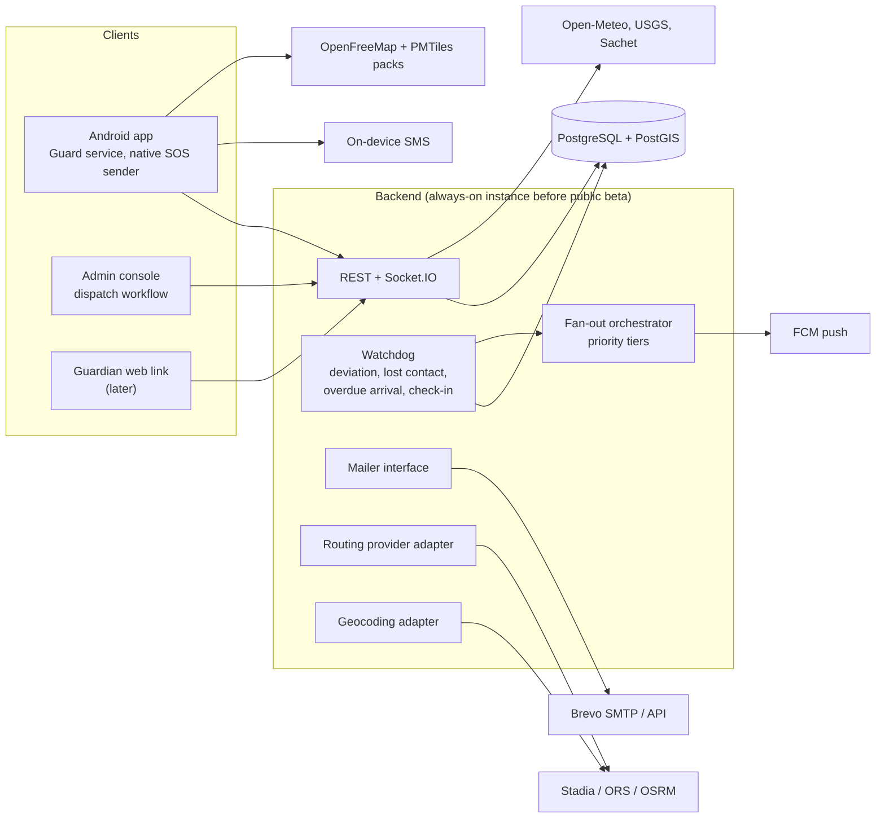

# Architecture Decision Records – Version 2

| | |
|---|---|
| **Format** | Context → Decision → Consequences → Revisit when |
| **Status values** | **Accepted** (decided by the product owner) · **Proposed** (recommendation awaiting a decision) · **Superseded** or **Dropped** |
| **Sources** | [`references.md`](./references.md) |
| **Updated** | 21 September 2026 (ADR-002, 003, 005, 006, 009, 010, 011 revised; ADR-013 to 015 added) and 22 September 2026 (ADR-016 to 018) |

## 1. Register

| ADR | Title | Status |
|---|---|---|
| 001 | Distribute as an APK | Accepted |
| 002 | Free-by-default stack behind swappable interfaces | Accepted |
| 003 | Online basemap: OpenFreeMap; PMTiles for offline and fallback; MapTiler only on the server | Proposed |
| 004 | Routing behind a provider adapter (Stadia/Valhalla → ORS → FOSSGIS OSRM) | Proposed |
| 005 | Guardian channels: FCM push and on-device SMS; no Telegram | Accepted |
| 006 | E-mail through Brevo: SMTP primary, HTTPS API backup | Accepted |
| 007 | Watchdog runs inside the backend with an external keep-warm ping | Proposed (implemented in V1 for the deviation rule) |
| 008 | Layered no-unlock SOS triggers; volume pattern is opt-in | Proposed |
| 009 | Chat: staged, contacts-only, text → voice and images | Accepted in principle; staging proposed |
| 010 | Public reports show a display name only; per-report anonymity | Accepted (name shown); safeguards proposed |
| 011 | Age policy: 18+ at launch, teen mode later after legal advice | Proposed (conflicts with the all-ages wish; needs a decision) |
| 012 | Server-side breadcrumbs with 30-day retention | Proposed |
| 013 | Emergency medical card: optional, encrypted, shown only in an SOS | Accepted; details proposed |
| 014 | Staged public rollout: closed beta → public beta → v1 | Proposed |
| 015 | Solo-developer scope order and cut list | Proposed |
| 016 | Roles versus relationships | Accepted |
| 017 | SOS delivery follows a priority-tier escalation ladder | Accepted |
| 018 | Environmental hazard data sources | Accepted |

## 2. Target Architecture

## 3. Decisions

### ADR-001 – Distribute as an APK
**Context.** Safora is a college project for this and the next year. Publishing on Google Play adds review, policy constraints and account costs.
**Decision.** Build signed APKs and publish them on GitHub Releases with checksums.
**Consequences.**
- *Unlocks:* an AccessibilityService volume trigger without Play review [R13]; `SEND_SMS` for on-device SMS, which Play restricts to default handlers with narrow exceptions [R14]; no Data Safety form.
- *Costs:* users must allow installation from unknown sources; updates are manual (mitigated by an in-app update check, ENG-7); Android 13 and later shows an extra "restricted settings" step for sideloaded apps that use accessibility 🔬; a lost signing key means a reinstall.
- *Design rule:* keep Play-restricted code (SMS, accessibility) in an **APK-only build flavour**, so a Play build remains possible later.

**Revisit when** the pilot ends and a public launch is planned.

### ADR-002 – Free-by-default stack behind swappable interfaces
**Context.** There is no budget for paid services now, but paid upgrades are acceptable if Safora becomes popular. Features are not designed around the quotas of the Render, Neon and Cloudinary free plans.
**Decision.** Prefer free and open services and wrap each in a small interface (`Mailer`, `RoutingProvider`, `GeocodingProvider`, `PushSender`, `TileSource`), so that replacing one is a configuration change. Stay on the current free hosting for development and the closed beta.
**Consequences.** Features are not bent around quotas. Two inexpensive safeguards remain: the keep-warm ping (ADR-007) and a scheduled database dump (ENG-8). Free-tier terms change without notice, so every provider has a documented fallback.

**Revisit when** real users arrive. Upgrade the backend to an always-on instance and the database to a paid plan **before** the public beta (PUB-2). A sleeping server or a paused database is a safety failure, not an inconvenience.

### ADR-003 – Online basemap: OpenFreeMap; PMTiles for offline and fallback; MapTiler only on the server
**Context.** OpenStreetMap raster tiles show local-language labels, cannot legally be prefetched in bulk and require attribution [R18]. A MapTiler key exists, but its free plan is non-commercial, limited to 100,000 requests and 5,000 sessions per month, pauses when exhausted, forbids server-side caching of map content, and the key would sit inside the APK where anyone can copy it [R50][R51]. OpenFreeMap serves vector tiles with no key, no registration and no view limits; commercial use is allowed and attribution is required [R48][R49].
**Decision.** Use OpenFreeMap for the online map (a MapLibre GL layer inside the existing Leaflet map, with an own copy of the style and English-first labels). Build PMTiles region packs with `protomaps-leaflet` [R19] as the offline map and as the fallback if OpenFreeMap is unavailable. Keep MapTiler only as a **server-side geocoding fallback**, which its terms permit [R50]. The style URL is a remote-configuration value.
**Alternatives.** MapTiler in the client (key exposure, monthly pause, non-commercial); a MapLibre React Native rewrite (larger change, PMTiles support unconfirmed [R45]); continuing with OpenStreetMap raster tiles (policy).
**Consequences.** No key to steal, no quota that can switch the map off, English labels after a style change 🔬, and legal offline packs. Costs: dependence on a donation-funded service with no guarantee (hence the fallback ladder in `map-routing-search.md` §1) and a Leaflet–MapLibre bridge to be tested on real phones 🔬.

**Revisit when** OpenFreeMap has an outage during the beta (bring MAP-2 forward) or the application grows enough to justify a paid tile provider.

### ADR-004 – Routing behind a provider adapter
**Context.** The current router returns car routes for every mode and has no instructions [R24]. Valhalla offers pedestrian, motor-scooter, auto and bicycle costing, localised instructions and options such as `use_lit` and `exclude_polygons` [R20][R21][R27]. Stadia hosts it, and its free tier covers non-commercial and academic use with hard limits [R22]. OpenRouteService has a free tier (2,000 directions per day) with walking, cycling and driving and alternatives [R23][R46].
**Decision.** `POST /api/route` on the backend calls Stadia first, then OpenRouteService, then FOSSGIS OSRM. Results are cached and keys stay on the server.
**Consequences.** Real per-mode routes, steps ready for voice, and no keys in the APK. Costs: three integrations to maintain; the scooter profile is approximated by car on the fallbacks; the terms of Stadia's free tier must be confirmed for the project 🔬.

**Revisit when** the free credits run out (self-host Valhalla on a student-credit VM [R43], or pay).

### ADR-005 – Guardian channels: app push and on-device SMS; no Telegram
**Context.** There is no free server-side SMS in India (registered templates are required [R30]). The product owner decided that guardians use the Safora app, so the app itself grows.
**Decision.** Two channels in parallel: **FCM push plus in-app inbox** to verified guardians, and **on-device SMS from the walker's SIM** (APK flavour) as the safety net for people who are not on the app or for a phone with no internet. A private web tracking link (TRK-6) is deferred. Telegram is dropped. Delivery is tracked per channel.
**Alternatives rejected.** A Telegram bot (owner's decision), a paid SMS gateway (cost and template registration), the WhatsApp Business API (paid, approval), e-mail for emergencies (slow, capped at 300 per day [R32]).
**Consequences.** Simple and free. Costs: a guardian must install an APK to receive push (the SMS fallback covers the gap), and the walker's plan pays for SMS.

**Revisit when** guardians without the app prove common during the beta (then build the web link).

### ADR-006 – E-mail through Brevo: SMTP primary, HTTPS API backup
**Context.** Welcome, verification and password-reset mail is needed. Brevo's free plan allows 300 e-mails per day with full transactional access [R32]. SMTP was tested on Render's free plan and works; an earlier source claimed those ports are blocked [R33], and the direct test overrides it. There is no domain and none is planned for two years.
**Decision.** A `Mailer` interface with `BrevoSmtpMailer` (primary), `BrevoApiMailer` (HTTPS backup) and `ConsoleMailer` (development). Templates are repository files; an outbox with priority and a 280-per-day guard; Brevo web-hooks handle bounces. E-mail never carries emergencies.
**Consequences.** Works today and survives a change of host. Costs: without an own domain, Brevo may rewrite the sender and inbox placement is weaker, so e-mail stays non-critical and messages stay short and consistent.

**Revisit when** deliverability is poor during the beta or volume approaches 300 per day.

### ADR-007 – Watchdog inside the backend with a keep-warm ping
**Context.** Escalation must not depend on the phone. Render's free web service sleeps after 15 minutes idle and has no free background workers or cron [R41]; Neon's free compute scales to zero after 5 minutes and includes a limited number of compute hours [R40].
**Decision.** Run the watchdog as an in-process tick (30 seconds) with the active-journey list in memory, and call `POST /api/internal/tick` every minute from a free external scheduler (a Cloudflare Worker cron [R39] or cron-job.org). Idle ticks make no database queries. All rules are idempotent and driven by timestamps.
**Consequences.** Works today at zero cost and survives restarts. Costs: a single instance is a single point of failure, and the external scheduler is one more thing to monitor.

**Implementation note.** V1 implements the deviation rule with this design and a 60-second external ping. V2 adds the other rules.

**Revisit when** moving to an always-on paid instance (the scheduler can then go; consider a separate worker).

### ADR-008 – Layered no-unlock triggers; volume pattern opt-in
**Context.** Indian phones already have a power-button 112 panic [R1][R47], and Google's Personal Safety has a five-press SOS [R3]. Reliable background detection of volume keys needs an AccessibilityService or fragile workarounds [R15][R16]. Foreground services that use location or microphone generally cannot start from the background [R11][R12], and vendor battery managers kill background work [R17].
**Decision.** Provide several triggers (notification action, Quick Settings tile, widget, shake, opt-in volume pattern), all passing through a **native** SOS sender that does not need the React Native runtime. Do not intercept the power button. The server watchdog stays the safety net.
**Consequences.** Robust to the failure of any single trigger. Costs: native Kotlin work; onboarding for battery and auto-start settings; audio evidence after a locked-screen trigger needs the TRG-6 spike.

**Revisit when** TRG-6 shows which audio approach works on the reference devices.

### ADR-009 – Chat: staged and contacts-only
**Context.** The product owner wants ordinary chat with text, audio and media. That is a messenger: storage, moderation, abuse handling, media risk and possible intermediary duties under Indian IT rules 🔬, about 50 focused days.
**Decision.** Build in stages: **CHT-1** a thread on a Safe Walk or SOS, **CHT-2** one-to-one text between **mutually accepted contacts**, **CHT-3** voice notes and images between the same contacts. No strangers, no groups, no arbitrary files. Messages are stored on the server (not end-to-end encrypted) and the interface says so. Retention is 30 days after the last activity. Chat and media stay off for any future under-18 accounts.
**Consequences.** Delivers the request while keeping the abuse surface small. Costs: a large effort in the second year, a moderation duty (PUB-3) and a legal review (PUB-4).

**Revisit when** the beta shows that most value is in walk and SOS threads (then stop after CHT-1 and CHT-2).

### ADR-010 – Public reports show a display name only
**Context.** Public endpoints originally returned the reporter's name and user id. The product owner decided that names should show.
**Decision.** Public responses show a display name and nothing else about the person (no `userId`, e-mail or phone). Recommended safeguards: a per-report "show my name / anonymous" toggle, and forced anonymity for harassment, suspicious-activity and isolated-area reports.
**Consequences.** Removes the account-linking leak and meets the product wish. Residual risk: people reporting a specific person can be identified if they choose to show their name (R-9). Staff still see identity for moderation.

**Revisit when** beta users report feeling unsafe about names (make anonymous the default).

> **Note on V1.** V1 goes further than this decision: public responses omit the reporter entirely, and staff see the identity. See [`../v1/api.md`](../v1/api.md#31-report-representations). The display-name option is a V2 product choice.

### ADR-011 – Age policy: 18+ at launch, teen mode later
**Context.** The product owner wants Safora to serve everyone, from age 12 if needed. India's DPDP Rules treat under-18s as children: verifiable parental consent is required before processing, and tracking and behavioural monitoring are restricted with narrow exemptions [R53][R54][R55]. Safora's core features (continuous location, audio, chat) are of the risky kind.
**Decision (proposed).** Launch **18+** (a checkbox and an enrolled beta). Do not collect birth dates. Design the guardian model so that a parent is a special guardian, and add a **teen mode** only after legal advice and a real consent method.
**Consequences.** Lower legal risk and less to build now. Cost: schoolchildren cannot be served yet, which limits the stated goal.

**Revisit when** PUB-4 gives a clear answer or a legitimate consent path is found. **A decision is needed:** this is the one place where the recommendation and the request differ.

### ADR-012 – Server-side breadcrumbs with 30-day retention
**Context.** Live tracking, the watchdog and evidence packets need stored positions. Storing them forever creates risk.
**Decision.** Store breadcrumbs during active journeys only; delete after 30 days (consider 7); SOS audio after 30 days; run a scheduled purge job (ENG-1).
**Consequences.** Enables TRK-3, TRK-4 and ADM-4 while limiting exposure. The retention periods are to be confirmed with the supervisor (`security-privacy-compliance.md` §2).

### ADR-013 – Emergency medical card
**Context.** Blood group and similar information helps when an ambulance arrives. It is health data and highly sensitive.
**Decision.** An **optional** card (blood group, allergies, conditions, medications, one note) stored in its own table, encrypted at application level (AES-GCM, key in an environment variable), visible only to the user and, **only inside an active SOS**, to guardians and staff. Staff views are audit-logged. The card is deleted with the account or on request.
**Consequences.** Useful at the moment it matters; a database dump reveals nothing readable. Costs: key management (losing the key loses the cards) and a small amount of cryptographic code.

**Revisit when** the legal review (PUB-4) advises a different consent flow.

### ADR-014 – Staged public rollout
**Context.** The product is meant for public use, but only a few testers can be recruited and there is one developer.
**Decision.** Three gates: **closed beta** (5 to 8 people, "prototype – do not rely on it alone") after M1, M2 and M3a; **public beta** after M4 and PUB-1, PUB-2 and PUB-4; **v1** after M3b, M5 and M6. Nothing goes public before server-side escalation, account deletion, e-mail verification, always-on hosting and the legal basics.
**Consequences.** Real risk control and honest communication. Costs: the public date is months away; keep the testers' data small and deletable.

### ADR-015 – Solo-developer scope order and cut list
**Context.** The full wish list is about 322 focused days (1.5 years at four days per week, 3 years at two).
**Decision.** Order: M1 trust fixes → M2 map quick wins → M3 escalation → M4 accounts → M5 routing and voice → M6 triggers → M7 chat → M8 local fit and public readiness. When short, cut in this order: media chat → one-to-one chat → advisories and audits → safe places and alerts → volume trigger → safest route → voice → widget → Hindi. Never cut the trust fixes, the watchdog, the guardian handshake, account deletion or the PUB legal items.
**Consequences.** Something visible early (maps) and the core safety promise next. Costs: chat and triggers arrive late; say so honestly to users.

### ADR-016 – Roles versus relationships
**Context.** The backend has three roles (`user`, `moderator`, `admin`), but `moderator` has never been assigned or given a distinct interface. A `volunteer_responder` role (community members pinged for nearby SOS) and an `org_admin` role (multi-institution scoping) were also considered.
**Decision.** A **role** changes what permissions and dashboard an account has; a **relationship** links two accounts. `moderator` becomes a real role with the permission split in `accounts-email-local.md` §8 (moderators flag abuse, admins act on it). `guardian-of` and `parent-of` (AGE-2) stay **relationships**, not roles; any ordinary user can hold them. `volunteer_responder` and `org_admin` are **not built**, because both depend on external adoption rather than engineering effort.
**Consequences.** A small, stable role list that does not grow with every feature that needs "someone with extra visibility". No cost identified.

### ADR-017 – Escalation ladder, not simultaneous broadcast
**Context.** The original fan-out design notified every verified guardian at once. The product owner asked for a priority order instead.
**Decision.** `trusted_contacts.priority_tier` takes the values 1, 2 and 3. The orchestrator notifies tier 1 immediately, advances to tier 2 after 2 minutes without acknowledgement and to tier 3 after another 2 minutes. **If no tier acknowledges and there is no next tier, it stays with the primary tier; it never falls back to "notify everyone".** On-device SMS (TRK-8) still goes to everyone immediately regardless of tier, because it costs nothing extra and does not depend on server orchestration. A forward reference to the V3 mesh-messaging note records the natural extension for "primary unreachable, no signal at all".
**Consequences.** More realistic dispatch behaviour. A walker with a single contact effectively has no ladder, which is documented. Costs: secondary and tertiary contacts can be notified up to 4 minutes later than under the old design.

**Revisit when** post-beta data shows that two minutes per tier is wrong in either direction, or when the V3 mesh work is undertaken.

### ADR-018 – Environmental hazard data sources
**Context.** Weather and earthquake data should improve route-safety accuracy, from sources that are free and reliable, with a clear rule for how live data may and may not affect routing.
**Decision.** Open-Meteo (free, no key, 10,000 calls per day) feeds a temporary boost to the waterlogging weight during active rain, reusing the existing safety-score formula. USGS (free, public domain, real time) drives time-limited advisories through the same delivery path as Sachet advisories, **not** live route recalculation: an earthquake event does not say which specific roads have become unsafe, only that caution is warranted for a period. The official BIS seismic zoning map is a **static** multiplier for landslide and bridge hazard severity in Zone IV and V areas (Uttarakhand), because that is a static geological fact.
**Consequences.** Both sources are free. The static and dynamic split keeps the design honest and avoids implying that a live earthquake feed identifies dangerous roads.

**Revisit when** real usage shows that the waterlogging boost needs tuning, or if the terms of USGS or Open-Meteo change.
