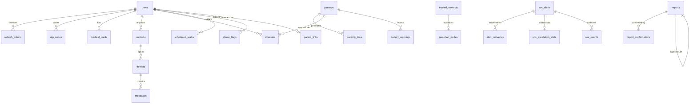

# Database Schema – V2 Additions

> New tables and columns introduced in V2, on top of V1 ([`../v1/database.md`](../v1/database.md)). Full `CREATE TABLE` statements are in the linked specification sections. This file is the index and the relationship map.

## 1. New Tables by Feature

| Table | Purpose | Specification |
|---|---|---|
| `refresh_tokens` | Rotating session refresh tokens | [`accounts-email-local.md`](./accounts-email-local.md) §3 (SEC-5) |
| `otp_codes` | E-mail verification and password-reset codes | §1 |
| `email_outbox` | Queued transactional e-mail | §1 |
| `guardian_invites` | Guardian handshake tokens | [`safety-and-tracking.md`](./safety-and-tracking.md) §1 |
| `alert_deliveries` | Per-channel SOS delivery tracking | §2 |
| `sos_escalation_state` | Which tier of the escalation ladder an SOS is on | §2 (TRK-11) |
| `tracking_links` | Guardian web-view tokens (deferred feature) | §5 |
| `checkins` | Safety Check timers | §6 |
| `battery_warnings` | One row per battery-threshold crossing during a walk | §6b (TRK-10) |
| `scheduled_walks` | Recurring Safe Walk reminders (driven by local notifications) | §6d (TRK-13) |
| `contacts`, `threads`, `messages` | Chat | §10 |
| `medical_cards` | Encrypted emergency medical information | `accounts-email-local.md` §9 |
| `abuse_flags` | Moderator-flagged accounts for admin review | §8 (SEC-10) |
| `parent_links` | Consent authority for teen accounts (a relationship, not a role) | §4 (AGE-2) |
| `report_confirmations` | Unique "still there" and "cleared" votes | §2 (SEC-3), [`map-routing-search.md`](./map-routing-search.md) §9 |
| `advisories` | Sachet and manual disaster advisories | `accounts-email-local.md` §6.2 |
| `safe_places`, `safe_stops` | Police, hospital and pharmacy overlay; verified local spots | `map-routing-search.md` §7 |
| `place_audits` | SafetiPin-style safety ratings | `accounts-email-local.md` §6.3 |
| `weather_cache` | Short-lived cache of Open-Meteo responses | [`environmental-hazards.md`](./environmental-hazards.md) §2 (WX-1) |
| `sos_events` | Admin dispatch audit trail | `accounts-email-local.md` §7 (ADM-1) |
| `staff_audit_log` | Staff views of sensitive records | §7, §9 |

`organizations` (campus scoping) is dropped from the plan.

## 2. Column Additions to Existing Tables

| Table | New columns | Specification |
|---|---|---|
| `users` | `email_verified_at`, `email_bounced_at`, `token_version`, `language` | `accounts-email-local.md` §1 |
| `users` | `display_name`, `trust_score` | §2; `map-routing-search.md` §9 (MAP-9c) |
| `trusted_contacts` | `status`, `guardian_user_id`, `accepted_at`, `revoked_at`, `language`, `priority_tier` | `safety-and-tracking.md` §1, §2 |
| `journeys` | `mode`, `escalation_reason`, `type` (`safe_walk` or `walk_with_me`); `last_location`, `last_seen_at`, `deviated_at` and `escalated_at` already exist from V1 | §3, §4, §6c |
| `reports` | `reporter_display`, `duplicate_of` | `accounts-email-local.md` §2; `map-routing-search.md` §9 (MAP-9d) |

Category-specific decay is handled in application code and needs no schema change.

## 3. Relationships (V2 additions only)

## 4. Retention

See [`security-privacy-compliance.md`](./security-privacy-compliance.md) §2 for the full table. In short: breadcrumbs 30 days, SOS audio 30 days, chat messages 30 days after the last activity, OTP codes purged 24 hours after use or expiry, and tracking links purged 30 days after expiry. A scheduled purge job (ENG-1) is required once these tables exist. **Do not ship the tables without it.**

## 5. Migration Order

Apply V2 migrations in the order of the implementation sequence in [`api.md`](./api.md#10-notes-for-the-implementer): `refresh_tokens` and `otp_codes` (session and e-mail) before `guardian_invites` (which assumes verified-e-mail accounts), before `contacts`, `threads` and `messages` (chat, which assumes the guardian handshake is proven).

Use a real migration tool for this phase (`node-pg-migrate`, ENG-1) instead of V1's inline SQL in `initDatabase()`. V2 has enough schema changes that tracking them by hand stops being safe.
