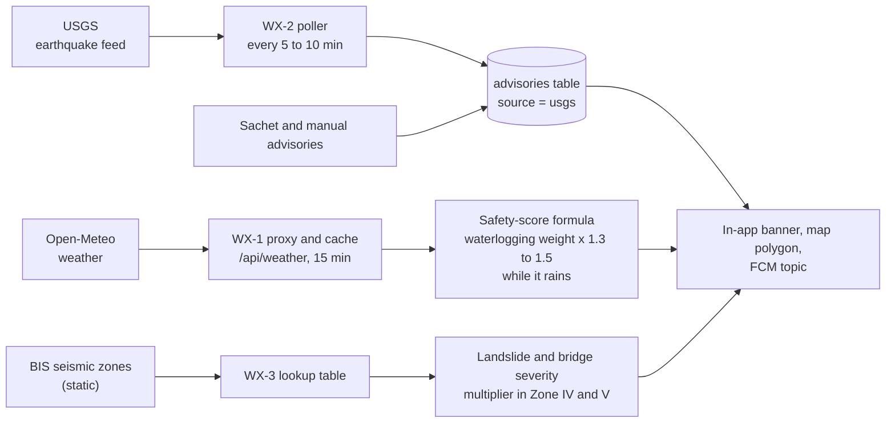

# Environmental Hazards – Weather and Earthquakes

| | |
|---|---|
| **Version** | V2 – planned |
| **Covers** | WX-1 (weather overlay), WX-2 (earthquake advisories), WX-3 (static seismic-zone weighting) |
| **Added** | 22 September 2026 |
| **Related** | [`map-routing-search.md`](./map-routing-search.md) §9, [`accounts-email-local.md`](./accounts-email-local.md) §6.2, ADR-018 |

This is a separate subsystem: external live-data ingestion that the safety-score formula and the advisory delivery system both depend on.



## 1. Data Sources

| Source | Cost | Coverage | Provides |
|---|---|---|---|
| **Open-Meteo** [R57] | Free, no key, up to 10,000 calls per day for non-commercial use | Any latitude and longitude, including Dehradun and Uttarakhand | Current conditions and forecast: precipitation, wind, weather codes (fog, thunderstorm), temperature. **Attribution required (CC BY 4.0)** |
| **USGS earthquake feeds** [R58] | Free, no key, public domain | Global, including India | A real-time GeoJSON feed of earthquakes, updated within minutes: magnitude, location, depth, time |
| **India Seismic Zoning Map (BIS)** [R59] | Static reference, no API | India | Uttarakhand lies in Seismic Zone IV and V; used as a fixed multiplier, not a live feed (section 4) |

## 2. WX-1 – Live Weather Overlay

### Design
- The backend proxies Open-Meteo. The mobile app never calls it directly, which keeps attribution and rate-limit handling in one place, the same pattern as the proxying of geocoding and routing.
- Endpoint: `GET /api/weather?lat=&lng=`, a thin proxy cached for 15 minutes per cell of about 1 km, because weather does not change fast enough to justify a call per request.
- **Score integration.** When precipitation above a threshold (moderate or heavy rain, from Open-Meteo's intensity codes) is active in an area, the severity weight *S* of **waterlogging** reports in that area is multiplied by 1.3 to 1.5, and it decays back to normal once the condition clears. This reuses the existing formula ([`../v1/safety-algorithms.md`](../v1/safety-algorithms.md)) instead of building a parallel scoring system.
- **Interface.** A small current-conditions chip on the Home and Map screens, and a caution banner at the start of a Safe Walk if heavy rain, fog or thunderstorm is detected along the route ("Heavy rain expected – waterlogging risk is elevated right now").

### Data model

```sql
CREATE TABLE weather_cache (
  grid_cell TEXT PRIMARY KEY,           -- latitude and longitude rounded to ~1 km, as a string key
  conditions JSONB NOT NULL,
  fetched_at TIMESTAMPTZ NOT NULL DEFAULT now()
);
```

The row expires and is refreshed on the first request after 15 minutes. This is a simple time-to-live check in application code and needs no cron job.

## 3. WX-2 – Earthquake Advisories

### Design
- Poll the USGS GeoJSON feed (for example the "past hour" or "past day" significant-earthquake feed) every 5 to 10 minutes from a scheduled job, reusing the external scheduler that already triggers the watchdog (`/api/internal/tick` or a sibling `/api/internal/quake-check`).
- Filter to earthquakes within a configurable radius of Uttarakhand (for example 200 km) above a minimum magnitude (for example M3.5; smaller ones are neither felt nor relevant).
- On a match, create a row in the same `advisories` table that holds Sachet advisories, with `source = 'usgs'` and `event = 'earthquake'`, and a plain-language headline ("M4.2 earthquake detected 40 km from Dehradun, 2 hours ago – check for road damage before walking near hill cuttings or unstable slopes").
- **Time-limited.** The advisory expires automatically after a configurable window (48 to 72 hours). Aftershock and landslide risk is real but must not linger as a stale warning.
- Delivery uses the same channel as Sachet advisories. No separate notification system is needed.

### What it does not do
It does **not** feed live route recalculation ("avoid this road because of the earthquake"). A live feed says that an event happened, not which streets are now structurally unsound. That is the job of local authorities and on-the-ground reporting, which the hazard-report system already covers with the new landslide and damaged-bridge categories. The advisory only raises awareness and prompts caution.

## 4. WX-3 – Static Seismic-Zone Weighting

### Design
- A fixed multiplier is applied to the per-category decay weights ([`map-routing-search.md`](./map-routing-search.md) §9) for **landslide** and **damaged bridge or river crossing** reports when the report's location lies in India's officially mapped Seismic Zone IV or V, which covers Uttarakhand. Confirm the exact district boundaries against the current BIS map before hard-coding, because zone boundaries can be revised (V19).
- This is **not a live call.** It is a static geographic lookup (a bounding polygon or district list built into the backend), which reflects a static fact about regional seismic risk.
- Effect: a landslide report in a Zone V area is treated as more severe and slower to decay than the same report in a Zone II area elsewhere, because the geological risk differs independently of any current event.

## 5. Rate Limits, Caching and Failure Behaviour

- **Open-Meteo:** cache aggressively (section 2). 10,000 calls per day is generous at Safora's scale, but there is no reason to call more than needed.
- **USGS:** the feeds are designed for polling; an interval of 5 to 10 minutes is well within reasonable use.
- **If either service is unreachable:** fail silently for the weather chip and banner (show nothing rather than an error that alarms the user over a non-critical feature), but log the failure so that an extended outage is noticed. A failed earthquake poll only means a missed cycle; the next successful poll catches up, because the USGS feed includes a look-back window.

## 6. Effort

| Item | Size |
|---|:---:|
| WX-1 weather overlay and score integration | M (about 4 to 5 days) |
| WX-2 earthquake advisory polling and delivery | M (about 4 to 5 days; mostly reuses the planned advisory delivery system) |
| WX-3 static seismic-zone weighting | S (about 1.5 days; a lookup table, not a live integration) |
