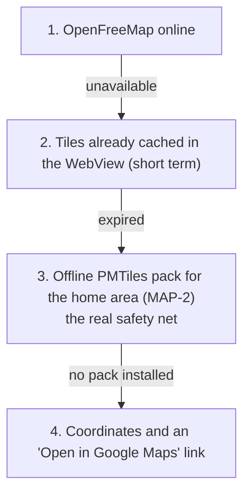
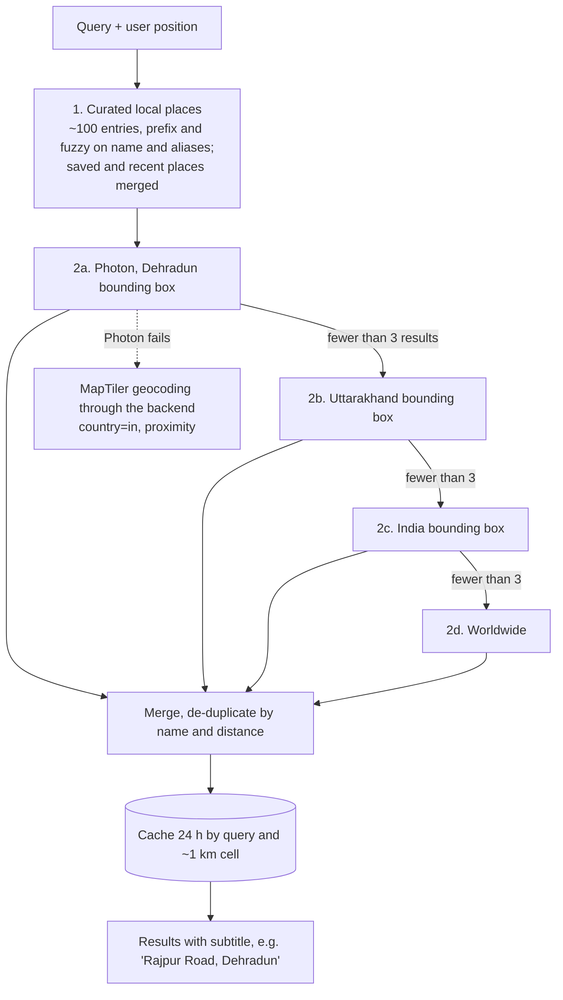
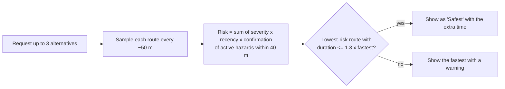
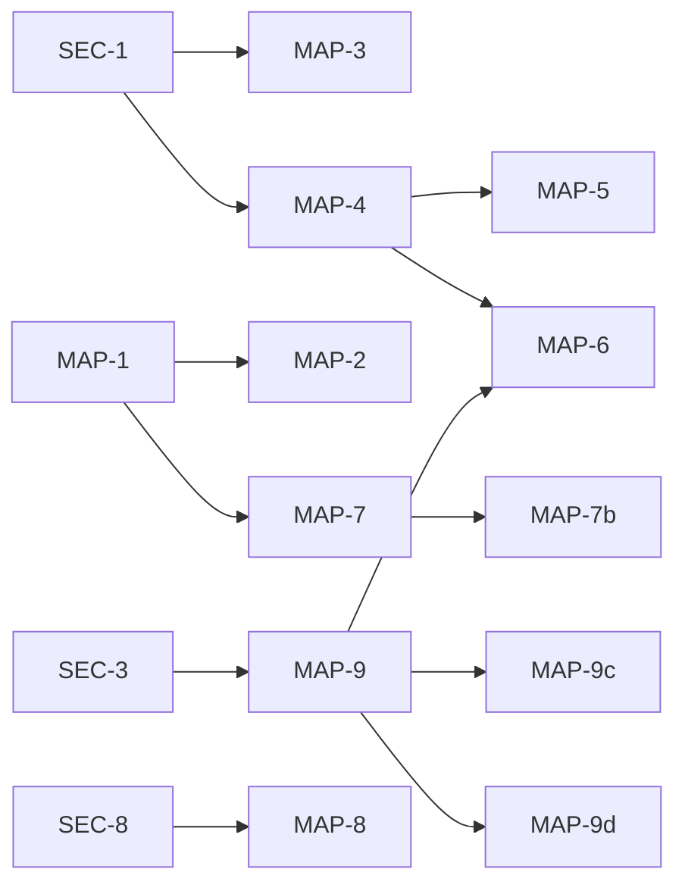

# Specification – Map, Search, Routing, Voice Guidance and Hazard Scoring

| | |
|---|---|
| **Version** | V2 – planned |
| **Covers** | MAP-1 to MAP-9, including MAP-7b, MAP-9c, MAP-9d and MAP-9e |
| **Related** | [`environmental-hazards.md`](./environmental-hazards.md) (WX-1 to WX-3), [`references.md`](./references.md) |
| **Status tags** | ✅ verified · 📄 documented only · 🔬 needs a test · 🗓 planned |
| **Updates** | 21 Sep 2026: the basemap decision changed to **OpenFreeMap**; PMTiles moved to the offline and fallback role. 22 Sep 2026: safe stops (MAP-7b), reporter trust score (MAP-9c), duplicate detection (MAP-9d) and an optional photo EXIF check (MAP-9e) |

## 0. What Is Wrong Today (verified) ✅

| Symptom | Cause found in the code |
|---|---|
| Search does not find local places well | Photon is called with only `lat` and `lon`; no `bbox`, `lang`, `zoom` or `location_bias_scale` [R25]. The MapTiler fallback has `country=in` but no proximity |
| Other countries' labels show in their own language | The basemap is OSM raster tiles drawn with local names; no parameter can change this |
| Walk, bike and car look the same | `fetchFootRoute` calls the driving route and only divides the distance by a fixed speed. The public OSRM demo also returns car routes whatever the URL says [R24] |
| No voice or turn instructions | The route request has no `steps`; there is no navigation engine or text-to-speech |
| "10 km offline cache" | Prefetches from `tile.openstreetmap.org`, which the tile policy prohibits; attribution is hidden [R18] |

---

## 1. Map Tiles and Labels (MAP-1) – OpenFreeMap

### Goal
English labels everywhere, good India detail, no keys in the APK, no request limits that can switch the map off, visible attribution, and a plan for when the free host is unavailable.

### Options compared

| Option | Key in the app? | Limits | Public or commercial use | Offline | Verdict |
|---|:---:|---|---|:---:|---|
| **OpenFreeMap** (public vector tiles) | **No** | No limits on views or requests; no registration [R48] | Allowed; attribution required [R48][R49] | No | **Use for the online map** |
| **MapTiler Cloud, free plan** | Yes, visible to anyone who opens the APK | 100,000 requests and 5,000 map sessions per month; the service **pauses until the next month** when used up [R50][R51] | **Non-commercial only** [R50]; the terms also forbid caching map content on your server [R50] | No | Keep only as a **server-side geocoding fallback**; its terms allow using search results outside the service [R50] |
| **Protomaps PMTiles** (self-hosted) | No | Hosting and bandwidth costs (free options unproven; test in MAP-2) | Allowed (OSM data) | **Yes** | **Offline packs and fallback** (MAP-2) |
| OSM raster tiles | No | Prohibited for prefetch and offline; attribution must be shown [R18] | Volunteer-run, no service guarantee | Not allowed | **Remove** |

A map key inside the APK can be copied and used up by anyone, and then **the map stops for every user until the next month**. That is unacceptable for a safety application. OpenFreeMap has no key and no quota. Its weakness is that it is donation-funded with no service guarantee, so a fallback ladder is needed.

### Design
- **Basemap:** OpenFreeMap vector tiles, styles at `tiles.openfreemap.org/styles/{liberty|positron|bright}` [R52]. Offer **Light** (positron), **Dark** (an own dark variant of the same style) and the optional online-only **Satellite** (Esri imagery, attribution shown, **no prefetch**).
- **Rendering:** MapLibre GL JS inside the existing Leaflet map through the `maplibre-gl-leaflet` bridge, so markers, clusters, polylines and layers already written in Leaflet keep working 🔬 (check WebView performance; the bridge is community-maintained).
- **English labels:** OpenMapTiles-schema tiles carry several name fields (local, English, Latin transliteration). Keep **an own copy** of the style JSON in the repository and change the label expression to prefer the English name, then the Latin name, then the local name 🔬 (confirm the field names in the tiles first).
- **Attribution:** "OpenFreeMap © OpenMapTiles Data from OpenStreetMap" [R49]; MapLibre adds it automatically. Also show "Esri" while satellite is on. Never hide it.
- **Remove** the OSM raster layer, the CSS-inversion "Dark Matrix" and `cacheSurrounding10km` (all requests to `tile.openstreetmap.org`). Keep `noWrap` and `maxBounds`.
- **Remote-configuration switch:** the style URL is a configuration value the backend can change, so that an OpenFreeMap outage can be answered with a self-hosted or MapTiler style without a new APK.

### Fallback ladder



### Borders
Indian law has specific rules about how the national boundary is drawn. OSM-derived maps show de facto borders. The risk is low for a small beta; seek advice before a large public launch 🔬.

### Acceptance criteria
- Panning to Tokyo, Kathmandu and Beijing shows English or Latin-script labels.
- A network log of a 5-minute session shows **zero** requests to `tile.openstreetmap.org` and **no map key** in any request from the phone.
- Attribution is visible in every screenshot (light, dark, satellite).
- Changing the style URL in remote configuration changes the basemap without an APK update.

---

## 2. Offline Map Packs (MAP-2)

This is now the **reliability fallback** for the online basemap and the offline story. It is scheduled in M8, but should be brought forward if OpenFreeMap proves unreliable during the beta.

- Region packs as **PMTiles** files rendered with `protomaps-leaflet` [R19] as a separate layer used only offline or as a fallback: *Dehradun* (approximate bounding box `77.85,30.20,78.20,30.45`, zoom 0 to 16) and *Uttarakhand* (`77.5,28.7,81.1,31.5`, zoom 0 to 12). Boxes are approximate (`minLon,minLat,maxLon,maxLat`); check them on a map before extracting.
- Extract from a public Protomaps build with the `pmtiles` command-line tool 🔬 (confirm the extract command and the resulting file sizes, which are unknown until measured).
- Delivery options to test: bundled in the APK, a one-time download from a GitHub release, or Cloudflare R2 (a free allowance exists but the account may need a payment method) [R39]. Pick the simplest that works over mobile data.
- In the app, **Settings → Offline maps** shows installed packs, their size, "update" and "delete". The WebView loads the file from local storage.
- The pack version is stored in the app; updated maps ship with app releases (ENG-7).

### Acceptance criteria
- With airplane mode on, the Dehradun pack pans and zooms from zoom 10 to 16 and shows road names.
- Pack size and download time on 4G are recorded in the beta notes.

---

## 3. Search v2 (MAP-3)

### Goal
Typing "Clock Tower", "ISBT", "DBUU", "Rajpur Road" or a misspelling returns the Dehradun result first.

### Design
All lookups go through the backend, which also fixes the exposed-key problem:

`GET /api/geo/search?q=…&lat=…&lng=…` (authenticated, 30 per minute per user)



1. **Curated local places first** (JSON in the repository, about 100 entries): university gates, hostels, library, cafeteria, bus stand, ISBT, Clock Tower, hospitals, police stations.
2. **Photon with a tiered bounding box** [R25]. Dehradun `77.85,30.20,78.20,30.45`; Uttarakhand `77.5,28.7,81.1,31.5`; India `68.1,6.7,97.4,35.7`; then worldwide. The boxes are approximate and must be verified visually.
3. Parameters: `lang=en`, `lat` and `lon` from the user position, `zoom≈12`, `limit=8` and a **low** `location_bias_scale` (lower values weigh distance more than prominence; 🔬 tune between 0.05 and 0.3 with the test set below) [R25].
4. **Cache** responses for 24 hours by normalised query and about 1 km cell. Photon's public server asks users to be fair and throttles heavy use [R26]; the cache and a 300 ms client debounce (minimum 3 characters) keep requests low.
5. Fallback if Photon fails: MapTiler geocoding **through the backend**, with the key in the environment.

### Test set (part of CI later, ENG-3)
Twenty queries with the expected top result inside the Dehradun box, including 5 misspellings and 5 Hindi-transliterated names ("Ghantaghar", "Rajpur Road", …). Pass mark: the expected place is in the top 3 for at least 90 % of the queries.

### Acceptance criteria
- Median search response below 400 ms after cache warm-up; no client request goes to Photon or MapTiler directly.

---

## 4. Routing Service and Per-Mode Routes (MAP-4)

### Goal
Real routes for **walk, scooter, car and bike**, with turn instructions, alternatives and a safety score, behind one API and swappable providers.

> **V1 state.** V1 shows one road geometry for all modes, with times computed from calibrated speeds. This is the limitation that MAP-4 removes.

### API
`POST /api/route` (authenticated, 20 per minute per user)

```json
{ "from": {"lat":30.31,"lng":78.03}, "to": {"lat":30.32,"lng":78.04},
  "mode": "walk|scooter|car|bike", "alternatives": true,
  "prefer": "fastest|safest", "language": "en|hi" }
```

Response: `routes[]`, each with `geometry` (encoded polyline), `distanceM`, `durationS`, `steps[]` (`instruction`, `maneuver`, `distanceM`, `streetName`, `pointIndex`), `safety` (`score`, `hazardCount`, `unlitShare?`) and `provider`.

### Provider chain (`RoutingProvider` adapter)

| Order | Provider | Profiles | Notes |
|---|---|---|---|
| 1 | **Stadia Maps** (hosted Valhalla) | `pedestrian`, `motor_scooter`, `auto`, `bicycle` | Localised instructions in 25+ languages [R21]. The free tier is for development, evaluation and non-commercial (including academic) use and stops with HTTP 429 when credits run out [R22]. 🔬 Confirm that the terms cover the project and record the monthly credit limit |
| 2 | **OpenRouteService** | `foot-walking`, `cycling-regular`, `driving-car` | Free tier of 2,000 directions per day and 40 per minute [R46]; up to 3 alternatives; avoid-area limits (up to 200 km², extent up to 20 km) [R23]. **No scooter profile; use `driving-car`** |
| 3 | **FOSSGIS OSRM** | Separate foot, bike and car endpoints | Free, fair use. The plain public demo server ignores the profile and returns car routes [R24], so it is never used for walking |
| 4 | Offline fallback | Straight line × 1.25 winding factor | Only to show something; labelled "approximate" |

Keys stay on the server. Responses are cached by (mode, endpoints rounded to 4 decimals, preference) for 10 minutes.

### Durations
Use the provider's duration. The calibrated constants in `routingService.ts` (walk 1.60 m/s, scooter 8.88 m/s plus 20 s, car 7.22 m/s plus 45 s) become the **offline fallback only**. 🔬 Compare the provider's walking time with a real 1 km walk on campus before deciding whether to scale it.

### Modes in the map radar and Safe Walk
The mode chips (Walk, Scooter, Car, Bike) in the radar call `/api/route` with that mode. Safe Walk stores `journeys.mode` and uses per-mode defaults. The values are proposals to be tuned in the beta; the walking corridor equals the V1 default.

| Mode | Corridor | Location interval | Deviation prompt |
|---|:---:|:---:|---|
| Walk | 100 m | 3–5 s | 60 s |
| Bike or scooter | 150 m | 3 s | 45 s |
| Car | 200 m | 3 s | 45 s |

### Acceptance criteria
- Walking and car routes differ for a pair of campus points that has a footpath shortcut.
- Switching off provider 1 (bad key) transparently falls back to provider 2, then 3.
- No provider key appears in the APK (`strings` or decompile check).

---

## 5. Turn-by-Turn Navigation and Voice (MAP-5)

### Goal
Guidance in the style of common navigation apps: the next turn as text, the distance, spoken instructions and automatic re-routing.

### Behaviour
- **Position tracking:** snap the location to the route polyline, find the current step and the distance to the next manoeuvre.
- **Announcement distances (proposals):** walking at 30 m and at the turn; scooter and car at 200 m, 50 m and at the turn.
- **Text-to-speech:** Android's built-in `TextToSpeech` through a React Native module, with English (India) and Hindi voices if installed 🔬, using audio-focus ducking so that music lowers instead of stopping. The instruction text comes from the routing provider in the chosen language; if a language is unsupported, English is used.
- **Walker-safe modes (default for Walk):** *Earphone-only* (speak only when headphones are connected) and *Haptic* (short and long vibration patterns for left and right). A phone announcing a woman's route aloud at night can be unsafe, so **voice is off by default for Walk** and needs an explicit toggle.
- **Re-routing:** if the user is more than **40 m** off the route for **10 s** (walking) or **60 m** for **10 s** (vehicle), a new route is requested from the current position. Navigation re-routing is separate from the Safe Walk safety deviation: a re-route inside the corridor is silent, while leaving the corridor still starts the deviation prompt.
- **Offline:** the last route steps are cached; there is no re-routing offline; the screen shows "Offline – following saved route".
- **Battery:** GPS at 1 Hz only while navigating; the screen may sleep with a foreground notification showing the next turn (this needs the foreground service for reliable behaviour with the screen off; V1 already provides it for Safe Walk).

### Acceptance criteria
- On a real 1 km campus walk, spoken instructions arrive at the announced distances (±15 m) and a deliberate wrong turn triggers a re-route within 15 seconds.
- With headphones off and *Earphone-only* set, nothing is spoken.

---

## 6. Safest Route (MAP-6)

### Goal
Offer "Fastest" and "Safest" and explain the trade-off ("+3 min, 2 fewer hazards"). The method is rule-based, with no machine learning. AI routing is a V3 research item (see [`../v3/01-ai-safe-route-recommendation.md`](../v3/01-ai-safe-route-recommendation.md)), and this rule-based ranking is its baseline.

### Method



1. Request up to 3 alternatives where the provider allows.
2. Sample each route every about 50 m and sum `severity × recency × confirmation` of active hazards within 40 m, using the decay code with MAP-9's half-lives. That sum is the route's **risk**.
3. For **walking**, if the provider supports it, request Valhalla's `use_lit` pedestrian option (0 to 1; higher avoids unlit streets; not a guarantee) [R27].
4. Optionally **exclude** the surroundings of severe, confirmed hazard clusters with `exclude_polygons` (works but is costly, so use a few small polygons) [R21].
5. Choose the lowest-risk route whose duration is at most **1.3 ×** the fastest; otherwise show the fastest with a warning.

### Data-quality note
Information on lit streets depends on OSM tagging, which may be sparse in Dehradun. Measure the share of tagged ways before promising this in the interface 🔬.

### Acceptance criteria
- On a seeded test area with a known hazard on the direct route, "Safest" avoids it and states the extra time.
- If no alternative exists, the interface says so.

---

## 7. Safe Places Overlay (MAP-7)

- **Layers:** police stations, hospitals and clinics, pharmacies and 24-hour shops.
- **Source:** OpenStreetMap through a one-off import, not live queries. Stored in `safe_places(id, osm_id, type, name, phone, opening_hours, location geography)` and refreshed monthly by a script (use Overpass sparingly or a regional extract).
- **Query** with `ST_DWithin` within 2 km of the user; a "Nearest safe place" button opens directions and offers a call button when a number is known.
- **Verify by hand** the roughly 30 places nearest the university and central Dehradun (OSM completeness there is unknown 🔬) and add missing ones through the curated list (section 3).

### MAP-7b – "Safe stop" verified local spots
Beyond OSM-sourced police, hospitals and pharmacies (institutional and static), a **curated, physically verified** list of local businesses that agreed to be a place where someone can wait or ask for help. It is modelled on the UK's "Ask for Angela" scheme [R60], where venue staff respond discreetly to a code phrase or request.

```sql
CREATE TABLE safe_stops (
  id SERIAL PRIMARY KEY, name TEXT NOT NULL,
  category VARCHAR(30),                         -- cafe|pharmacy|shop|hostel_gate|other
  location GEOGRAPHY(Point,4326) NOT NULL, phone TEXT,
  verified_by INTEGER REFERENCES users(id), verified_at TIMESTAMPTZ,
  notes TEXT,                                    -- e.g. "ask for the manager, mention Safora"
  active BOOLEAN NOT NULL DEFAULT true
);
```

- A separate table from the OSM-sourced `safe_places`, because the verification process and the level of trust differ.
- **Verification is manual and physical.** The support member visits the location, confirms that the business is willing to be listed and records how someone should ask for help there.
- Shown with an icon distinct from the OSM-sourced places, so that users understand they are specifically vetted.
- Start small, with 5 to 10 verified spots near the university and central Dehradun. A short list of reliable spots beats a long list of unverified ones.

---

## 8. Hazard Proximity Alerts (MAP-8)

- Wires up the currently non-functional "Hazard alerts" Settings toggle ✅.
- **Privacy-preserving:** the phone subscribes to FCM **topics per geohash cell** (precision 6, about 1.2 km × 0.6 km) for its own cell and its neighbours. The server never stores continuous locations for this.
- When a report with severity of at least 4 (or with at least 2 confirmations) is created, the server publishes to that cell's topic; the phone checks the distance (below 500 m) and shows a notification.
- A night-only option (for example 8 pm to 6 am) and per-category mute.
- 🔬 Check the FCM limit on topic subscriptions per app instance and the topic-message delivery delay.

---

## 9. Hazard Scoring Changes (MAP-9)

### Problem and V1 baseline
Early builds used one 24-hour half-life for every category, so a broken streetlight, a waterlogged road and a landslide faded at the same rate. **V1 improved this with a single 168-hour half-life and a floor of 0.25** (see [`../v1/safety-algorithms.md`](../v1/safety-algorithms.md)). MAP-9 replaces the single constant with per-category values.

### Proposal (starting values; calibrate in the beta 🔬)

| Category | Half-life | Reason |
|---|:---:|---|
| Poor lighting | 14 days | Stays until repaired |
| Road hazard or construction | 7 days | Repairs take days |
| Waterlogging or flash flood | 12 hours | Clears quickly after rain |
| Isolated area | None (static) | A property of the place |
| Harassment or suspicious activity | 72 hours | Fades but matters |
| Landslide or blocked road (new) | Until cleared | Persists until someone says it is cleared |
| Wildlife sighting (new) | 48 hours | Animals move |
| Poor mobile coverage (new) | None (static) | A property of the place |

### "Still there" and "Cleared" confirmations
Each hazard card offers **Still there** (extends life) and **Cleared**. After 2 unique "cleared" votes the status becomes `resolved`. This uses the `report_confirmations` table with a `vote` column (`present` or `cleared`), unique per user (SEC-3).

### Acceptance criteria
- Unit tests for each category half-life; a landslide report does not decay until cleared.
- Two "cleared" votes by two different users resolve a hazard; one user cannot vote twice.

### MAP-9c – Reporter trust score
The same anti-gaming pattern that Waze uses for traffic reports [R61]: an account whose past reports were confirmed by others counts for more than a new or often-disputed account.

```sql
ALTER TABLE users ADD COLUMN trust_score REAL NOT NULL DEFAULT 1.0;
```

- Recomputed periodically, not per report: `trust_score = clamp(0.5, 2.0, 1.0 + 0.1 × (confirmed_reports − disputed_reports))`, where "disputed" means reports later marked `duplicate` or `fake` by moderation.
- Applied as an additional multiplier in the safety score: `penalty = S × D × T × C × trust_score(reporter) × 5`.
- **New accounts start at 1.0.** Trust moves only with the track record, so the mechanism cannot suppress genuine first-time reporters.
- It is never shown to the reporter as a visible score, to avoid gamification pressure. It is an internal weighting signal.

### MAP-9d – Duplicate and near-duplicate detection
Two reports of the same category within a short time and a short distance are probably the same hazard. Left unhandled, they inflate a cluster's severity and count.

- On creation, check for **unresolved** reports of the **same category** within about **30 m** and **2 hours** (tune both).
- If found, do not reject the new report. Link it (`reports.duplicate_of INTEGER REFERENCES reports(id)`) and **do not double-count it**; treat it as an additional confirmation of the existing report, reusing `report_confirmations`.
- Staff can also mark duplicates manually. The automatic check is a first pass, not a replacement for human judgement.

### MAP-9e – Photo EXIF sanity check (optional, weak signal)
Many phones strip GPS data from photos by default for privacy, and users must not be pushed towards less privacy to satisfy this check. It therefore stays a soft signal and never a requirement.

- If a photo's EXIF **does** contain GPS or a time stamp, compare it loosely with the report's claimed place and time. If it is wildly inconsistent (a different city, or a time months old), flag the report for review in the moderation queue instead of rejecting it.
- If EXIF data is **absent** (the common case), do nothing. Absence is neutral.
- It is a minor anti-abuse aid, not a verification system, and must never become load-bearing for trust decisions.

---

## 10. Dependencies Between Map Items


