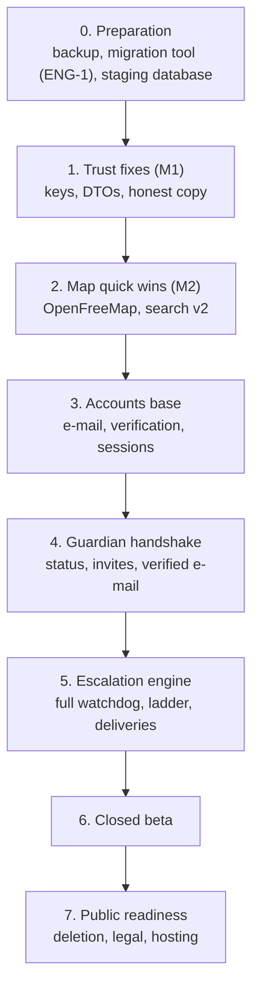

# Migration Plan – V1 to V2

| | |
|---|---|
| **Purpose** | How to move a running V1 system to V2 without breaking users, data or the safety behaviour |
| **Audience** | Whoever implements and deploys V2 |
| **Related** | [Roadmap](./roadmap.md) · [Database additions](./database.md) · [API additions](./api.md) · [V1 operations runbook](../v1/operations-runbook.md) |

## 1. Principles

1. **Never break an alert path.** Escalation and SOS must work at every step of the migration.
2. **Schema first, code second.** Apply additive migrations before the code that needs them.
3. **Additive then restrictive.** Add columns and tables with defaults first; tighten constraints later.
4. **One behavioural change at a time**, each behind a configuration switch where possible.
5. **Back up before every migration** (see the runbook).

## 2. Sequence

## 3. Data Migration Steps

| Step | Change | Handling of existing V1 data |
|---|---|---|
| Migration tool | Introduce `node-pg-migrate`; baseline the V1 schema as migration 0 | Capture the current schema; no data change |
| `users` columns | Add `email_verified_at`, `email_bounced_at`, `token_version` (default 0), `language` (default `en`), `display_name`, `trust_score` (default 1.0) | Existing users keep `email_verified_at = NULL`; they verify on next login. Default `display_name` is the first name |
| E-mail and codes | Create `otp_codes` and `email_outbox` | None |
| Sessions | Create `refresh_tokens`; shorten the access token | Existing 7-day tokens remain valid until they expire or `token_version` is raised. Roll out the new login first, then enforce |
| Guardians | Add `status`, `guardian_user_id`, `accepted_at`, `revoked_at`, `language`, `priority_tier` to `trusted_contacts` | Set every existing contact to `pending` unless the contact already matches a verified account; default `priority_tier = 1`. Notify walkers that their guardians must accept; keep the SMS fallback for pending contacts |
| Alerts | Create `alert_deliveries`, `sos_escalation_state` | None; new alerts write to them |
| Journeys | Add `escalation_reason`, `type` (default `safe_walk`) | Existing rows default correctly |
| Reports | Create `report_confirmations`; add `reporter_display`, `duplicate_of` | Rebuild `confirmations_count` from the table; anonymise or fill `reporter_display` from the old name only if the user opted in |
| Retention | Add the scheduled purge job | Run first in report-only mode, then delete |
| Medical card | Create `medical_cards` | None |

## 4. Behavioural Changes and Their Switches

| Change | Risk | Switch or safeguard |
|---|---|---|
| Guardian acceptance required | Existing guardians stop receiving app alerts until they accept | Keep sending the SMS to pending contacts for a transition period; show the walker who is pending |
| Escalation ladder replaces simultaneous push | Secondary contacts are notified later | Configuration flag `LADDER_ENABLED`; tier defaults to 1 so behaviour is unchanged until the walker sets tiers |
| Short-lived access tokens | Users are signed out more often if refresh fails | Roll out refresh first; extend the lifetime temporarily if needed |
| New map style | Different appearance; remote style URL | Keep the old style as a fallback in remote configuration |
| Public report names | Privacy expectations | Launch with anonymous default; the display-name option is opt-in |

## 5. Rollout Checklist

- [ ] Backup taken; restore tested once.
- [ ] Migration applied to staging and tested with a copy of production data.
- [ ] Automated tests green (the 104 V1 tests plus the new ones).
- [ ] Drills `S1`, `S2`, `W1`, `W2` pass on two phones ([testing plan](./testing-and-beta.md)).
- [ ] The scheduler still reaches `/api/internal/tick` and the watchdog escalates.
- [ ] Release APK signed and installed over the V1 build on a test phone (upgrade path) and fresh.
- [ ] Documentation and the changelog updated.

## 6. Rollback

- Schema changes are additive, so the V1 code keeps working against the V2 schema. Roll back the **code** first.
- If a migration must be reverted, restore from the backup taken before it; do not drop columns that V2 data has already filled without a copy.
- Feature switches (ladder, guardian enforcement) can be turned off without redeploying.
