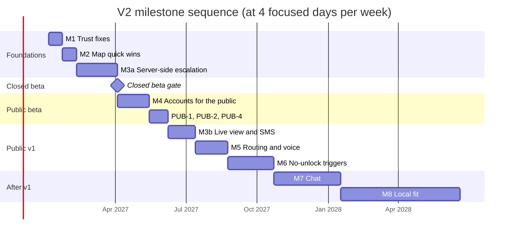
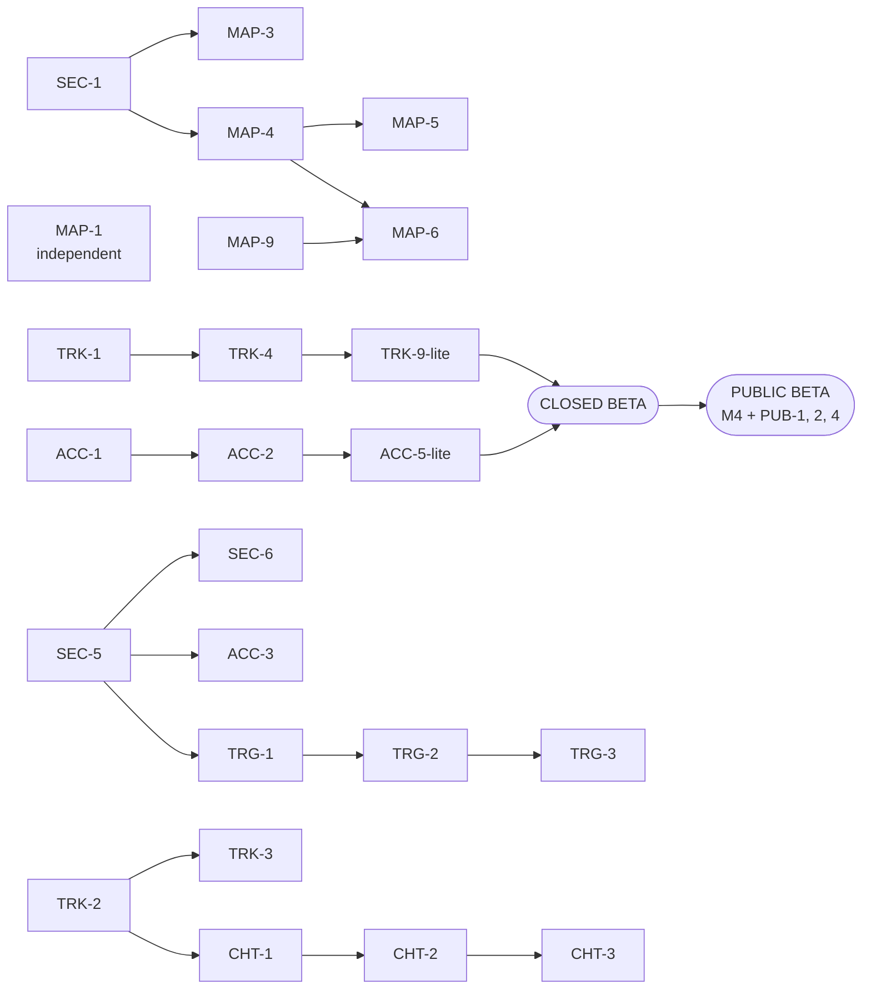

# Roadmap – Version 2 (Product)

| | |
|---|---|
| **Version** | V2 – planned |
| **Scope** | Everything beyond the V1 college release (see [`../v1/tasks.md`](../v1/tasks.md)) and short of the research items in [`../v3/`](../v3/README.md) |
| **Status labels** | 🗓 planned · ✅ done · 📄 documented only · 🔬 needs a test or check |
| **Sizes** | **S** about 1.5 focused days · **M** about 5 · **L** about 12 · **XL** about 25 |
| **Sources** | [`references.md`](./references.md) (`[R1]` … `[R61]`) |

V1 ships a narrower, submission-shaped version of the safety features described here: a deviation-only watchdog, a simplified guardian model, no e-mail, no session hardening and the existing map and search stack. This document is the fuller design to which those V1 shortcuts point.

## 1. Principles

1. **Fix what can hurt people first.** Privacy leaks and false claims come before new features.
2. **Server-side safety, not phone-side hope.** Anything that must happen when a phone is dead, offline or taken is done by the backend.
3. **Layered triggers and channels.** No single mechanism (one button, one push, one SMS) is trusted alone.
4. **Free by default, swappable later.** Every external service sits behind a small interface so that a paid upgrade is a configuration change (ADR-002).
5. **Consent and revocability** for anything that shares a location (`security-privacy-compliance.md` §5).
6. **Realistic for one developer.** Ship small milestones that are each usable on their own, and say "not yet" to anything that does not fit.
7. **Every feature ships with tests, documentation and a real-device check** (section 8).

### Positioning against existing Indian platforms

Safora complements, and does not copy, what already exists:

- **112 India / ERSS** [R2][R10] is the national emergency number and app, with volunteer "SHOUT" alerts. Safora does not replace it; it keeps 112 one tap away and adds guardians, tracking and hazard context.
- **Himmat Plus (Delhi Police)** [R6][R7] and **Haryana "Safe Journey"** [R9] are police-linked SOS and monitored-trip services. They show the value of a human control room, which the admin console (ADM-1) provides at small scale.
- **Uttarakhand Police App** [R8] combines citizen services and SOS for the state. The sources reviewed do not describe a community hazard map or a guardian-followed Safe Walk in it; these are Safora's strengths.

## 2. Product Decisions (21 September 2026)

| # | Decision | Effect on the plan |
|---|---|---|
| Y1 | One developer, one support member | Scope follows a strict order (section 4); the support member takes the non-code work in section 5 |
| Y2 | No custom domain for two years | E-mail works without a custom domain; links use the Render URL |
| Y3 | No Telegram; guardians use the Safora app | **TRK-7 dropped.** On-device SMS remains the safety net |
| Y4 | Public reports show a display name only | No user id, e-mail or phone. Two safeguards are recommended (SEC-2): a per-report "show my name" toggle and forced anonymity for sensitive categories |
| Y5 | The product is intended for all ages | **Legal warning:** data of under-18s needs verifiable parental consent under India's DPDP Rules. Recommendation: launch 18+ and add a teen mode later (AGE-1, AGE-2) |
| Y6 | Chat should be ordinary chat with text, audio and media | Staged plan CHT-1 to CHT-3 (contacts only, size limits). It is the largest item, about 50 focused days |
| Y7 | Built for public use, not only for one college | A public-readiness track (PUB-*), a staged rollout, an always-on host before real users, and "beta – do not rely on it alone" wording |
| Y8 | Student data for a pilot is not available | A closed beta with 5 to 8 people instead of a campus pilot ([`testing-and-beta.md`](./testing-and-beta.md)) |
| Y9 | A MapTiler key is available | Use **OpenFreeMap** for the online basemap and keep MapTiler only as a server-side geocoding fallback (ADR-003) |
| Y10 | Keep medical information | An optional, encrypted emergency medical card shown only during an SOS (MED-1) |
| – | SMTP was tested on Render's free plan and works | SMTP is acceptable behind the `Mailer` interface, with an HTTPS API as backup (ADR-006) |

## 3. Capacity and Gates

**Assumption.** 18 to 24 hours per week is about 2.5 to 3 focused days per week. A coding agent gives a modest speed-up on writing code, not on design, real-device testing or review. Sizes are before that adjustment.

| Milestone | Contents | Focused days | Calendar at 2 days/week | At 4 days/week |
|---|---|:---:|:---:|:---:|
| **M1 – Trust fixes** | SEC-1, SEC-2, SEC-3, SEC-4, SEC-7, SEC-8, SEC-9 | 10.5 | about 5 weeks | about 2.5 weeks |
| **M2 – Map quick wins** | MAP-1, MAP-3 | 10 | about 5 weeks | about 2.5 weeks |
| **M3a – Server-side escalation** | ACC-1, ACC-2, TRK-1, TRK-4, ACC-5-lite, TRK-9-lite | 30 | about 15 weeks | about 7.5 weeks |
| **M3b – Live view and SMS** | TRK-2, TRK-3, TRK-5, TRK-8 | 20 | about 10 weeks | about 5 weeks |
| **M4 – Accounts for the public** | SEC-5, SEC-6, ACC-3, ACC-4, AGE-1, MED-1 | 23 | about 11.5 weeks | about 5.75 weeks |
| **M5 – Routing and voice** | MAP-4, MAP-5 (MAP-6 optional, +5) | 24 | about 12 weeks | about 6 weeks |
| **M6 – No-unlock triggers** | TRG-1, TRG-2, TRG-3, TRG-6 | 34 | about 17 weeks | about 8.5 weeks |
| **M7 – Chat** | CHT-1, CHT-2, CHT-3 | 49 | about 24.5 weeks | about 12.25 weeks |
| **M8 – Local fit and public readiness** | LOC-1 to LOC-4, MAP-2, MAP-7 to MAP-9, TRK-6, ADM-1, ADM-3, ADM-4, PUB-1 to PUB-5 | 88.5 | about 44 weeks | about 22 weeks |
| **Engineering (continuous)** | ENG-1, 3, 4, 5, 7, 8 | 33.5 | spread across milestones | |
| **Total** | | **about 322** | **about 3 years** | **about 1.5 years** |

The complete list is therefore roughly 1.5 to 3 years of solo work. Three gates make it manageable:

| Gate | Requires | Focused days | At 2 days/week | At 4 days/week |
|---|---|:---:|:---:|:---:|
| **Closed beta** (5 to 8 people, labelled "prototype – do not rely on it alone") | M1 + M2 + M3a | 50.5 | about 6 months | about 3 months |
| **Public beta** (anyone can install; deletion, verification and legal basics in place) | Closed beta + M4 + PUB-1, PUB-2, PUB-4 | 85 | about 10 months | about 5 months |
| **Public v1** (all originally requested features except chat) | Public beta + M3b + M5 + M6 | 163 | about 19 months | about 9.5 months |

Chat (M7) and Hindi and local polish (M8) come after public v1.

> **Post-V1 adjustment.** V1 already contains lighter versions of SEC-2, SEC-4, SEC-9, TRK-1, a minimal TRK-4 and TRK-2. Treat those lines as "harden and extend the V1 version" and reduce the totals accordingly.

(The dates are illustrative and only show the order and relative size of the milestones.)

## 4. Work Items

### Phase 0 – Security and honesty (M1)

| ID | Item | Size | Depends |
|---|---|:---:|---|
| SEC-1 | Rotate the MapTiler key, remove it from source, proxy geocoding through the backend, scan the full history with gitleaks | S | – |
| SEC-2 | Public report responses: remove `userId`, e-mail and phone; show a display name only; per-report "show my name" toggle; forced anonymity for sensitive categories (recommended) | S | – |
| SEC-3 | `report_confirmations` (unique per report and user), block self-confirmation, per-user limit | S | – |
| SEC-4 | Correct overclaiming copy; add the "not a replacement for 112" notice | S | – |
| SEC-7 | Per-user duress PIN in secure storage; reject trivial PINs | S | – |
| SEC-8 | Settings: persist the toggles and wire them to behaviour, or remove those that do nothing | S | – |
| SEC-9 | Remove or clearly label sample data in the admin console | S | – |
| SEC-10 | Use the moderator role (permission split, abuse-flag queue) – added 22 Sep 2026 | M | – |

### Phase 1 – Real escalation (M3)

| ID | Item | Size | Depends |
|---|---|:---:|---|
| TRK-1 | `journey_breadcrumbs` table; persist each update and `last_seen_at` | S | – |
| TRK-4 | **Watchdog engine:** deviation timeout, lost contact, overdue arrival, with server-side escalation and a `confirm-safe` endpoint | L | TRK-1 |
| ACC-5-lite | Guardian handshake in the app: `pending → verified → revoked`; the guardian must be a Safora user with a verified e-mail | M | ACC-2 |
| TRK-9-lite | Fan-out: FCM push, in-app inbox, delivery log, guardian "I'm on it" and all-clear | M | TRK-4 |
| TRK-2 | Mobile Socket.IO client with JWT, rooms and reconnection | M | TRK-1 |
| TRK-3 | Admin live radar on real data | M | TRK-2, SEC-9 |
| TRK-8 | On-device SMS from the user's SIM (APK flavour) with delivery status | M | – |
| TRK-5 | Check-in timer ("Safety Check") | M | TRK-4 |
| TRK-11 | Escalation ladder with priority-tier delivery, replacing simultaneous broadcast – added 22 Sep 2026 | M | TRK-9-lite |
| TRK-10 | Battery dead-man's switch: 30-second cancel, repeats every 5 per cent drop – added 22 Sep 2026 | M | TRK-9-lite |

ACC-5-lite needs e-mail verification, so ACC-1 and ACC-2 are pulled forward into M3a; ACC-3 and ACC-4 stay in M4.

### Phase 2 – Map and search (M2 first, M5 later)

| ID | Item | Size | Depends |
|---|---|:---:|---|
| MAP-1 | English and India basemap with OpenFreeMap (a MapLibre layer inside the existing Leaflet map), visible attribution, remove OpenStreetMap prefetch | M | – |
| MAP-3 | Search v2: backend proxy, bounding-box tiers, `lang=en`, bias tuning, curated local places, cache | M | SEC-1 |
| MAP-4 | Routing service with providers; real profiles for walk, scooter, car and bike; driving mode in the radar | L | SEC-1 |
| MAP-5 | Turn-by-turn navigation with voice, earphone-only and haptic options, re-routing | L | MAP-4 |
| MAP-6 | Safest route: hazard ranking, lit streets for walking | M | MAP-4, MAP-9 |
| MAP-9 | Category-specific decay and "still there / cleared" confirmations | M | SEC-3 |
| MAP-2 | Offline region packs (PMTiles), also the fallback if the tile host disappears | M | – |
| MAP-7 | Safe places overlay | M | MAP-1 |
| MAP-8 | Hazard proximity alerts (geohash FCM topics) | M | SEC-8 |
| MAP-7b | "Safe stop" verified local spots – added 22 Sep 2026 | M | MAP-7 |
| MAP-9c | Reporter trust score – added 22 Sep 2026 | S | MAP-9 |
| MAP-9d | Duplicate and near-duplicate report detection – added 22 Sep 2026 | S | MAP-9 |
| MAP-9e | Photo EXIF sanity check (weak signal only) – added 22 Sep 2026 | S | SYN-3 (V1) |
| WX-1 | Weather overlay (Open-Meteo), see [`environmental-hazards.md`](./environmental-hazards.md) – added 22 Sep 2026 | M | MAP-9 |
| WX-2 | Earthquake advisories (USGS) – added 22 Sep 2026 | M | LOC-3 |
| WX-3 | Static seismic-zone weighting – added 22 Sep 2026 | S | MAP-9 |

### Phase 3 – Accounts for the public (ACC-1 and ACC-2 in M3a; the rest in M4)

| ID | Item | Size | Depends |
|---|---|:---:|---|
| ACC-1 | `Mailer` interface; SMTP implementation and HTTPS API backup; template files; outbox; daily-cap guard | S | – |
| ACC-2 | Welcome and e-mail verification (six-digit code) | M | ACC-1 |
| ACC-3 | Forgot and reset password (code); sign out of all sessions | M | ACC-1, SEC-5 |
| ACC-4 | "Password changed" and "Account deleted" notices | S | ACC-1 |
| SEC-5 | Session hardening: short access token, rotating refresh token, secure storage, `token_version` | M | – |
| SEC-6 | Account deletion (API and in-app) with data removed per `security-privacy-compliance.md` §2 | M | SEC-5 |
| AGE-1 | Age policy screen and sign-up gate (18+ at launch; designed for a later teen mode) | S | – |
| MED-1 | Optional emergency medical card, encrypted, visible only during an SOS | M | – |
| AGE-2 | `parent-of` relationship (data model only; teen mode stays gated on PUB-4) – added 22 Sep 2026 | S | AGE-1 |

### Phase 4 – No-unlock triggers (M6)

| ID | Item | Size | Depends | Note |
|---|---|:---:|---|---|
| TRG-1 | Native Kotlin module: secure token store and a native SOS sender (HTTPS and SMS) | L | SEC-5, TRK-8 | |
| TRG-2 | "Guard" standalone foreground service with a battery and auto-start checklist | M | TRG-1 | The Safe Walk foreground service already exists in V1 (`SafeWalkService.kt`) |
| TRG-3 | Quick Settings tile, notification action and widget | M | TRG-1 | Standalone trigger outside active walks |
| TRG-6 | Cold locked-screen audio evidence for standalone triggers | S | TRG-2 | Dual-pipe audio already works in V1 for Safe Walks |
| TRG-4 | Volume-pattern trigger through an AccessibilityService (opt-in) | L | TRG-2 | |
| TRG-5 | Shake trigger (opt-in) | S | TRG-2 | |

### Phase 5 – Chat (M7, staged)

| ID | Item | Size | Depends |
|---|---|:---:|---|
| CHT-1 | Thread attached to a Safe Walk or SOS: quick replies and text; delivered and read ticks; Socket.IO and FCM | L | TRK-2, ACC-5 |
| CHT-2 | One-to-one text chat between mutually accepted contacts; block, mute, report; rate limits | L | CHT-1 |
| CHT-3 | Voice notes and images between accepted contacts; size and duration caps; signed URLs; auto-expiry | XL | CHT-2 |
| CHT-4 | Codeword or duress phrase in chat that silently triggers an SOS – added 22 Sep 2026 | S | CHT-1 |

*Not planned:* groups, public chat, chat with strangers, files of any type.

### Phase 6 – Local fit and public readiness (M8)

| ID | Item | Size |
|---|---|:---:|
| LOC-1 | Hindi and English (strings, TTS voice, TalkBack) | L |
| LOC-5 | Vibration-only alert patterns (accessibility for deaf and hard-of-hearing users) – added 22 Sep 2026 | S |
| TRK-12 | "Walk with me" live request (lighter than a full Safe Walk) – added 22 Sep 2026 | M |
| TRK-13 | Scheduled and recurring Safe Walk reminders – added 22 Sep 2026 | S |
| LOC-2 | Uttarakhand hazard categories and severity guidance | S |
| LOC-3 | Sachet advisory ingestion and admin broadcast | M |
| LOC-4 | Audit-style rating fields | M |
| TRK-6 | Guardian web tracking link for guardians without the app – deferred | L |
| ADM-1 | Dispatch workflow: assign responder, notes, call-back log, audit trail | M |
| ADM-3 | Analytics: time-of-day heat map and response-time metrics | M |
| ADM-4 | PDF evidence packet (forensic incident dossier) | M |
| ADM-5 | Municipal 112 ERSS and campus CAD connector (CAP protocol and web-hooks) | M |
| PUB-1 | Terms of use, privacy policy and grievance contact, drafted from a template and checked by a qualified person | M |
| PUB-2 | Hosting upgrade to an always-on instance and a paid database before real users | S |
| PUB-3 | Moderation tools: report queue for hazards and chat reports, block lists | M |
| PUB-4 | Legal review: DPDP, minors, chat and media, audio recording | M |
| PUB-5 | Support contact and an in-app "report a problem" | S |

### Engineering (continuous)

| ID | Item | Size |
|---|---|:---:|
| ENG-1 | `node-pg-migrate`, indexes, remove `typeorm`, move the seed to `scripts/` | M |
| ENG-3 | PostGIS integration tests and Maestro flows for SOS and Safe Walk | L |
| ENG-4 | CI: lint, gitleaks, CodeQL, Dependabot, Android build, coverage gate | M |
| ENG-5 | Structured logs, a database-checking health endpoint, optional Sentry | M |
| ENG-7 | In-app update check through GitHub Releases; release-signing procedure | M |
| ENG-8 | Scheduled database dump and restore drill | S |

ENG-2 (screen refactoring) and ENG-6 (OpenAPI) follow after public v1.

**Dropped.** TRK-7 Telegram bot (decision Y3); the `volunteer_responder` role and all institution-scoped features (aggregate organisation data, `org_admin`), because both depend on external adoption. **Deferred.** TRK-6 tracking link, ADM-2 campus console and the campus pilot (replaced by the closed beta).

## 5. How the Support Member Can Help (no coding)

| Task | Supports |
|---|---|
| Test on their own phone (brand and Android version) with the device checklist | Device matrix |
| Build the curated Dehradun places list (name, aliases, coordinates), 100 entries | MAP-3 |
| Verify police stations, hospitals and pharmacies near the beta area | MAP-7 |
| Write and check Hindi strings | LOC-1 |
| Recruit and brief the 5 to 8 beta testers; collect feedback forms | Closed beta |
| Watch hazard reports for abuse or duplicates during the beta | PUB-3 |
| Draft the privacy policy and terms from a template and check what the app really does | PUB-1 |
| Keep the status tags in the documents up to date | All |

## 6. If Time Runs Short

Cut in this order, last cut first: CHT-3 (media chat) → CHT-2 (one-to-one chat) → LOC-3 and LOC-4 → MAP-7 and MAP-8 → TRG-4 (volume pattern) → MAP-6 → MAP-5 voice (keep routing) → TRG-3 widget → LOC-1 Hindi.

**Never cut:** SEC-1 to SEC-4, TRK-1, TRK-4, ACC-5, SEC-6, PUB-1, PUB-2 and PUB-4.

## 7. Critical Path

## 8. Definition of Done (every item)

- [ ] Code merged behind CI (build, type-check, tests, gitleaks) with a test that would fail without the change.
- [ ] Spec status tag updated (🗓 → ✅) and any API or database change written into the spec.
- [ ] Checked on **two real phones**; anything background-related on one phone that is neither a Pixel nor a Samsung.
- [ ] No new secret, key or personal data in the repository or in logs.
- [ ] Privacy check: new personal data? If yes, update `security-privacy-compliance.md` §2.
- [ ] Failure mode written down: what does the user see if this feature fails?

## 9. Risks

| # | Risk | Likelihood | Impact | Mitigation |
|---|---|:---:|:---:|---|
| R-1 | One developer: illness, exams, burnout | High | High | Small milestones; the cut list; the support member covers testing and content |
| R-2 | Locked-screen audio cannot start from the background on newer Android | High | Medium | TRG-6 spike; send the SOS without audio first [R11][R12] |
| R-3 | Vendor battery managers kill the Guard service | High | High | Onboarding checklist; the server watchdog is the safety net [R17] |
| R-4 | False alarms from hill dead zones | High | Medium | Tiered stale rules; tune during the beta |
| R-5 | Render's free web service sleeps and delays the first SOS | High | High | Keep-warm ping (ADR-007); always-on instance before real users (PUB-2) |
| R-6 | Guardian feature used for stalking or coercion | Medium | High | Anti-coercion rules (`security-privacy-compliance.md` §5); visible sharing; revocation; guardians can leave |
| R-7 | Minors on a location app without parental consent | High if Y5 stays | High | Launch 18+; teen mode only after legal advice |
| R-8 | Open chat with media: abuse, grooming, illegal content, storage cost | Medium | High | Contacts-only chat; block and report; size caps; moderation queue (PUB-3); legal review (PUB-4) |
| R-9 | Reporter names shown publicly expose people who report stalkers or harassment | Medium | High | Per-report anonymity; forced anonymity for sensitive categories; display name only |
| R-10 | Free map or routing providers change terms or disappear | Medium | Medium | Provider adapters; offline PMTiles fallback (MAP-2) |
| R-11 | Scope: years of work at two days per week | High | High | Gates (section 3) and cut list (section 6) |

## 10. Open Questions

| # | Question | Default assumption |
|---|---|---|
| Q1 | How many hours per week can the developer and the support member give? (This sets the calendar.) | 15 hours per week for the developer |
| Q2 | Launch at 18+ and add a teen mode after legal advice? | Yes |
| Q3 | Per-report "show my name" toggle, with forced anonymity for harassment, suspicious-activity and isolated-area reports? | Yes |
| Q4 | Contacts-only chat (no strangers, no groups), staged CHT-1 to CHT-3, with clear wording that messages are stored on the server and not end-to-end encrypted? | Yes |
| Q5 | Which SMTP provider and port worked on Render's free plan? | Brevo SMTP, port to be recorded |
| Q6 | Is a Play Store release planned? (Decides whether SMS and accessibility code stays in an APK-only flavour) | Maybe; keep an APK-only flavour |
| Q7 | Medical-card fields? | Blood group, allergies, conditions, medications and one free-text note, all optional |
| Q8 | Who reviews the privacy policy and DPDP points? | The project supervisor or a qualified adviser |
