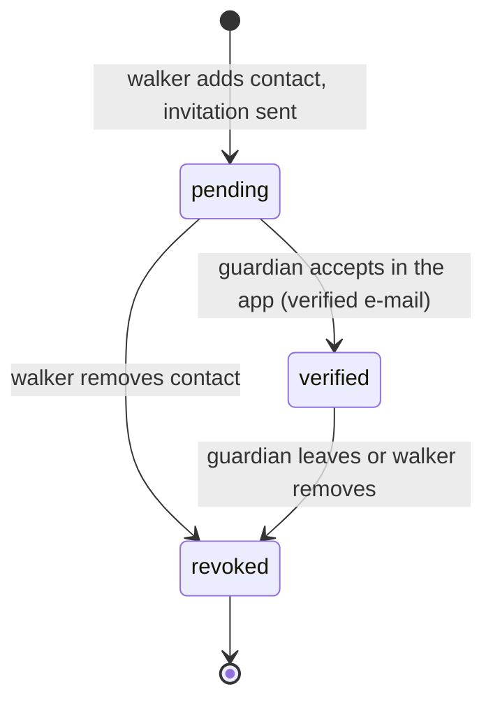
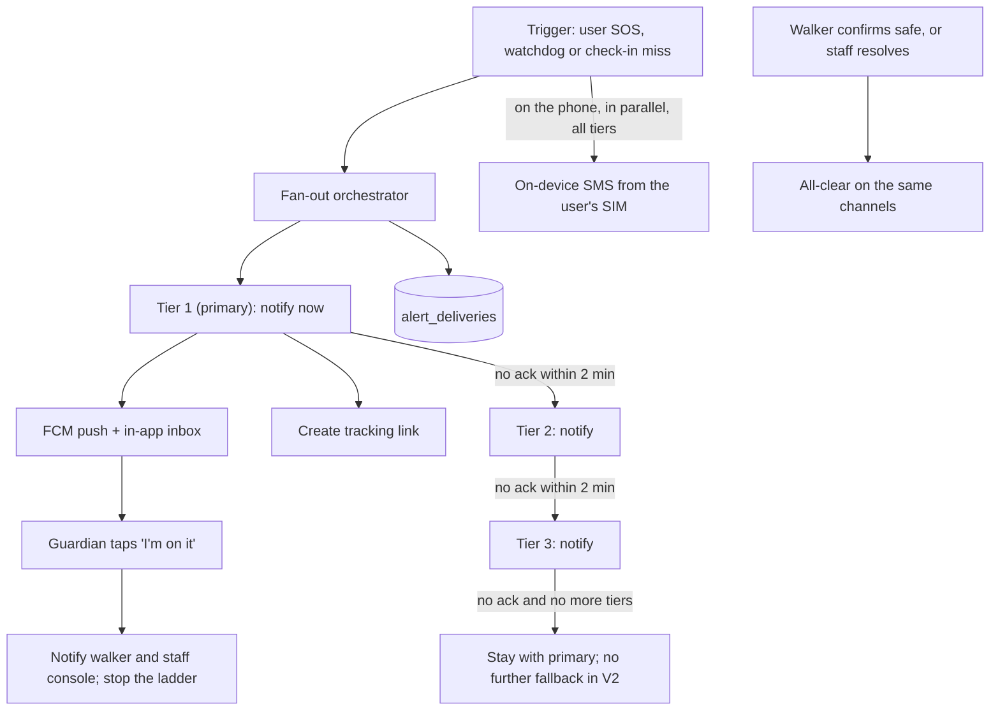
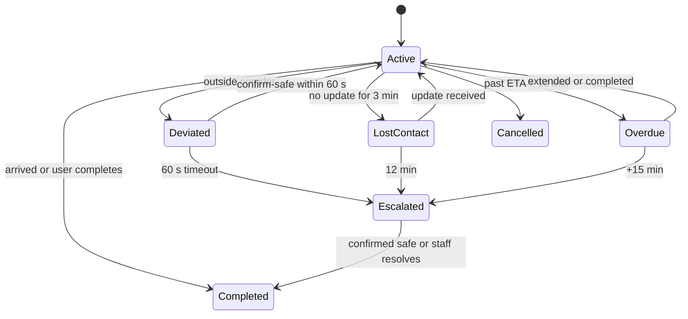
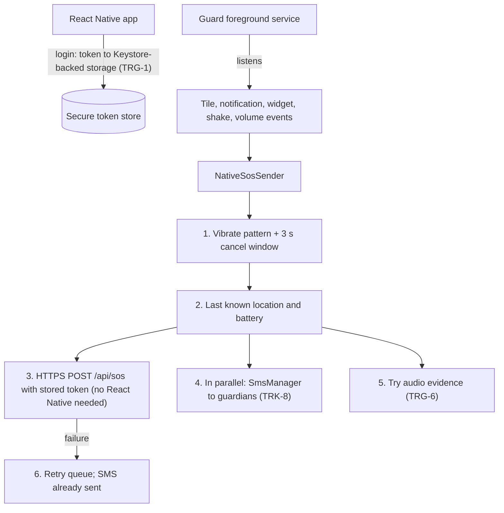

# Specification – Safety, Tracking and Triggers

| | |
|---|---|
| **Version** | V2 – planned |
| **Covers** | ACC-5, TRK-1 to TRK-13, TRG-1 to TRG-6, CHT-1 to CHT-4, ADM-4, ADM-5 |
| **Reasoning and sources** | [`architecture-decisions.md`](./architecture-decisions.md), [`references.md`](./references.md) |
| **Status tags** | ✅ verified · 📄 documented only · 🔬 needs a test · 🗓 planned. All items are 🗓 unless marked |

**Changes in V2:** Telegram was dropped (guardians use the Safora app), the tracking link is deferred, and chat is split into stages. **Added 22 September 2026:** an escalation ladder (TRK-11) replaces "notify everyone at once", and a battery dead-man's switch (TRK-10), "walk with me" (TRK-12), scheduled walks (TRK-13) and a chat duress codeword (CHT-4) were added.

**Relation to V1.** V1 delivers the deviation rule only, with a corridor that staff can configure (default 150 m), `confirm-safe`, breadcrumbs, a live guardian view and a simplified guardian model. V2 extends or replaces each of these. See [`../v1/architecture.md`](../v1/architecture.md).

## 1. Guardian Model (ACC-5)

### Goal
Only people who have **explicitly accepted** can receive someone's location or alerts. In V1, any account that registers with a matching e-mail address or phone number starts receiving that person's alerts, so a stranger who signs up first could intercept them. V2 closes this gap.

### Contact channels (app first)
No Telegram; guardians use the Safora app. A trusted contact is reachable through the following channels, each with its own consent step:

| Channel | Suits | Consent step | Cost |
|---|---|---|---|
| **App** (FCM push and in-app inbox) | A guardian who has Safora | The guardian accepts the invitation inside a verified account | Free |
| **On-device SMS** (safety net) | Any phone number the walker entered | The walker confirms the number; the guardian can ask the walker to stop | The walker's SIM plan; APK build only |
| **Web tracking link** (deferred, section 5) | A guardian without the app | None needed (the link is private, expiring and revocable) | Free |

A guardian who does not yet have Safora is invited by a share message with the download link. Because installing an APK is real friction, the SMS safety net still reaches such guardians during an SOS.

### Status model



- `pending`: created by the walker; the invitation is sent. **No location and no SOS content is sent** apart from the single drill or invitation message.
- `verified`: the guardian accepted in the app and receives alerts through it.
- `revoked`: the guardian left or was removed. The contact is excluded at once from all fan-out and tracking links.
- SMS-only contacts (no Safora account) stay `pending`. They still receive the SOS **SMS**, because the walker chose to send it from their own phone (explicit walker consent, stated in the interface), but nothing else.

### Rules
1. An invitation through the app requires the guardian's **verified** e-mail (ACC-2). An unverified account cannot be matched.
2. The walker sees each guardian's state (App ✅ / SMS only / Pending).
3. A guardian can **leave** at any time (`DELETE /api/guardian/links/:id`); the walker is notified.
4. Rate limit: 10 new invitations per user per day. A guardian can report "I don't know this person", which blocks that sender.
5. A guardian is told exactly what they will receive ("live location during Safe Walks you start, and SOS alerts").

### Data model

```sql
ALTER TABLE trusted_contacts
  ADD COLUMN status VARCHAR(20) NOT NULL DEFAULT 'pending',   -- pending|verified|revoked
  ADD COLUMN guardian_user_id INTEGER REFERENCES users(id),   -- set when accepted in the app
  ADD COLUMN accepted_at TIMESTAMPTZ,
  ADD COLUMN revoked_at TIMESTAMPTZ,
  ADD COLUMN language VARCHAR(5) DEFAULT 'en',
  ADD COLUMN priority_tier SMALLINT NOT NULL DEFAULT 1;       -- 1 primary, 2 secondary, 3 tertiary (section 2)

CREATE TABLE guardian_invites (
  id UUID PRIMARY KEY,
  contact_id INTEGER NOT NULL REFERENCES trusted_contacts(id) ON DELETE CASCADE,
  channel VARCHAR(20) NOT NULL,                               -- app|email
  token_hash TEXT NOT NULL, expires_at TIMESTAMPTZ NOT NULL,
  used_at TIMESTAMPTZ, created_at TIMESTAMPTZ DEFAULT now()
);
```

The walker sets `priority_tier` when adding or editing a contact. Contacts default to tier 1 until the walker organises them, which preserves the "everyone is notified" behaviour until then.

### API

| Endpoint | Purpose |
|---|---|
| `POST /api/sos/contacts` (existing) | Creates a `pending` contact and triggers invitations |
| `POST /api/guardian/invites/:token/accept` | The guardian accepts in the app |
| `GET /api/guardian/links` | The guardian lists the people who added them |
| `DELETE /api/guardian/links/:id` | The guardian leaves |
| `POST /api/sos/contacts/:id/resend` | Re-sends the invitation (10-minute cool-down) |

### Acceptance criteria
- A second account registered with a guardian's e-mail **before** the real guardian cannot receive alerts unless it holds a verified e-mail.
- A `pending` or `revoked` contact receives nothing during a test SOS.
- The walker interface shows the correct channel state within 5 seconds of acceptance.

---

## 2. Alert Fan-Out Orchestrator (TRK-9) and Escalation Ladder (TRK-11)

### Goal
An SOS or an escalation event reaches guardians through every available channel, with delivery tracking, acknowledgement and an all-clear message. Since 22 September 2026 delivery follows a **priority ladder**, primary tier first, instead of notifying every verified guardian at once.



### Escalation ladder behaviour (TRK-11)
1. **An SOS goes to the primary tier (`priority_tier = 1`) first**, on all channels and immediately. This applies to every SOS, manual or watchdog-triggered.
2. **Wait 2 minutes** for any primary contact to acknowledge ("I'm on it"). The first acknowledgement from *any* tier stops the ladder.
3. **No primary acknowledgement after 2 minutes:** notify the secondary tier (`priority_tier = 2`) on the same channels, with the same 2-minute wait.
4. **No secondary acknowledgement after 2 minutes:** notify the tertiary tier, with the same pattern.
5. **If no secondary or tertiary contacts exist, or all tiers are exhausted without acknowledgement, the ladder stays with primary.** It does not fall back to notifying everyone. This is a deliberate choice: the behaviour is simple and avoids a confusing moment when everyone is suddenly pinged. A walker with only one contact is effectively primary and has no ladder to climb, and the interface says so ("add a secondary contact to enable escalation").
6. **On-device SMS (TRK-8) goes to everyone regardless of tier**, in parallel and from the moment of the trigger. It is a phone-originated safety net, not part of the server-orchestrated ladder, and costs nothing extra to send at once.
7. Every SOS still creates a tracking link and follows the drill, idempotency, acknowledgement and all-clear rules below. The ladder changes only *when each tier's push fires*.

### Forward reference – V3 offline messaging
Once V3's offline mesh messaging exists (see [`../v3/02-offline-emergency-messaging.md`](../v3/02-offline-emergency-messaging.md)), "primary unreachable through normal channels (no push delivery and no SMS delivery confirmation) and no cell or data signal" is exactly the condition for a last-resort tier: try reaching anyone in Bluetooth or Wi-Fi Direct range. **Not built now.** The note exists so that the two systems fit together without retrofitting.

### Behaviour per tier
1. **Parallel, independent channels within a tier.** A failure in one never blocks another. Each channel retries three times with exponential back-off, honouring provider back-off headers.
2. **Idempotency.** Every event has an `event_id`; guardians receive one message per channel per event; repeated watchdog ticks never re-send.
3. **Message content.** The walker's first name, the time, coordinates as a map link, battery level, an audio link (signed URL) if present, the tracking link and the event type. No phone number of the walker unless the guardian already has it.
4. **Acknowledgement.** An "I'm on it" button in the app. The first acknowledgement (from any tier) notifies the walker, shows in the staff console and halts the ladder.
5. **All-clear.** When the walker confirms safety or staff resolve the alert, a short message goes to **every tier that was actually notified**, and the tracking link expires.
6. **Drills** (`is_test`) use the same code path, including the ladder, so a drill is a real test of tier timing. They are labelled `[DRILL]` and never page staff.

### Data model

```sql
CREATE TABLE alert_deliveries (
  id BIGSERIAL PRIMARY KEY, event_id UUID NOT NULL,
  sos_id INTEGER REFERENCES sos_alerts(id) ON DELETE CASCADE,
  contact_id INTEGER REFERENCES trusted_contacts(id) ON DELETE SET NULL,
  tier SMALLINT NOT NULL,              -- 1|2|3 at the time of sending
  channel VARCHAR(20) NOT NULL,        -- fcm|sms|link
  status VARCHAR(20) NOT NULL,         -- queued|sent|failed|delivered|acked
  error TEXT, attempts INT DEFAULT 0, sent_at TIMESTAMPTZ, acked_at TIMESTAMPTZ,
  created_at TIMESTAMPTZ DEFAULT now()
);
CREATE INDEX ON alert_deliveries (event_id);

CREATE TABLE sos_escalation_state (
  sos_id INTEGER PRIMARY KEY REFERENCES sos_alerts(id) ON DELETE CASCADE,
  current_tier SMALLINT NOT NULL DEFAULT 1,
  tier_notified_at TIMESTAMPTZ NOT NULL DEFAULT now(),
  acked_at TIMESTAMPTZ,                -- set on the first ack from any tier; halts the ladder
  updated_at TIMESTAMPTZ DEFAULT now()
);
```

The existing 30-second watchdog tick checks `sos_escalation_state` rows. If `acked_at IS NULL`, `now() − tier_notified_at > 2 minutes`, `current_tier < 3` and a contact exists at the next tier, it advances the tier and notifies. If no next tier exists and there is still no acknowledgement, nothing further happens: this **is** the "stay with primary" behaviour.

SMS results are reported back by the phone (`POST /api/sos/:id/sms-status`) so that staff can see whether the walker's phone really sent them.

### Acceptance criteria
- Three tiers, none acknowledging: primary at T+0, secondary at T+2 min, tertiary at T+4 min, then nothing further.
- Any tier's "I'm on it" halts advancement: `sos_escalation_state.acked_at` is set and no later `alert_deliveries` rows appear.
- A walker with only a primary contact: primary is notified once, the ladder does not advance and nothing fails.
- On-device SMS fires immediately regardless of tier, shown by an SMS delivery row with `sent_at` close to the trigger time while `current_tier` is still 1.
- The staff console shows per-channel, per-tier status for each guardian within 10 seconds.

---

## 3. Breadcrumbs, Sockets and Live Radar (TRK-1, TRK-2, TRK-3)

> **Status.** The core of these three items is **delivered in V1** (breadcrumbs, mobile Socket.IO client, live admin radar). V2 adds the extra columns and the lost-contact support below.

### Data model

```sql
CREATE TABLE journey_breadcrumbs (
  id BIGSERIAL PRIMARY KEY,
  journey_id INTEGER NOT NULL REFERENCES journeys(id) ON DELETE CASCADE,
  location GEOGRAPHY(Point,4326) NOT NULL, speed REAL, accuracy REAL, battery SMALLINT,
  recorded_at TIMESTAMPTZ NOT NULL DEFAULT now()
);
CREATE INDEX ON journey_breadcrumbs (journey_id, recorded_at DESC);

ALTER TABLE journeys
  ADD COLUMN mode VARCHAR(10) DEFAULT 'walk',             -- walk|bike|scooter|car
  ADD COLUMN last_location GEOGRAPHY(Point,4326),
  ADD COLUMN last_seen_at TIMESTAMPTZ,
  ADD COLUMN deviated_at TIMESTAMPTZ,
  ADD COLUMN escalated_at TIMESTAMPTZ,
  ADD COLUMN escalation_reason VARCHAR(30);
```

### Behaviour
- `PATCH /api/journeys/:id/location` inserts a breadcrumb, updates `last_location` and `last_seen_at`, evaluates the corridor and emits `journey:location` to the rooms `staff`, `journey:{id}` and (through a link token) `track:{linkId}`.
- The mobile app opens **one** authenticated socket after login (JWT in the handshake), joins the active journey room, and falls back to REST only if the socket drops.
- Update interval: walking 5 s (V1 uses 3 s or 5 m), bicycle, scooter and car 3 s. When the phone is stationary for 60 seconds, updates pause and a heartbeat is sent every 30 seconds instead, which saves battery and keeps `last_seen_at` fresh.
- Retention: breadcrumbs older than 30 days are deleted by a scheduled job (`security-privacy-compliance.md` §2).

### Acceptance criteria
- Walking with the app open produces a row about every 5 seconds and a moving marker in the radar with less than 3 seconds of lag.
- The radar never shows sample data when the backend is reachable (SEC-9).

---

## 4. Watchdog Engine (TRK-4)

### Goal
Escalation that does not depend on the phone staying alive. V1 implements the first rule (deviation); V2 adds the others.

### Rules

| Rule | Detects | Step 1 | Step 2 | Step 3 |
|---|---|---|---|---|
| **Deviation** (V1) | The walker leaves the corridor (default 150 m, configurable 20 to 1000 m) | Push and in-app prompt "Are you OK?" | No `confirm-safe` within **60 s**: **escalate** | – |
| **Lost contact** | Active journey with `last_seen_at` older than **3 min** | Push to the walker ("still there?") | **6 min:** soft notice to guardians ("last seen at …", no SOS) | **12 min:** full escalation |
| **Overdue** | `now` later than `expected_arrival_at + 10 min` | Push "Still walking? Extend or complete" | **+5 min** without a reply: soft notice to guardians | **+10 min:** full escalation |
| **Check-in miss** (TRK-5) | The timer passes `due_at` | Push and 60-second countdown | Escalate | – |

All numbers are **defaults and configurable**, to be tuned in the beta. Hill areas have dead zones, so *lost contact* is deliberately gentler than *deviation* (risk R-3).

### Escalation action
1. Set `escalated_at` and `escalation_reason` (`deviation`, `lost_contact`, `overdue` or `checkin`) and write an `escalation_events` row.
2. Create an SOS alert with `source = 'watchdog'`, located at the last known point, and start the fan-out (section 2).
3. Create a tracking link (section 5) and include it.
4. Keep watching: if the walker reconnects and confirms safety, send the all-clear.



### Runtime design (ADR-007)
- An in-process scheduler tick every 30 seconds inside the Express service. The list of **active journeys is held in memory**, loaded from the database at start-up and updated on start, complete, cancel and location events, so an idle tick makes no database query.
- Render's free web service sleeps after 15 minutes idle [R41]. An external scheduler calls `POST /api/internal/tick` with a secret header every minute, and the tick endpoint runs the check too. An always-on paid instance removes the need for the scheduler.
- Because the service can restart at any time, every rule is **idempotent** and driven by timestamps stored in the database, not by in-memory timers.

### API
`POST /api/journeys/:id/confirm-safe` (V1) · `GET /api/journeys/:id/status` · `POST /api/internal/tick` (secret header, no user authentication, V1).

### Acceptance criteria (each by simulation and on a real phone)
- Force-stop the app during a walk: guardians receive a *lost contact* notice at about 6 minutes and escalation at about 12 minutes (default settings).
- Leave the corridor and ignore the prompt: escalation within 60 ± 5 seconds **with the app killed**.
- Restart the backend during a walk: no duplicate alerts and no missed alerts.
- Escalation never fires twice for the same journey.

---

## 5. Guardian Live-Tracking Link (TRK-6) – deferred to M8

Because guardians are expected to use the app, the web link is optional. Build it only if beta testers say that guardians without the app matter. The design below remains valid.

### Goal
A guardian without the app follows a walk in any browser. The design limits the harm of a leaked link.

### Token and lifetime
- A 128-bit random token in the URL (`/t/<token>`); only its SHA-256 hash is stored.
- Separate from the login JWT; read-only access to **one** journey or SOS.
- Expires 30 minutes after the walk ends; SOS links expire 6 hours after the last update. The walker can **revoke** the link at any time.

```sql
CREATE TABLE tracking_links (
  id UUID PRIMARY KEY,
  journey_id INTEGER REFERENCES journeys(id) ON DELETE CASCADE,
  sos_id INTEGER REFERENCES sos_alerts(id) ON DELETE CASCADE, checkin_id INTEGER,
  token_hash TEXT NOT NULL UNIQUE, created_by INTEGER REFERENCES users(id),
  created_at TIMESTAMPTZ DEFAULT now(), expires_at TIMESTAMPTZ NOT NULL, revoked_at TIMESTAMPTZ,
  last_viewed_at TIMESTAMPTZ, view_count INT DEFAULT 0
);
```

### What the viewer shows
The walker's **first name**, current position on the map, the time of the last update ("12 s ago"), a status banner (On route, Off route, Lost contact or SOS), the destination name if the walker allows it, and the battery level (walker toggle). **No phone number and no history trail.** During an escalation, the last 15 minutes of the trail are shown to help responders.

### Endpoints and hardening

| Endpoint | Notes |
|---|---|
| `GET /api/track/:token` | Returns the minimal state above. Rate limit 60 per minute per IP. `Cache-Control: no-store`, `X-Robots-Tag: noindex`. The same 404 for unknown, expired and revoked tokens |
| Socket room `track:{linkId}` | Joined with the token, not a JWT; receives only position and status events |
| `POST /api/journeys/:id/tracking-links` | The walker creates or refreshes a link |
| `DELETE /api/tracking-links/:id` | The walker revokes |

The viewer is a public route in the existing admin static site (`/t/:token`), so it costs nothing extra.

### Acceptance criteria
- A link stops working within 5 seconds of revocation and after expiry.
- The viewer discloses no field beyond those listed (a test snapshots the JSON).
- Brute-forcing tokens is rate limited and shows no timing difference between "unknown" and "expired".

---

## 6. Check-In Timer – "Safety Check" (TRK-5)

Modelled on the Safety Check of Google's Personal Safety app, which asks the user to confirm safety before a timer ends and starts emergency sharing if they do not [R3][R4], and which lets the user add time [R5].

### Flow
1. The user picks a reason (walking alone, meeting someone, hiking, travelling), a duration (15 minutes to 8 hours) and the guardians to notify.
2. A reminder push arrives at `due_at − 5 min`.
3. At `due_at`: a push and a full-screen prompt with a 60-second countdown: **I'm safe**, **Add 15 minutes** (at most three times), **Need help**.
4. No response: the watchdog escalates as in section 4 (check-in miss) and starts a tracking link.
5. "I'm safe" resolves the check; guardians who were told about it receive a short "all good".

```sql
CREATE TABLE checkins (
  id SERIAL PRIMARY KEY, user_id INTEGER NOT NULL REFERENCES users(id) ON DELETE CASCADE,
  reason VARCHAR(30), due_at TIMESTAMPTZ NOT NULL, extensions SMALLINT DEFAULT 0,
  contact_ids INTEGER[] DEFAULT '{}',
  status VARCHAR(20) DEFAULT 'active',          -- active|resolved|escalated|cancelled
  created_at TIMESTAMPTZ DEFAULT now(), resolved_at TIMESTAMPTZ
);
```

### Acceptance criteria
- A check-in set for 15 minutes escalates at 16 minutes with the phone switched off.
- Three extensions work; a fourth is refused.

---

## 6b. Battery Dead-Man's Switch (TRK-10)

### Goal
If the battery is about to die during an active Safe Walk, send guardians a last-known-location message **before** it dies, instead of letting the watchdog notice the resulting silence minutes later through the lost-contact rule.

### Flow
1. During an active Safe Walk the phone monitors its battery level (already sent with every location update).
2. Each time the level crosses a **5-point drop** below a starting ceiling (for example 20 %, then 15 %, 10 %, 5 %; configurable) and a walk is active, a full-screen prompt appears: *"Your battery is at 15 %. We'll send your location to your guardians in 30 seconds unless you cancel."*
3. A **30-second cancel window**, using the same component as the SOS cancel countdown.
4. If not cancelled, a **battery-warning alert** is sent. It is a distinct type from a full SOS: no audio attempt, no ladder, just one message ("battery low, last known location: link") to the walker's **primary tier only**.
5. The prompt **repeats at each further 5-point threshold**, each with its own cancel window, so it cannot become an unstoppable nuisance if the user is fine.
6. It stops when the walk ends or the phone dies. The lost-contact rule is the final safety net.

```sql
CREATE TABLE battery_warnings (
  id BIGSERIAL PRIMARY KEY,
  journey_id INTEGER NOT NULL REFERENCES journeys(id) ON DELETE CASCADE,
  battery_level SMALLINT NOT NULL, sent BOOLEAN NOT NULL DEFAULT false,
  cancelled BOOLEAN NOT NULL DEFAULT false, created_at TIMESTAMPTZ DEFAULT now()
);
```

### Acceptance criteria
- A simulated drop from 22 % to 19 % during an active walk shows the prompt at the 20 % crossing, not before.
- Cancelling within 30 seconds sends nothing; letting it expire sends exactly one message to the primary tier.
- A further drop to 14 % triggers a second, independent prompt.
- No prompt appears without an active Safe Walk, whatever the battery level.

---

## 6c. "Walk With Me" Live Request (TRK-12)

### Goal
A lighter alternative to a planned Safe Walk for a spontaneous need ("stay with me for the next 10 minutes"), without a destination or route.

### Flow
1. The user taps "Walk with me" (no destination), picks a duration (5 to 30 minutes) and the guardians to ask.
2. The selected guardians who are reachable are notified.
3. A guardian who accepts sees a simplified live-location view for the duration. There is no corridor or deviation logic: this is presence sharing, not route following.
4. The session ends automatically at the chosen duration or when the user taps "Done".
5. No watchdog escalation is tied to it, because it is deliberately lightweight. A full Safe Walk gives deviation-style guarantees.

### Data model
Reuses `journeys` with a new `type` column:

```sql
ALTER TABLE journeys ADD COLUMN type VARCHAR(20) NOT NULL DEFAULT 'safe_walk'; -- safe_walk|walk_with_me
```

`walk_with_me` journeys leave `route_polyline` and `deviated_at` unused and are excluded from the deviation rule. Lost-contact protection is off by default.

### Acceptance criteria
- A request without a destination succeeds (a full Safe Walk requires one).
- A guardian who accepts sees the live marker; one who ignores it sees nothing further.
- The session ends automatically with no lingering tracking.

---

## 6d. Scheduled and Recurring Safe Walks (TRK-13)

### Goal
Remind the user to start tracking for a route and time they walk regularly.

### Flow
1. After a Safe Walk, offer "Make this a regular walk?" with a day-of-week and time picker, or let the user create it on a "Scheduled walks" screen.
2. A local notification fires a few minutes before the scheduled time. **It is a reminder, not an automatic start.** Starting location tracking without an explicit action each time would be a consent problem (`security-privacy-compliance.md` §5, rule D1).
3. Tapping the reminder pre-fills a new Safe Walk with the saved destination.

```sql
CREATE TABLE scheduled_walks (
  id SERIAL PRIMARY KEY, user_id INTEGER NOT NULL REFERENCES users(id) ON DELETE CASCADE,
  destination_lat DOUBLE PRECISION, destination_lng DOUBLE PRECISION, destination_label TEXT,
  day_of_week SMALLINT[] NOT NULL,            -- 0 = Sunday ... 6 = Saturday
  time_of_day TIME NOT NULL, active BOOLEAN NOT NULL DEFAULT true,
  created_at TIMESTAMPTZ DEFAULT now()
);
```

The schedule is implemented as local device notifications; the server learns of it only when the user starts a walk.

### Acceptance criteria
- A schedule for Monday, Wednesday and Friday at 9:00 PM produces a reminder at the right time on those days only.
- Tapping the reminder opens a pre-filled start screen, not an already-started walk.

---

## 7. Telegram Alert Bot (TRK-7) – dropped

Dropped on 21 September 2026 (decision Y3). Guardians use the Safora app. If guardian reach without the app becomes a problem, prefer the web tracking link (section 5) before reconsidering a messaging bot.

---

## 8. On-Device SMS from the User's SIM (TRK-8)

### Why
It is the only free way to send an **automatic** SMS in India. Because it is person-to-person from the user's own SIM, it does not need the template registration that India requires for application-to-person SMS [R30]. It also works with **no internet** if there is cell signal, which the current `sms:` composer handles poorly because the user must tap Send.

> **V1 state.** V1 opens a pre-filled SMS in the phone's messaging app and the user confirms the send, because Android does not allow silent sending without the `SEND_SMS` permission.

### Design
- Android `SmsManager` through a small native module. The `SEND_SMS` permission is declared **only in the APK build flavour**; Google Play restricts SMS permissions to default handlers with narrow exceptions [R14], so a future Play build removes the module (ADR-005).
- SMS text of at most two segments: `Name needs help. Live: <tracking link> Map: https://maps.google.com/?q=lat,lng Battery 68%. Sent by Safora.`
- Multi-SIM: use the SIM the user chose for SMS and show it in Settings.
- Delivery: register sent and delivered intents; report each result to the server (`sms-status`) so that staff see it. With no signal, queue and retry for up to 10 minutes.
- The interface states that the user's plan charges apply.
- Runs **in parallel** with the server fan-out, never instead of it.

### 🔬 Verify
The runtime-permission prompt and background sending on a sideloaded APK on Android 12 to 14 (Samsung, Xiaomi, Realme).

### Acceptance criteria
- With data off and the SIM on, an SOS sends an SMS to all `verified` and SMS-only contacts without any tap after the countdown.
- The result of each SMS appears in the staff console after the phone regains internet.

---

## 9. No-Unlock SOS Triggers (TRG-1 to TRG-6)

### Context
- Indian smartphones are required to support a **power-button panic** that calls 112 (three quick presses) [R1][R47]. Safora does **not** intercept the power button. Onboarding should tell the user to keep that feature on; Safora adds guardians, audio and tracking.
- Google's Personal Safety app offers a five-press power-button Emergency SOS on many Android phones [R3]. Safora does not duplicate it; onboarding can mention it.

### Trigger set (layered, all optional except the in-app button)

| # | Trigger | Works when locked? | Notes |
|---|---|:---:|---|
| 1 | In-app SOS button (V1) | No | Built ✅ |
| 2 | **Persistent notification action** ("SOS") while a Safe Walk or Guard mode is active | Yes | Foreground-service notification; no special permission |
| 3 | **Quick Settings tile** | Usually 🔬 | Some devices ask for unlock first; test per vendor |
| 4 | **Home-screen widget** | No (unlocked only) | Fast from the home screen |
| 5 | **Volume pattern** (default Volume Up, Volume Up, Volume Down within 1.5 s) | Yes | Needs an AccessibilityService |
| 6 | **Shake** (opt-in) | Yes if Guard runs | Accelerometer threshold; high false-positive risk |
| 7 | Decoy calculator duress PIN (V1) | No | Built ✅; make the PIN per user (SEC-7) |

### Native architecture (Kotlin)



Running without the React Native bridge matters: the JavaScript engine may not be alive on a locked phone.

### Volume-pattern trigger (TRG-4) – why it is opt-in
- Reliable background detection of volume keys needs an AccessibilityService key-event filter. Other approaches use tricks (silent media sessions, volume observers) that need "unrestricted" battery use and have blind spots at minimum and maximum volume [R15][R16].
- The service must declare only key-event filtering (no window-content access), be enabled manually by the user in system settings, and be **disclosed clearly in the app** before the user is sent there. Google Play expects prominent disclosure and narrower APIs where possible [R13]. That is not binding on an APK, but the same rules make it trustworthy.
- 🔬 Android 13 and later adds a "restricted settings" step for sideloaded apps before an accessibility service can be enabled. Confirm on test phones and document the exact taps in onboarding.
- A kill switch in Settings stops the service, and the app shows a persistent notice while it is active.

### Foreground service (TRG-2) and Android limits [R11][R12]
- Declare foreground-service types (`location`, and only what is truly needed). The permission for a foreground service that uses location, camera or microphone is a "while-in-use" permission, so **such a service generally cannot be started from the background**. It must be started while the app is visible, for example when the user turns on Guard mode or starts a Safe Walk.
- Background location access is granted only if the user allows "all the time". Without it, a location service cannot be created from the background.
- Play policy accepts foreground-service location use that continues a user-started action and stops when it ends [R42]; Safe Walk fits. A permanent Guard mode is acceptable in an APK but must be clearly user-controlled.
- **Battery managers.** Xiaomi MIUI needs auto-start and no battery restriction; Oppo, Vivo, OnePlus and Huawei clean up aggressively; settings can reset after system updates [R17]. The onboarding checklist (TRG-2) requests the battery-optimisation exemption, opens the vendor's auto-start screen and links to a device-specific guide. V1 already contains this engine. The **server watchdog remains the safety net**.

### Locked-screen audio evidence (TRG-6)

> **V1 status.** Approach A was built, tested and verified in V1 in `SafeWalkService.kt` under `FOREGROUND_SERVICE_TYPE_MICROPHONE` with the dual-pipe audio engine (see [`../v1/dual-pipe-audio-streaming.md`](../v1/dual-pipe-audio-streaming.md)). V2 only needs to extend it to cold hardware triggers (volume pattern, Quick Settings tile) when no walk is active.

A microphone foreground service generally cannot be started from the background [R12]. Three approaches are tested and the result recorded per device:

| Approach | Idea | Expected risk | Status |
|---|---|---|---|
| A | A Guard or Safe Walk service started while the app was visible keeps its while-in-use access; on trigger it starts the dual-sink recorder | Proven in V1 | ✅ Implemented in V1 |
| B | The trigger launches a transparent activity shown over the lock screen; the recorder starts from that visible activity | Needs the full-screen-intent permission on Android 14 and later | 🗓 V2 standalone triggers |
| C | Send the SOS without audio at once; record later when the screen wakes | Always works; loses early audio | Fallback |

**Decision rule.** Ship whichever of A or B works on at least 80 % of the reference devices; otherwise ship C and state the limit in the interface. SOS delivery never waits for audio.

### Acceptance criteria
- Each enabled trigger sends an SOS within 6 seconds of the last gesture (3-second cancel plus network) on the reference devices.
- An SOS from the tile or notification works with the app swiped away.
- Disabling a trigger in Settings stops it at once.
- Accidental-trigger rate in a 24-hour pocket test is at most one per device (shake excluded).

---

## 10. Chat (CHT-1 to CHT-4) – staged

### Scope
"Normal chat" with text, audio and media is a full messaging product and the largest item on the list (about 50 focused days). It is built in three stages, each usable on its own, with the safeguards that make an open messenger safe enough for a safety app.

| Stage | What | Who can talk | Size |
|---|---|---|:---:|
| **CHT-1** | Thread attached to one Safe Walk or SOS: quick replies and short text; delivered and read ticks | Walker and verified guardians (staff join SOS threads) | L |
| **CHT-2** | One-to-one text chat | People who have **mutually accepted** each other as contacts | L |
| **CHT-3** | Voice notes and images | The same accepted contacts | XL |
| **CHT-4** | Codeword or duress phrase that silently triggers an SOS (added 22 Sep 2026) | Any accepted contact or guardian thread | S |
| – | Groups, public rooms, chat with strangers, arbitrary files | **Not planned** | – |

### Why "accepted contacts only"
- A chat that strangers can open becomes a channel for harassment and grooming, the exact harm a safety app must not create. A contact link needs both people's consent, the same handshake as guardians (section 1).
- Media multiplies risk (illegal content, abuse, storage cost). Voice and images come last, with limits.
- Messaging may make Safora an "intermediary" with takedown and grievance duties under Indian IT rules 🔬. This is one of the topics for the legal review (PUB-4).

### Common design
- **Contacts:** `contacts(user_id, contact_user_id, status, created_at)`; a chat exists only when both directions are `accepted`. Guardians (ACC-5) count automatically as contacts for CHT-1 threads.
- **Transport:** Socket.IO room `chat:{id}` (JWT handshake); FCM push when the recipient is offline; messages queued on the phone when offline and sent later (idempotency key per message).
- **Controls:** block, mute, "report this message" (to the moderation queue, PUB-3), one-tap "leave chat".
- **Limits:** 20 messages per minute per user; 2,000 characters per message.
- **Honest wording:** messages are stored on the server so they can be delivered and moderated and are **not end-to-end encrypted** (E2EE is a separate XL project). The interface says so at first use.
- **Retention:** messages are deleted 30 days after the last activity unless the user deletes them earlier; account deletion removes all messages the user sent.
- **Minors:** if a teen mode ever exists (AGE-1), chat is off for under-18s until a legal review says otherwise.

### Data model

```sql
CREATE TABLE contacts (
  user_id INTEGER REFERENCES users(id) ON DELETE CASCADE,
  contact_user_id INTEGER REFERENCES users(id) ON DELETE CASCADE,
  status VARCHAR(10) NOT NULL DEFAULT 'pending',            -- pending|accepted|blocked
  created_at TIMESTAMPTZ DEFAULT now(), PRIMARY KEY (user_id, contact_user_id)
);
CREATE TABLE threads (
  id UUID PRIMARY KEY, kind VARCHAR(10) NOT NULL,           -- journey|sos|direct
  ref_id INTEGER,
  user_a INTEGER REFERENCES users(id) ON DELETE CASCADE,
  user_b INTEGER REFERENCES users(id) ON DELETE CASCADE,
  created_at TIMESTAMPTZ DEFAULT now(), closed_at TIMESTAMPTZ
);
CREATE TABLE messages (
  id BIGSERIAL PRIMARY KEY, thread_id UUID REFERENCES threads(id) ON DELETE CASCADE,
  sender_id INTEGER REFERENCES users(id) ON DELETE SET NULL,
  client_id UUID NOT NULL,                                  -- idempotency key
  kind VARCHAR(12) DEFAULT 'text',                          -- text|quick|system|voice|image
  body VARCHAR(2000), media_url TEXT, media_seconds SMALLINT, media_bytes INTEGER,
  created_at TIMESTAMPTZ DEFAULT now(), delivered_at TIMESTAMPTZ, read_at TIMESTAMPTZ,
  UNIQUE (thread_id, client_id)
);
CREATE INDEX ON messages (thread_id, created_at);
```

### CHT-1 details
Quick replies "On my way", "Call me", "Share ETA", "I'm safe" and "Need help"; short text of at most 500 characters; the thread closes 24 hours after the journey or SOS ends; staff can read **SOS threads only**.

### CHT-3 media limits (proposal)
Voice notes of at most 2 minutes and 1 MB (Opus or AAC); images resized on the phone to at most 1280 px and 500 KB; only `image/jpeg`, `image/png`, `image/webp`, `audio/aac` and `audio/ogg`; stored in Cloudinary under random names with **signed, expiring URLs**; assets deleted with the message; a daily media quota per user. Storage growth is a cost item and is tracked.

### Acceptance criteria
- CHT-1: messages appear within 2 seconds when both are online and arrive as a push when offline; a removed guardian can no longer join.
- CHT-2: a stranger cannot open a chat; a blocked user cannot message; reporting a message puts it in the moderation queue.
- CHT-3: a 3 MB image is rejected with a clear message; expired media links stop working.

### CHT-4 – Codeword or duress phrase in chat

**Goal.** A way to trigger an SOS silently through an ordinary-looking chat message, for situations where reaching for the SOS button is itself dangerous. The principle is the same as the UK "Ask for Angela" scheme [R60]: a phrase that means something different to the person who knows to listen for it.

**Design.**
- Per user, set in Settings, following the per-user-secret pattern of the duress PIN (SEC-7) but with a **phrase**, for example "send me the blue umbrella photo".
- Checked **on the device only**, before a message is sent. The phrase is never transmitted as plain distress text. The message that is sent, if any, still looks ordinary; alternatively nothing is sent and the app silently starts the SOS flow.
- On a match, the **same SOS flow** as any other trigger runs (through the escalation ladder, section 2, starting at the primary tier). There is no parallel "codeword SOS" path.
- **No visible confirmation.** Unlike the normal SOS, there is no countdown or on-screen indication, because nothing may look different to someone watching the screen. This is a documented exception to the "always show a cancel window" pattern, accepting a small risk of accidental triggering in exchange for not exposing the user.
- **Reject trivial or common phrases**, as the duress PIN rejects `0000` and `1234`; a phrase like "help" or "call me" would misfire.

**Acceptance criteria.**
- Typing the exact phrase triggers an SOS with no visible countdown or confirmation.
- If the phrase is sent as a message at all, it reads as an ordinary message to anyone viewing the chat.
- A near miss (one word different) triggers nothing.

---

## 11. Test Scenarios (details in [`testing-and-beta.md`](./testing-and-beta.md))

1. Kill the app during a walk: the server escalates (TRK-4).
2. One guardian with the app and one SMS-only contact: each receives exactly one message per channel (TRK-9).
3. Revoke the link mid-walk: the viewer stops within 5 seconds (TRK-6).
4. Wrong-guardian registration race: no alert leaks (ACC-5).
5. Locked-screen trigger with the app swiped away (TRG-2, TRG-3).
6. Three-tier contact list with no acknowledgement: primary at T+0, secondary at T+2 min, tertiary at T+4 min, then no further escalation (TRK-11).
7. Battery drop across two consecutive 5-point thresholds in one walk: two independent, separately cancellable warnings (TRK-10).
8. Codeword typed in chat: an SOS triggers with no visible confirmation (CHT-4).

---

## 12. Forensic Evidence Dossier (ADM-4) and Municipal CAD Connector (ADM-5)

### ADM-4 – One-click forensic evidence packet (PDF)

**Goal.** Generate a tamper-evident PDF dossier of an emergency incident for a police First Information Report or a campus disciplinary hearing.

**Contents.**
1. **Case metadata:** alert ID, citizen profile (name, emergency contacts, medical note), start and stop times, device model and battery progression.
2. **GPS breadcrumb map:** a map snapshot with time-stamped corridor waypoints, speed and lateral-deviation markers.
3. **Audio evidence log:** a link to the signed master recording and any stitched rescue slices, a waveform thumbnail, the audio format (Opus 24 kbps, AAC 32 kbps or 16 kHz PCM WAV) and the clarity-filter status.
4. **Guardian and dispatcher audit trail:** a chronological ledger of WebSocket broadcasts, FCM delivery confirmations, SMS transmissions and staff triage notes (`dispatched → acknowledged → resolved`).
5. **Cryptographic checksum:** a SHA-256 hash of the audio file and the payload JSON, embedded in the footer to show the chain of custody.

### ADM-5 – Public-safety CAD and 112 ERSS connector

**Goal.** Interoperability with municipal 112 emergency response systems and campus security control rooms.

- **Common Alerting Protocol (CAP v1.2):** active SOS incidents are formatted as standard XML or JSON payloads with a location polygon, urgency and the verified audio URL.
- **Web-hook egress:** configurable, authenticated endpoints fire on state changes (`sos.created`, `sos.audio_finalized`, `sos.resolved`).
- **Mutual TLS:** a secure channel to municipal control-room servers.
