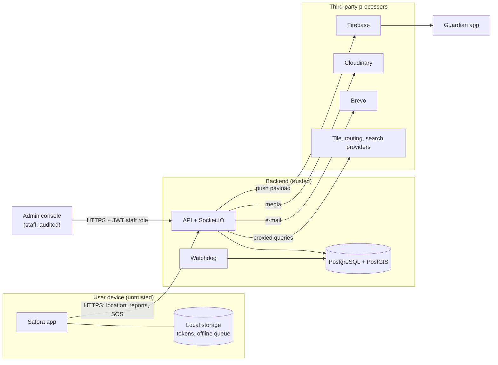
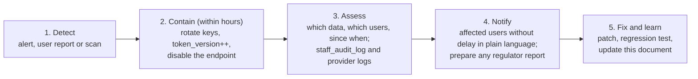

# Security, Privacy and Compliance

| | |
|---|---|
| **Version** | V2 – planned |
| **Updated** | 21 Sep 2026 for a public product, reporter display names, an emergency medical card, staged chat and the all-ages request |
| **Important** | **This is not legal advice.** It is an engineering summary to support discussions with the project supervisor and the university. Retention periods and legal readings marked "proposal" or 🔬 must be confirmed |
| **Status tags** | ✅ verified · 📄 documented only · 🔬 needs confirmation · 🗓 planned |

## 1. Principles

1. **Collect the least and keep it for the shortest time.** Location exists to protect a walk in progress, not to build a history.
2. **The walker is in control.** Nothing is shared without a visible, revocable consent.
3. **A safety application must not become a surveillance tool.** Guardian features are designed against coercive use (section 5).
4. **Honest claims.** The interface never promises what the system does not do (SEC-4).
5. **Defence in depth.** No single control (rate limit, JWT, signed URL) is treated as sufficient.

## 2. Data Inventory and Retention (proposal)

| Data | Where | Sensitivity | Purpose | Proposed retention |
|---|---|:---:|---|---|
| Name, e-mail, phone, password hash | `users` | Medium | Account | Until deletion; warn, then delete after 24 months of inactivity |
| Emergency medical card (blood group, allergies, conditions, medications, note) | `medical_cards` (encrypted) | **High – health data** | Shown to guardians and responders **only during an SOS** | Until the user deletes it or the account |
| Display name | `users.display_name`, `reports.reporter_display` | Low to medium | Shown on public reports (if enabled) | Until deletion; anonymous reports store none |
| Guardian names, phones, e-mails | `trusted_contacts` | Medium – **third-party data** | Alerts | Until removed or revoked, or the account is deleted |
| Hazard reports (location, text, photo) | `reports` | Low to medium | Community map | Kept; identity never public; `user_id` cleared on deletion |
| Safe Walk route and breadcrumbs | `journeys`, `journey_breadcrumbs` | **High** | Corridor check, escalation | **30 days** (review; consider 7) |
| SOS event (location, battery) | `sos_alerts` | **High** | Response | Full detail for 90 days, then anonymised for statistics |
| SOS audio | Cloudinary (signed URL) | **High** | Evidence | **30 days**, then the asset is deleted |
| Tracking links | `tracking_links` | High | Guardian viewing | Expire automatically; rows purged after 30 days |
| Chat messages and contacts list | `messages`, `contacts` | Medium to high | Coordination between accepted contacts | 30 days after the last activity; deleted with the account |
| Chat media (voice, images) | Cloudinary (signed, expiring URLs) | High | CHT-3 | Deleted with the message; hard cap 30 days |
| FCM token | `users` | Medium | Delivery | Until logout, revocation or deletion |
| E-mail codes | `otp_codes` | High (short-lived) | Verification | Hashed; purged 24 hours after use or expiry |
| Outgoing e-mail queue | `email_outbox` | Medium | Delivery | 30 days; the code payload is cleared once sent |
| Server logs | Render | Medium | Debugging | 14 days; **no** coordinates, tokens or codes in logs |

**Processors.** Neon (database), Render (hosting), Cloudinary (audio and photos), Firebase (push), Brevo (e-mail), and the tile, routing and search providers, which receive queries and coordinates. The latter are proxied through the backend so that end users' IP addresses are not exposed.

### Data flow and trust boundaries

## 3. Threat Model

| # | Threat | Example | Mitigation | Item |
|---|---|---|---|---|
| T1 | Reporter identification | Scraping `/api/reports` to find who reported a stalker ✅ | No identity in public DTOs; staff only (**done in V1**) | SEC-2 |
| T2 | Confirmation stuffing | One script fakes "community verified" ✅ | Unique confirmations, self-confirm block, limiter | SEC-3 |
| T3 | Guardian hijack | A stranger registers a guardian's e-mail first and receives alerts ✅ | Verified e-mail and accepted handshake | ACC-2, ACC-5 |
| T4 | Stolen token | Phone or backup theft gives 7-day access ✅ | 15-minute access token, rotating refresh token, Keychain, `token_version` | SEC-5 |
| T5 | Tracking-link leak | A link is forwarded or posted | Short life, revocable, minimal fields, `no-store`, rate limit, no history | TRK-6 |
| T6 | IDOR | User A reads User B's journey, contact or audio | Ownership checks exist ✅ (tested in V1); add tests for new tables | ENG-3 |
| T7 | Fake SOS and spam | Repeated false alarms exhaust guardians and staff | Per-user limits ✅; drills labelled; staff can mark a false alarm; repeated false alarms flagged | ADM-1 |
| T8 | Alert fatigue | Too many false deviations or dead-zone alerts | Tiered watchdog rules; tune in the beta | TRK-4 |
| T9 | Phone dead or taken | No escalation because everything runs on the phone ✅ | Server watchdog (**deviation rule done in V1**) | TRK-4 |
| T10 | Secrets exposure | Keys in a public repository ✅ (MapTiler in source; earlier credentials in history, since rotated) | Rotate, proxy, gitleaks in CI and pre-commit | SEC-1, ENG-4 |
| T11 | Admin misuse | Staff browse identities or audio without need | Role scoping, audit log of sensitive views | ADM-1 |
| T12 | Account enumeration | Forgot-password reveals who is registered | Uniform responses and timing | ACC-3 |
| T13 | Brute force | Password or code guessing | Per-e-mail and per-IP limits ✅; code attempts capped | ACC-2, ACC-3 |
| T14 | Accessibility-service abuse | The trigger service reads other apps' screens | Key-event filter only, no window content, in-app disclosure, kill switch | TRG-4 |
| T15 | Malicious APK | A fake "Safora" APK circulates | Official releases only, published SHA-256, signed builds, in-app version check | ENG-7 |
| T16 | Public-service abuse | The backend is used to exhaust Photon or routing quotas | Authentication, per-user limits and caching on proxy endpoints | MAP-3, MAP-4 |
| T17 | Coercive guardian use | Someone forces a person to add them and watches them | Section 5 rules | ACC-5, TRK-6 |
| T18 | Chat abuse and grooming | A stranger contacts a young or vulnerable user | Contacts-only chat (mutual acceptance), block and report, moderation queue, no chat for minors | CHT-2, PUB-3 |
| T19 | Illegal or abusive media | Images or voice notes used to share harmful content | Size and type caps, only accepted contacts, report button, signed expiring URLs, deletion on report | CHT-3, PUB-3 |
| T20 | Reporter exposed by name | Someone who reports a stalker is identified and targeted | Display name only, per-report anonymity, forced anonymity for sensitive categories | SEC-2 |
| T21 | Minors on a location app | A child uses Safe Walk without parental consent | 18+ policy at launch; teen mode only after legal advice | AGE-1 |
| T22 | Medical data leak | A database dump exposes health information | Application-level AES-GCM encryption; separate table; audit log on staff views | MED-1 |

## 4. India – DPDP Act 2023 and Rules 2025 (engineering view)

The Digital Personal Data Protection Rules were notified on **13 November 2025** with a phased start. The core obligations of data fiduciaries take effect on **13 May 2027**, and one summary says that penalty powers switch on from **13 November 2026** [R28][R29] 🔬 (confirm the dates). A college project that processes location, audio and third-party contact details should already behave as if these apply.

| Duty (summary) | Safora response | Item |
|---|---|---|
| Clear, itemised notice and valid consent [R28] | Layered privacy notice at sign-up; separate consents for location, microphone, notifications and SMS from the user's SIM | AGE-1 |
| Purpose limitation and retention limits | The retention table in section 2; a scheduled purge job | ENG-1, SEC-6 |
| Erasure when the purpose ends or consent is withdrawn | Account deletion; withdraw-consent switches | SEC-6 |
| Reasonable security safeguards: encryption, access control, authentication controls, monitoring and logging [R28] | TLS everywhere; role checks; secure storage; refresh rotation; audit log; structured logs | SEC-5, ENG-5 |
| Breach handling: inform affected people without delay, in plain language [R28]; reporting to the Board has a 72-hour element in secondary summaries [R29] 🔬 | Incident playbook (section 8) | – |
| **Children (under 18):** verifiable parental consent before processing; tracking and behavioural monitoring restricted; exemptions are narrow and mostly by type of organisation (health care, schools, crèches, child transport) or specific purposes [R28][R53][R54] | **18+ at launch.** A teen mode later, only with legal advice and a real consent method | AGE-1, PUB-4 |
| Processor contracts | Keep a list of processors (section 2); use each provider's standard data-processing terms | – |
| Contact point for questions | A grievance e-mail in the app and the privacy notice | AGE-1, PUB-1 |

### The "all ages" request in detail (decision Y5)

- **What the rules say (summaries, not legal advice).** Anyone under 18 is a child. A service must obtain verifiable consent from a parent or lawful guardian *before* processing a child's personal data, and must not track or behaviourally monitor children [R53][R54][R55]. The exemptions in the Fourth Schedule apply to named types of organisation (clinical establishments, educational institutions, crèches, school transport) and to certain purposes such as emergency medical care and child-safety monitoring, each with conditions [R53][R54]. A general public safety application is not obviously one of them; whether "the child chooses to share their own location with their own guardians" changes that is a question for a lawyer.
- **Why it matters here.** Safe Walk collects continuous location, SOS collects audio, and chat and media add more. These are the high-risk processing types.
- **Consent method.** The Rules describe approved ways to verify a parent, including checks linked to India's DigiLocker identity system [R56]. That is a build-and-integrate task, not a checkbox.
- **Penalties.** The Act allows large penalties for breaches of children's-data duties [R55] 🔬 (confirm the amounts in the Act before quoting them).
- **Recommendation.** Launch **18+**. Build the guardian model so that a parent is just an adult guardian, and add a **teen mode (12 to 17)** with parent-verified consent, chat and media off, and no advertising or profiling, only after PUB-4.
- **Limit of this document.** It cannot state the project's exposure. Consult the supervisor or a lawyer before allowing under-18s.

**Other points in this jurisdiction.** The telecom regulator requires registered templates for application-to-person SMS [R30], which is why Safora sends SMS from the **user's own SIM** rather than through a bulk gateway. Recording audio of other people may have legal limits; SOS audio is recorded **from the user's own device, on the user's own trigger, with a clear consent screen**. Obtain the view of the supervisor or the university legal cell before the beta 🔬.

## 5. Anti-Coercion Design Rules

Location-sharing apps can become tools of digital coercive control, and research links their use in relationships to higher risk [R36]. Android's policy on tracking apps requires clear notice, consent and a persistent notification while tracking happens [R38]. Safety-app guidance also stresses that users must control when, how and with whom their information is shared [R37]. The following rules change how guardians work:

| # | Rule | Implementation |
|---|---|---|
| D1 | **No tracking without a walker-started action** | Sharing exists only during a Safe Walk, SOS or check-in that the walker starts (or the watchdog escalates) |
| D2 | **Visible while active** | A persistent notification and an in-app banner "Sharing with 2 guardians" whenever any link or guardian can see the location |
| D3 | **One-tap stop** | "Stop sharing" ends links and removes guardians from the current event immediately |
| D4 | **Guardians opt in** | The `pending → verified` handshake; nothing but the invitation is sent before acceptance |
| D5 | **Guardians can leave** | In the app; the walker is told |
| D6 | **No forced use** | Nothing in the app requires having a guardian; wording such as "for partners" or "monitor someone" is never used |
| D7 | **Least revealing viewer** | First name only; no phone number; no history except during an escalation |
| D8 | **Transparency** | Settings shows "Who can see me right now" and a log of past sharing (who, when, how long) |
| D9 | **Invitation rate limits and blocking** | 10 invitations per day; "I don't know this person" blocks the sender |
| D10 | **Safe exit** | "Remove all guardians and end all links" in Settings; also possible after a duress trigger |
| D11 | **Test before trust** | US researchers found that several safety apps failed to send correct locations or any information [R37]; every release must pass the drill checklist in [`testing-and-beta.md`](./testing-and-beta.md) |

## 6. Secrets and Supply Chain

- `.env` files are git-ignored ✅. `.env.example` lists every variable without values.
- **Never ship a secret inside the APK.** Anything in the APK is public. Map, routing, geocoding, e-mail and bot keys live only on the backend, and the phone calls the backend.
- Server-side keys: `JWT_SECRET`, Cloudinary, the Firebase service account, Brevo SMTP and API keys, Stadia, OpenRouteService and MapTiler keys, and the internal tick secret.
- History: earlier credentials sit in two or three old commits and were revoked ✅. Run `gitleaks` over the full history once, then on every push (CI) and before every commit (Husky is already present ✅).
- CI additions (ENG-4): CodeQL, Dependabot, lint, an Android build and a coverage threshold. Keep `npm audit` clean.
- Rotate every key when a team member leaves.

## 7. APK Distribution Security

- **Release signing key.** Generated once, stored offline (with two team members) and never committed. Losing it means users must uninstall to update.
- Publish APKs only on the repository's **GitHub Releases** with the SHA-256 checksum and a short verification note in the README, and tell users to install nothing else.
- R8 and ProGuard are enabled ✅; check that `android:allowBackup` is `false` and that cleartext HTTP is disabled 🔬.
- An in-app **update check** against the Releases API (ENG-7), with a "critical update" flag for safety fixes.
- Onboarding warns about the extra step on Android 13 and later for sideloaded apps that enable accessibility features 🔬.

## 8. Incident Playbook

## 9. Disclaimers to Show in the Product (final wording to be approved)

- "Safora is a community safety tool and does not replace calling 112. In an emergency call 112 first."
- "During the beta, only use the **Test SOS** button for drills."
- "Alerts depend on phone signal, battery and settings; delivery is not guaranteed."
- Beta participation is voluntary, with a written consent form and a way to leave and delete data at any time.

## 10. Public-Launch Readiness Checklist (PUB-1 to PUB-5)

Safora is intended for the public, not only for one college, and that raises the bar. Before anyone outside the beta group installs it:

| # | Item | Reason |
|---|---|---|
| 1 | **Terms of use and privacy policy** written for what the app really does (start from a template; have someone qualified read it) | Consent depends on it; the DPDP notice duty [R28] |
| 2 | **Grievance contact** inside the app (a monitored e-mail address) and a promise of reply time | DPDP; trust |
| 3 | **Account deletion** and "withdraw consent" switches working | SEC-6; DPDP erasure |
| 4 | **Paid, always-on hosting and a paid database** (one small paid instance is usually enough) | A safety app that sleeps is unsafe (R-5) |
| 5 | **Backups and a restore drill** | Neon's free plan has a short history and no scheduled backups [R40] |
| 6 | **Moderation queue** for reported hazards and chat messages, and a person who checks it daily | Abuse handling (T18 to T20) |
| 7 | **Legal review** of children's data, chat and media (possible intermediary duties), audio recording and map borders 🔬 | PUB-4 |
| 8 | **Support inbox** and an in-app "report a problem" | PUB-5 |
| 9 | **Clear beta wording** in the app: "Beta. Do not rely on Safora as your only safety measure. Call 112." | Honest claims |
| 10 | **Incident playbook** rehearsed once (section 8) | Breach duties |

Until items 1 to 5 are done, distribution stays limited to the closed beta.
