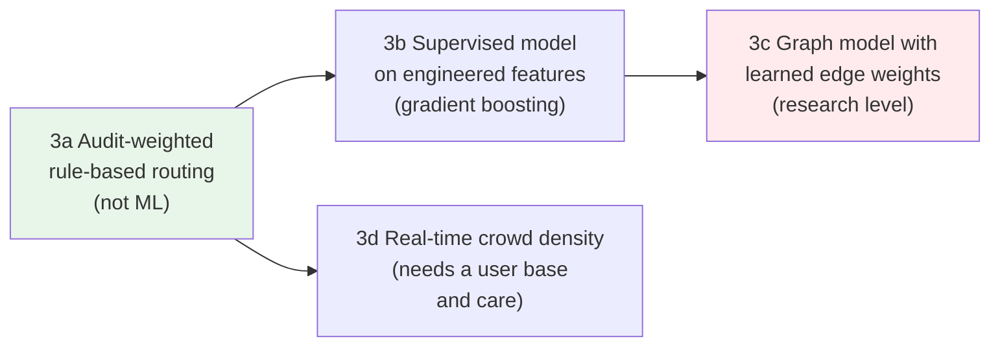

# V3.1 – AI Safe-Route Recommendation

> **Synopsis framing.** Score and recommend routes using lighting, crowd density and similar signals, beyond a fixed rule-based formula.

## 1. The Non-AI Baseline That Already Exists

V2's `MAP-6` ([`../v2/map-routing-search.md`](../v2/map-routing-search.md) §6) ranks up to three alternatives by summing `severity × recency × confirmation` of hazards within 40 m of each sampled point and, where the routing provider supports it, prefers routes flagged `use_lit` in pedestrian mode. It is deliberately **rule-based, not learned**: no training data, no model, fully explainable and cheap. Treat it as "V3 phase 0", the thing a real model would have to beat and the thing that produces the usage data a model would eventually learn from.

## 2. Why It Is Not Buildable Yet

| Requirement | Status |
|---|---|
| Labelled ground truth ("this street segment is or is not safe, at this time of day") | **Does not exist.** Safora's own hazard reports are sparse, self-selected and biased towards wherever existing users walk. They are not a representative safety map of Dehradun |
| A shared notion of "ground truth" | Contested even in the literature (section 5). "Safe" is subjective, time-dependent and different for different people |
| Feature data (streetlight positions, footfall) | Not systematically available for Dehradun in OpenStreetMap. A manual survey would be needed, which is what SafetiPin does at NGO scale over years |
| Compute and hosting for inference | Conflicts with the free-technology constraint unless the model runs on the device |
| Enough usage for a model to outperform the rule-based baseline | Needs real users over real time |

## 3. Candidate Approaches (roughly in order of realism)

### 3a. Crowdsourced audit score with weighted routing (lowest risk, most realistic first step)
Extend V2's `place_audits` ([`../v2/accounts-email-local.md`](../v2/accounts-email-local.md) §6.3, modelled on SafetiPin's nine-factor audit) so that every route segment has a community-rated score, then feed that score into the existing rule-based ranking as another weighted term. This is **not machine learning**. It is a richer input to the same deterministic formula, but it is the natural step before any model and the one most likely to ship.

### 3b. Supervised model on engineered features
Once audit coverage is decent and a real incident history exists, a gradient-boosted model (for example LightGBM) over engineered per-segment features (audit score, streetlight density, time of day, report recency and severity, a footfall proxy) could predict a risk score per segment and replace the hand-tuned weights. It is a modest step up in complexity, needs no deep learning or GPU inference, and a model of this size runs cheaply.

### 3c. Graph routing with learned edge weights
Treat the street network as a graph (which Valhalla and OSRM already build internally) and learn edge weights, for example with a graph neural network. This is the "proper" version of the idea but is a research-level undertaking, appropriate for a thesis and not a feature sprint.

### 3d. Real-time crowd density
The most literal reading of the synopsis needs either live footfall sensors (not available, expensive) or opportunistic inference from how many Safora users are walking a segment now. The second is interesting and cheap once Safora has concurrent usage, but with a handful of users "three people walked this street tonight" is not a signal and could itself be a privacy problem (inferring how many people are on a street from app data). It needs a minimum user base and careful aggregation (section 4).

## 4. Privacy Note

Any of 3b to 3d risks turning per-user location data into a shared signal of where people are. If pursued, aggregate and anonymise before the data reaches a model or an API response, and never expose "how many people are on this street right now" in a way that could identify an individual walker. This applies the anti-coercion principles of [`../v2/security-privacy-compliance.md`](../v2/security-privacy-compliance.md) §5 to a new feature.

## 5. What the Research Literature Says

Independent academic and journalistic sources are **sceptical of purely algorithmic safe-route scoring**. These points are worth citing if a reviewer pushes on this item:

- Crowdsourced safety-perception data (the SafetiPin model this idea descends from) reflects *who reports*, not objective risk. Routing away from areas flagged unsafe by a self-selected group can reinforce existing avoidance patterns (under-reported areas look artificially "safe") instead of correcting them. See `R35` in [`../v2/references.md`](../v2/references.md).
- "Safety" is not a stable, universal label: perceived safety varies with identity, time and local knowledge in ways that a single score per street segment flattens.
- Recent crowd-based routing research (for example the privacy-preserving personalised scores of Islam et al., 2021) still relies on user-contributed data and does not remove these limits.

This does not make the idea worthless. It means the honest framing is **"a decision-support layer using community input", not "an AI that knows which streets are safe".** Keep that framing in any report or demonstration.

## 6. Realistic Next Steps

1. Ship 3a (audit-weighted rule-based routing) and gather real usage. This alone would be a legitimate, demonstrable improvement over V2's hazard-only weighting.
2. When there is a meaningful volume of audits and hazard history (months, not weeks), scope 3b as its own project phase with a proper train and validation split and an honest comparison against 3a.
3. Do not attempt 3c or 3d without a dedicated research timeline separate from the product roadmap.
