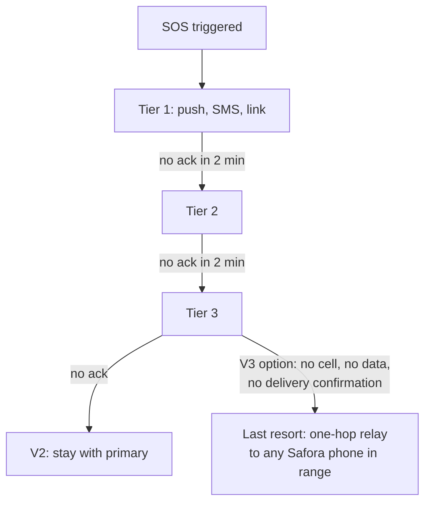
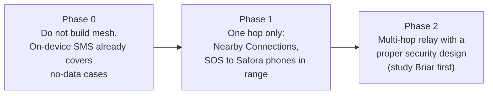

# V3.2 – Offline Emergency Messaging (Bluetooth and Wi-Fi Direct)

> **Synopsis framing.** Let an SOS reach someone nearby even with no internet or cell signal, from phone to phone.

## 1. Why This Is the Hardest V3 Item

Everything else in Safora, including every V1 and V2 feature, assumes a working path to the backend. This idea removes that assumption: there is no server and no central authority, and messages hop between nearby phones until one of them has connectivity or the intended recipient is in range. That is a different kind of system, not a feature added to the current one. Nothing built in V1 or V2 moves towards it, and this note exists to give real substance to the question "why not?".

## 2. Prior Art

| Project | Approach | Lesson |
|---|---|---|
| **Bridgefy** | Bluetooth mesh messaging, noticed during protests where the internet was cut (Hong Kong 2019 and others) | Proved that the concept works for short text at city-block range. Researchers also documented serious security flaws in 2020 (no real encryption, spoofable senders), a cautionary tale about *how* to build this, not only *whether* |
| **FireChat / Open Garden** | An early Bluetooth and Wi-Fi mesh chat (2014), also used in protests | Showed the user-experience pattern (messages "hop" through nearby devices), but the company and app are effectively defunct. Mesh chat apps have a poor survival record |
| **Briar** | Peer-to-peer messaging over Bluetooth, Wi-Fi and Tor; open source and maintained | The most credible current reference for secure mesh messaging on Android. Read its architecture documentation before attempting this |
| **goTenna, Meshtastic** | Dedicated LoRa hardware mesh (not phone only) | Reliable long-range mesh in practice usually needs *dedicated radio hardware*, not only a phone's Bluetooth and Wi-Fi radios |
| **Android Nearby Connections and Wi-Fi Aware** | Google's supported peer-to-peer discovery and data-transfer APIs | The right technical starting point, but they do not provide multi-hop relay (section 3) |

## 3. Why It Is Hard on Android

- **No true multi-hop mesh out of the box.** Nearby Connections and Wi-Fi Direct support direct or star topologies between nearby devices, not automatic relaying through several strangers' phones. Designing and implementing the relay protocol is most of what makes Bridgefy and Briar hard.
- **Background scanning restrictions.** Android increasingly limits how long an app may scan for Bluetooth or Wi-Fi peers in the background, as with the foreground-service limits in [`../v2/safety-and-tracking.md`](../v2/safety-and-tracking.md) §9. A mesh needs *continuous* discovery, which conflicts with battery-saving policy.
- **Battery cost.** Continuous BLE scanning and advertising is among the most power-hungry things an app can do, and a safety app that drains the battery defeats its purpose.
- **No delivery guarantee.** The reliability model of V2 (delivery tracking, retries, escalation) does not translate to a mesh with no central point.
- **Short range.** Bluetooth LE reaches tens of metres indoors and perhaps 100 m or more outdoors with a clear line of sight. "Someone nearby" in a real emergency, such as an isolated trail, is exactly the scenario in which nobody is in range.

## 4. Security and Abuse Risks

- **No central moderation.** A mesh has no server to rate-limit, ban or filter. Bridgefy's documented flaws are the direct result of building this quickly.
- **Anyone in range could see or interfere with relayed messages** unless end-to-end encryption is designed in from the start. That is a serious cryptography task, not an afterthought.
- **False SOS relay.** A mesh could be flooded with fake distress signals and has no authority to catch them, unlike V2's rate limiting and staff moderation.

## 5. Battery and Usability Trade-off

A phone that always scans for mesh peers "just in case" has worse battery life for everything else that V1 and V2 ask of it. Realistically this would be an **explicitly user-activated mode** ("I am going somewhere with no signal; turn on mesh standby"). That limits its usefulness for the unexpected emergencies that a safety app exists for.

## 6. Where It Would Fit in the Escalation Ladder

V2's escalation ladder ([`../v2/safety-and-tracking.md`](../v2/safety-and-tracking.md) §2, TRK-11) delivers an SOS to a walker's contacts in priority tiers and, if nobody acknowledges, **stays with the primary tier** instead of falling back further. The only condition in which that behaviour is genuinely insufficient is the scenario of this note: **the primary contact is unreachable by every normal channel (no push delivery and no SMS confirmation) and the phone has no cell or data signal at all.**

If one-hop messaging (phase 1 below) is ever built, it slots in as a **last-resort tier**: not a replacement for the app-based guardian model, but one more attempt ("reach anyone within Bluetooth or Wi-Fi Direct range") when the normal ladder has run out of options. This is recorded so that the two systems fit together later. **Nothing here is built or scheduled.**

## 7. Realistic Phasing If It Is Ever Attempted

1. **Phase 0 – do not build a mesh at all.** V2's on-device SMS ([`../v2/safety-and-tracking.md`](../v2/safety-and-tracking.md) §8) already sends an SOS over the cellular network with no internet, which covers "no data connection". The gap that a mesh would close is "no cellular signal at all", a much narrower and rarer case.
2. **Phase 1 (if pursued) – one hop only.** Direct phone to phone through the Nearby Connections API, no relay: "send my SOS to any Safora app within Bluetooth range". This is buildable and useful in a crowd (for example a festival) even if not in true isolation.
3. **Phase 2 – real multi-hop relay**, only after phase 1 proves useful and only with a proper security design (study Briar's architecture first) instead of a fast, Bridgefy-style implementation.
4. **Never attempt this as a side feature.** Budget it as its own project, with its own security review, separate from the product roadmap.
