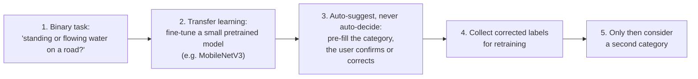

# V3.3 – AI Image Detection for Hazard Classification

> **Synopsis framing.** Classify a hazard's category or severity automatically from an uploaded photo instead of relying only on the user's manual choice.

## 1. Prerequisite Already Delivered

V1's photo picker (SYN-3, [`../v1/tasks.md`](../v1/tasks.md)) and the Cloudinary storage are the prerequisite. **No classification is possible without photos**, and V1 and V2 do not collect enough of them to train anything yet. Treat this note as "what to do once a real photo corpus exists".

## 2. Two Different Implementation Paths

### 2a. On-device (TensorFlow Lite, a small quantised model bundled in the APK)

| Advantage | Disadvantage |
|---|---|
| Free to run (fits the free-technology constraint) | Increases APK size. Even a small MobileNet-class classifier adds several MB, which is noticeable against the current release build of about 34 MB |
| Works offline and fast, with no server round trip | Limited to a model that fits and runs acceptably on a low-end Android phone; the accuracy ceiling is lower than that of a hosted model |
| No data leaves the device for inference | A model update needs an app update unless a model-download mechanism is built |

### 2b. Hosted inference API (a cloud model called from the backend)

| Advantage | Disadvantage |
|---|---|
| Can use a much larger and more accurate model | **Recurring cost**, which conflicts with the free-technology rule until there is revenue or a grant. Free tiers of hosted vision APIs are too limited for real volume |
| Easy to improve without shipping app updates | Every classification is a network call: added latency and a new failure mode (report submission depends on a third service) |
| Centralised data, easier to audit and retrain | Sends user photos to a third party, a new privacy surface to disclose (`../v2/security-privacy-compliance.md`, PUB-1) |

**Recommendation.** If this is ever built, start **on the device (2a)** with a deliberately narrow task (section 4). It is the only path that respects the free-technology constraint, and a narrow task does not need a large model.

## 3. Dataset Reality Check

| Requirement | Status |
|---|---|
| Labelled photos per hazard category (poor lighting, road hazard, waterlogging, isolated area, traffic, plus V2's landslide, wildlife and damaged-bridge categories) | **Does not exist.** It will take real usage over real time to accumulate even a few hundred photos per category, and hazard photos are messy (variable light, angle, occlusion) |
| Severity (1 to 5) from a photo alone | Harder still. Severity is a *user judgement* ([`../v1/safety-algorithms.md`](../v1/safety-algorithms.md)), not something reliably visible. Waterlogging could be severity 2 or 5 depending on depth, which a 2D photo often cannot show |
| Negative examples (photos that are *not* hazards) | Need deliberate collection. A model trained only on submitted hazard photos does not know what "normal" looks like |
| Diversity (day and night, monsoon and dry season, urban Dehradun and rural Uttarakhand) | A model trained on daytime dry-season photos from one small area will not generalise, and Safora's early user base is small and geographically narrow, which is the wrong training distribution |

## 4. A Realistic Narrow-First Task

Do not attempt "classify any hazard photo into 6 categories and 5 severities" as a first model.

1. **Binary task first:** "does this photo show standing or flowing water on a road, yes or no". This is a single, visually distinctive category with clear positive and negative examples, useful on its own (it can suggest the category) and realistic to label a few hundred examples for with a small user base.
2. **Transfer learning, not training from scratch.** Fine-tune a small pretrained image model on the narrow labelled set, which is standard practice for small datasets and feasible with free tools (the free tier of Google Colab, TensorFlow).
3. **Auto-suggest, never auto-decide.** Even a working model should *pre-fill* the category for the user to confirm or correct. It must not silently override the user's choice. This also gives a low-effort stream of corrected labels for later retraining.
4. **Only after the binary task is reliable**, consider more categories. Each new category restarts the question "is there enough labelled data".

## 5. Honest Framing for a Report

"AI hazard classification" as a general capability is a multi-month, data-dependent undertaking that V1 and V2 cannot support yet. A **narrow, single-category, auto-suggest model** (waterlogging detection) is a realistic first V3 project once a photo corpus exists, using transfer learning and always as a suggestion that the user confirms.
