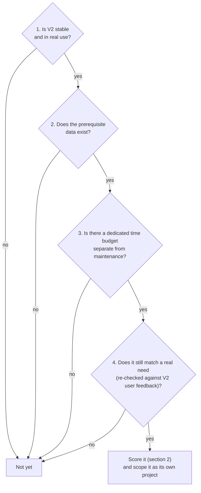

# V3.4 – Research and Evaluation Framework

> A way to decide *whether and when* to pursue any V3 item, not a plan to build all of them. Use it if the team, or a future one, revisits V3 after V2 ships.

## 1. Gate Questions Before Starting Any V3 Item

Ask these in order. A "no" at any step means "not yet", not "never".

1. **Is V2 stable and in real use?** None of the three V3 items make sense while the core product (accounts, tracking, triggers) is still being hardened. They would be built on a moving foundation, and none of them is needed for Safora to be useful.
2. **Does the prerequisite data exist?** Item 1 needs real hazard and audit history, item 3 needs a real photo corpus, and item 2 needs none (it is independent), which is part of why it is the easiest to *scope* even though it is the hardest to *build*.
3. **Is there a dedicated time budget separate from product maintenance?** All three are research-shaped work (uncertain timeline, evaluation against a baseline). Mixing them into ordinary feature sprints is how they either never finish or quietly degrade product quality.
4. **Does it still match a real need?** Re-check against actual user feedback from V2, not only the original synopsis wording. If usage shows that people do not struggle with route choice, item 1 may not be worth it regardless of feasibility.

## 2. Scoring Framework

Score each item from 1 (low) to 5 (high) on:

| Criterion | Meaning |
|---|---|
| **Data readiness** | Does the labelled or training data exist, or is it realistic to gather soon? |
| **Technical risk** (lower risk scores higher) | How likely is a competent attempt to work in a reasonable time? |
| **Free-technology compatibility** | Can it run without ongoing cost? |
| **User value if it works** | How much would it improve safety or usefulness compared with the rule-based or manual alternative in V2? |
| **Downside if it fails or is misused** (smaller downside scores higher) | The cost of getting it wrong. A poor AI route suggestion is embarrassing; a security flaw in mesh messaging or a false automatic classification could actively mislead someone in danger |

A sensible rule: **do not start anything that scores below 3 on Data readiness or below 3 on Free-technology compatibility.** Those two are hard blockers for a small, no-budget team, however good an idea looks otherwise.

## 3. Suggested Comparative Scores

These are an initial assessment; re-score with real usage data.

| Item | Data readiness | Technical risk | Free-technology compatibility | User value | Downside if it fails |
|---|:---:|:---:|:---:|:---:|:---:|
| 1. AI safe route (audit-weighted version, note 01 §3a) | 2 (needs audit data) | 4 | 5 | 4 | 2 (worst case: a poor suggestion) |
| 2. Offline mesh messaging | 5 (no data needed) | 1 (genuinely hard) | 4 | 3 (narrow real-world benefit) | 4 (a security or reliability failure could mislead someone in an emergency) |
| 3. AI hazard image detection (narrow binary task) | 1 (no photo corpus yet) | 3 | 4 (on-device only) | 2 (nice to have, not core) | 2 (a wrong suggestion; the user still confirms) |
| 4. Voice-activated SOS (note 06) | 2 (needs recordings of the safe word) | 3 | 4 (on-device) | 4 (valuable when the phone cannot be touched) | 4 (false triggers or missed triggers affect trust) |

Read this as follows. **The audit-weighted version of item 1 is the most realistic starting point once there is some audit data.** The narrow version of item 3 is a reasonable "someday" project once a photo corpus exists. Item 4 is attractive because V1 already provides the microphone service and the SOS pipeline, but it needs its own data collection and false-alarm testing. **Item 2 should be deferred indefinitely** unless someone wants to make mesh networking itself the focus of a future project, separate from Safora's core goals.

## 4. What Success Would Look Like

- **Item 1:** a route ranking that measurably differs from the pure hazard-density baseline and that a sample of real users rate as more trustworthy, evaluated with a held-out comparison, not only "it runs".
- **Item 2:** a working one-hop (not full mesh) SOS relay, security-reviewed, tested in a real no-signal location, with an honest write-up of its range and reliability limits.
- **Item 3:** a binary classifier with documented precision and recall on a held-out test set, always shown as a suggestion, with a clear plan for when it is wrong.
- **Item 4:** a documented false-accept and false-reject rate for the safe word across several voices, noise conditions and phone models, with measured battery cost.

## 5. What Not to Do

Do not let any V3 item become a way to avoid finishing V2. If reviewers ask about the AI, mesh or voice features, the honest answer is: *they are future scope, gated on data and time that V1 and V2 do not have yet; here is the research and here is what would need to be true first.* That is a stronger answer than a half-built version of any of them.
