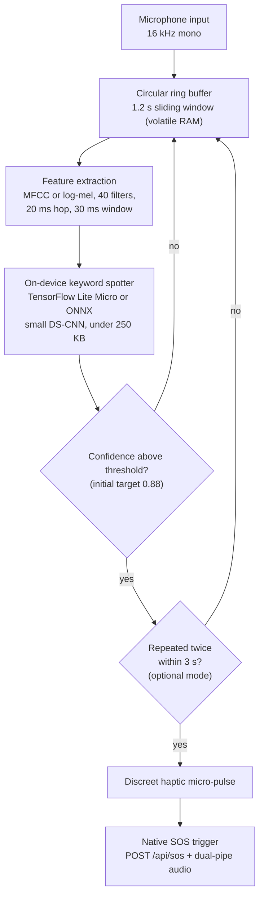

# V3.6 – Voice-Activated Hands-Free SOS ("Safe Word")

| | |
|---|---|
| **Classification** | Future scope: architectural feasibility study |
| **Target version** | V3 |
| **Prior art** | UrSafe, bSafe, the Google SoundTrigger API, Apple Siri emergency triggers |

## 1. Problem and Motivation

In an acute crisis (physical assault, confinement, abduction, a weapon at hand) a victim often **cannot touch the phone**. Taking it out of a pocket or handbag alerts an aggressor, and unlocking the screen or pressing hardware buttons can provoke violence.

V1 already provides locked-screen audio streaming and the corridor-deviation watchdog. Hands-free invocation is the remaining frontier. An **on-device keyword spotter** would let a user whisper a personal safe word (for example "Safora Red" or "Code Seven") to start the full emergency dispatch and the dual-pipe audio stream with no touch at all.

## 2. How Other Platforms Approach It

The table is qualitative. Published battery figures for such features vary and have not been independently verified for this note; measure Safora's own cost on the project's test phones (V3-V4).

| Platform | Ingestion | Model location | False-positive control |
|---|---|---|---|
| bSafe | Voice activation of the SOS (its App Store listing describes a voice-activated alarm) | Not stated | Not stated |
| UrSafe | Safe-word listening in the background | Reported as on-device; not independently verified | A user-defined safe word |
| Google Assistant and Siri | A low-power hardware audio processor that listens for the wake word | Dedicated hardware DSP | Multi-stage verification |

## 3. Recommended Architecture for Safora

### 3.1 Model design
- **Architecture:** a depthwise separable convolutional network (DS-CNN) or a temporal convolutional network (TCN), the families commonly used for small keyword-spotting models.
- **Runtime:** TensorFlow Lite for Android, integrated in the native Kotlin layer next to `SafeWalkService.kt`.
- **Input features:** 40 mel-filterbank energies computed every 20 ms over 30 ms windows, which gives 49 frames per second of audio.
- **Targets (to be validated, not measured):** a model binary of under 250 KB and an inference time of a few milliseconds per frame.

### 3.2 Privacy and battery safeguards
1. **Fully on-device processing.** No audio leaves the phone while it listens. The ring buffer is overwritten continuously in volatile memory. Audio is transmitted only *after* a verified match starts the dual-pipe streaming engine.
2. **Hardware offload where available.** On devices whose chipset exposes a low-power voice wake-up path (Android SoundTrigger), offload the listening to that processor to cut battery cost. Availability varies by vendor.
3. **Two-utterance confirmation (optional).** Require the phrase twice within 3 seconds ("Safora Red … Safora Red") to avoid false triggers from television or background speech, at the cost of a slower trigger.
4. **Per-user safe word.** The user records their own phrase. The enrolment reuses the rules of the duress PIN: reject trivially common phrases.
5. **Explicit user control.** The feature is off by default, shown in a persistent notification while active, and has a kill switch in Settings, in line with the anti-coercion rules in [`../v2/security-privacy-compliance.md`](../v2/security-privacy-compliance.md) §5.

### 3.3 Open questions
- How many enrolment samples are needed for a reliable per-user phrase?
- Whether a pre-trained keyword model with a fixed phrase is safer than a per-user phrase in terms of false accepts.
- Behaviour in noise, with accents (English, Hindi and mixed speech) and with the phone in a pocket or bag.
- Battery cost and thermal behaviour of continuous listening on mid-range phones.

## 4. Foundation Already in Place

- **V1:** `SafeWalkService.kt` is a typed Android foreground service (`FOREGROUND_SERVICE_TYPE_MICROPHONE`) with a partial wake lock. The native audio ingestion pipeline is built and verified. See [`../v1/dual-pipe-audio-streaming.md`](../v1/dual-pipe-audio-streaming.md).
- **V2:** the trigger architecture (TRG-1 and TRG-2 in [`../v2/safety-and-tracking.md`](../v2/safety-and-tracking.md) §9) separates native event dispatch from React Native and provides the native event sink to which this keyword spotter would connect.

## 5. Constraint from the Platform

A microphone foreground service generally cannot be *started* from the background on current Android versions. The keyword spotter therefore needs a service that was started while the app was visible (a Safe Walk or an explicit "Guard mode"), exactly as for the other no-unlock triggers. It cannot be an invisible, always-listening service, and it should not be.
