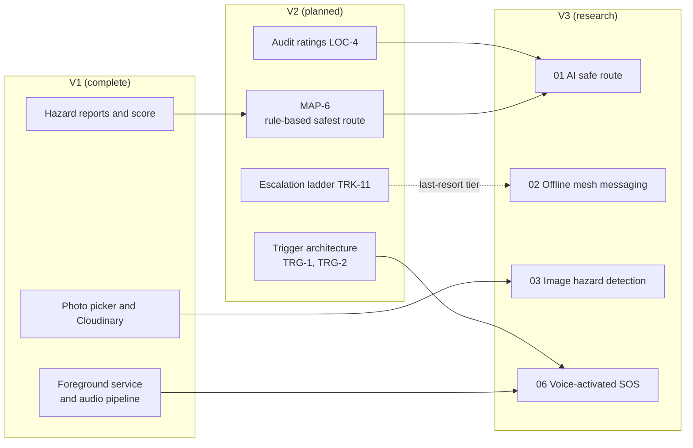

# Safora Documentation – Version 3 (Future Scope)

> V3 covers the future-scope items named in the synopsis, expanded into research notes. **Nothing here is scheduled work.** Each file is a starting point for a future scoping exercise. It shows that the project has thought beyond the current build and gives a future team somewhere real to start.

## Document Index

| Document | Contents |
|---|---|
| [`01-ai-safe-route-recommendation.md`](./01-ai-safe-route-recommendation.md) | The rule-based groundwork in V2, what machine learning would add, data requirements, candidate approaches, feasibility |
| [`02-offline-emergency-messaging.md`](./02-offline-emergency-messaging.md) | Bluetooth and Wi-Fi Direct SOS: prior art, Android constraints, security and abuse risks, why it is hard |
| [`03-ai-hazard-image-detection.md`](./03-ai-hazard-image-detection.md) | Classifying hazard photos: on-device versus hosted, dataset needs, a realistic narrow first step |
| [`04-research-and-evaluation-framework.md`](./04-research-and-evaluation-framework.md) | How to decide whether and when to build any of these: a scoring framework, not a commitment |
| [`05-references.md`](./05-references.md) | Sources for the claims in files 01 to 03 |
| [`06-voice-activated-sos.md`](./06-voice-activated-sos.md) | Hands-free "safe word" detection with an on-device keyword spotter: architecture, battery, false-alarm control |

## How V3 Relates to V1 and V2

- V1 and V2 do not depend on any V3 item.
- V2's `MAP-6` (rule-based safest route) is deliberately "V3 phase 0" for item 1: it gives a future model a baseline to beat and, eventually, usage data to learn from.
- V1's photo picker and Cloudinary storage are the prerequisite for item 3. No classification can happen until photos exist.
- Item 2 (mesh messaging) has no dependency in V1 or V2 and is the least connected to the current architecture.
- Item 6 (voice-activated SOS) builds directly on V1's microphone foreground service and audio pipeline, taking it from active live streaming to low-power passive detection.

## How to Present This in a Report

Frame V3 as follows: *the synopsis's future-scope items remain future scope. V1 and V2 build the data and infrastructure they would need (photo storage, hazard reports, rule-based route scoring, a foreground audio pipeline) without committing to unproven machine-learning or mesh-networking work inside the current project.* Each file gives enough substance to answer the question "how would you actually do that?" without having built it.
